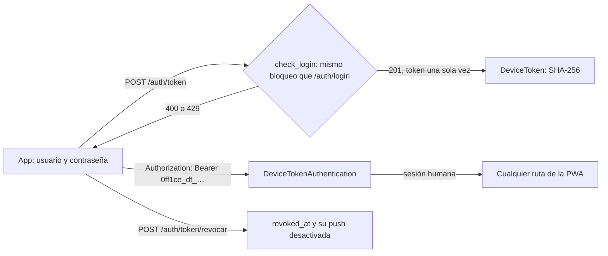

# App móvil: backend del login por dispositivo y la push nativa

La app móvil de 0ff1ce (React Native + Expo) usa la misma API que la PWA ([CONTRATO-API.md](../../../oficina/CONTRATO-API.md)). Para ella, el backend añade tres cosas:
- un **login por dispositivo**: una sesión humana sin cookies ni CSRF;
- la **push nativa a través de Expo**, con los mismos avisos que la Web Push de la PWA;
- los **errores del cliente** (`POST /api/v1/app/errores`): cuando una subida falla en el teléfono, la app manda qué falló (sin el contenido), y el backend lo escribe en el log y guarda los 200 más nuevos.

El código está en:
- `src/team_backend/authentication.py`: `DeviceTokenAuthentication`, `device_bearer` y `device_for`;
- `src/team_backend/movil_views.py`: las rutas nuevas;
- `src/team_backend/expo.py`: el envío a Expo y los recibos;
- los modelos `DeviceToken` y `ExpoPushToken` (migración `0016_app_movil`) y `AppClientError` (migración `0017_app_errores_cliente`).

## Límites

- **Un token de dispositivo es Gustavo en su teléfono.** Cuenta como sesión humana en `human_session()`, igual que la sesión de la PWA. Un token de servicio (`ApiCredential`) sigue sin poder decidir nada. `human_session()` pasó de rechazar `ApiCredential` a aceptar solo dos casos: sin `request.auth` (la sesión de Django) o un `DeviceToken`. Es más estricto que antes, no menos.
- **Mismos permisos que la sesión.** `KnowledgeAccess` y `require(user, …)` se aplican igual, así que un usuario sin `approve_actions` tampoco envía capturas desde el móvil.
- **El secreto no se guarda.** De cada token solo queda su SHA-256. El token en claro se devuelve una sola vez, en la respuesta del login, con `Cache-Control: no-store`.
- **Sin cuenta ni servicio de pago.** La API de push de Expo funciona sin access token. `EXPO_ACCESS_TOKEN` es opcional y solo se envía si está definido (la «seguridad de push mejorada» de Expo).
- **La push nunca rompe el trabajo que la dispara.** `expo.broadcast` registra el error en el log y devuelve 0, nunca lanza una excepción, igual que `avisar`.

## Login por dispositivo

- **Formato:** `0ff1ce_dt_` seguido de 43 caracteres base64url (32 bytes aleatorios). El prefijo distingue un token de dispositivo de un token de servicio sin mirar la base.
- **Orden de autenticación:** `DeviceTokenAuthentication`, luego `CredentialAuthentication` y por último `SessionAuthentication`.
  - La primera solo reclama los Bearer con el prefijo. Cualquier otro Bearer pasa intacto a `CredentialAuthentication`.
  - Un token con prefijo que no existe, está revocado o es de un usuario inactivo también pasa, y `CredentialAuthentication` lo rechaza con 401.
  - Así, un token de servicio nunca queda tapado, aunque empezara por el prefijo. Una prueba lo comprueba: sigue autenticando como servicio y sigue sin poder decidir.
- **CSRF:** DRF solo exige CSRF a las peticiones autenticadas con la sesión. Un Bearer no es una credencial que el navegador envíe solo, así que no hace falta. La sesión de la PWA sigue exigiendo `X-CSRFToken` como antes.
- **`GET /auth/session`** es una vista de Django, no de DRF, y lee el Bearer del dispositivo por su cuenta.
  - Con un token válido responde `{ authenticated: true, user }`.
  - Con uno revocado o desconocido responde `{ authenticated: false, user: null }`, con 200 como para la PWA sin sesión.
  - Sin Bearer de dispositivo, sigue mirando la cookie.
- **Bloqueo:** `POST /auth/token` comparte el contador de `/auth/login` (`check_login`). Diez fallos por IP y usuario en 15 minutos dan 429 en las dos puertas, y un acierto pone el contador a cero.
- **`last_used_at`** se escribe como mucho cada 5 minutos, para no escribir en la base en cada lectura.
- **Revocar** pone `revoked_at` y desactiva los `ExpoPushToken` del dispositivo (`last_error: device_revoked`): un teléfono perdido deja de recibir avisos.
  - **Desde la app:** `POST /auth/token/revocar` (cerrar sesión).
  - **Desde otro dispositivo:** «Dispositivos con la app», que llama a `DELETE /auth/dispositivos/<id>`.
  - **Desde el admin:** el campo `revoked_at`. El envío ya ignora los tokens de push de dispositivos revocados.
- **Sin caducidad.** El token vive hasta que se revoca; la lista muestra `last_used_at` para reconocer los olvidados.
- **Auditoría:** `auth.device_token` al entrar y `auth.device_revoked` al revocar, con el nombre del dispositivo.

## Push nativa con Expo

1. **Registrar.** La app obtiene su token con `getExpoPushTokenAsync` y lo registra con `POST /api/v1/push/expo` usando su token de dispositivo. El token de push queda ligado a ese login. Registrarlo otra vez lo actualiza y lo reactiva.
2. **Avisar.** `notificaciones.avisar` llama a `alerts.notify`, que envía la Web Push (`push.broadcast`) y la de Expo (`expo.broadcast`), cada una en su propio `try`.
   - Los interruptores por tipo (`OfficePreference.push_disabled`) y la push por defecto de cada tipo ya se aplican antes de `notify`, así que valen para las dos.
3. **Mensaje.** El título y el cuerpo son los mismos de la Web Push:

| Campo | Valor |
| --- | --- |
| `to` | `ExponentPushToken[…]` (también se acepta el formato antiguo `ExpoPushToken[…]`) |
| `title`, `body` | Los mismos de la Web Push: hasta 120 y 200 caracteres |
| `data` | `{ url, tag }`. `url` es la ruta dentro de la app: `/tu-turno` para los tipos de Tu turno, el `link` del aviso para los de Notificaciones (`/calendario/pieza/<id>`, `/resultados#resumen`…) o `/notificaciones`. `tag` es `0ff1ce-<tipo>`. |
| `channelId` | `default` |
| `priority` | `high` para los tipos `urgente` de Tu turno (acción incierta, LinkedIn caducado, máquina detenida) y para la prueba; `default` para el resto |
| `sound` | `default` (solo iOS) |
| `ttl` | 86400: Expo deja de intentarlo al día, como la Web Push |

4. **Enviar.** Los mensajes van en lotes de 100, el máximo de Expo, a `https://exp.host/--/api/v2/push/send`. Cada petición tiene un límite de 10 s (5 s para conectar). Expo devuelve un ticket por mensaje, en el mismo orden:
   - `ok`: guarda el id del ticket para pedir su recibo, junto con `last_success_at`;
   - `DeviceNotRegistered`: desactiva el token (la app se desinstaló o el token cambió);
   - otro error (`MessageRateExceeded`, `MessageTooBig`, `InvalidCredentials`…): lo guarda en `last_error`, y el token sigue activo.
5. **Recibos.** Después de cada envío, `check_receipts` pide a `…/push/getReceipts` los recibos de los tickets con más de 15 minutos, en lotes de 1000.
   - Un `DeviceNotRegistered` en el recibo también desactiva el token.
   - Expo borra los recibos a las 24 h, así que los tickets más viejos se descartan.
   - No hay tarea periódica: los recibos se revisan en el siguiente envío. Cada token guarda como mucho 50 tickets pendientes.
6. **Fallos de la petición.** Un error de red, un 4xx o 5xx o un `TOO_MANY_REQUESTS` quedan en el log (`expo_request_failed`, con el código y sin datos) y no cuentan contra el token: una caída de Expo no desactiva los teléfonos. No hay reintentos, porque la push es de mejor esfuerzo, igual que la Web Push.
7. **«Probar notificación».** `POST /api/v1/push/test` llega a las suscripciones de la PWA y a los teléfonos del usuario, con prioridad alta y `data.url: /ajustes`. Responde `{ sent }` con la suma de los dos envíos. Si no hay VAPID ni teléfonos registrados, responde 403 como antes.

## Errores del cliente

`ClientErrors` en `movil_views.py`. La forma exacta está en el contrato, en «Errores del cliente».
- **Solo metadatos.** El nombre y el mensaje del error, el código HTTP y el `detail`, y de cada parte de archivo su campo, tipo, esquema del URI y tamaño. Ni el audio, ni las fotos, ni la nota, ni nombres de archivo, ni tokens.
- **Sesión humana.** Un token de servicio recibe 403. Se apunta el dispositivo si el informe llega con un token de dispositivo.
- **Límites.** 8 KB por informe (413), 30 informes por hora y usuario (`ClientErrorThrottle`, 429), hasta 12 partes. Solo se guardan los `CLIENT_ERRORS_KEPT` (200) más nuevos.
- **Dónde mirar.** En el log, la línea `app_client_error {…}` del logger `team_backend.app`. En el admin de Django, «App client errors». Por la API, `GET /api/v1/app/errores` (los 50 más nuevos, con `operate_linkedin`).

## Ajustes

`GET /api/v1/ajustes` añade dos claves, para que la PWA y la app puedan mostrar «Dispositivos con la app». Las dos son del usuario que pregunta:
- `devices`: los logins vivos, del más nuevo al más viejo. `current` marca el que hace la petición y `push` dice si recibe avisos.
- `expo_push`: cuántos tokens de push activos tiene, la última entrega aceptada y el último error.

## Lo que la app tiene que hacer

- Guardar el token de dispositivo en almacenamiento seguro (`expo-secure-store`) y enviarlo como `Authorization: Bearer …` en cada petición, también en las subidas `multipart/form-data` y al pedir imágenes y audio.
- Crear el canal Android `default`, con importancia alta, antes de pedir el token de push.
- Registrar el token de push en cada arranque, porque Expo puede cambiarlo.
- Al tocar una notificación, navegar a `data.url`.
- Al cerrar sesión, llamar a `DELETE /api/v1/push/expo` y luego a `POST /api/v1/auth/token/revocar`. Revocar ya desactiva la push de ese dispositivo, así que el primer paso es solo limpieza.
- Si una petición devuelve 401, volver al login: el token se revocó.

## Límites conocidos

- **Conectar LinkedIn (OAuth) necesita la PWA.** El callback de LinkedIn valida el `state` guardado en la sesión con cookie, que el navegador del sistema no comparte con la app. Desde la app, ese paso abre la PWA en el navegador.
- **Los tickets pendientes se guardan en la fila del token**, sin bloqueo. Dos envíos simultáneos pueden perder un ticket, y entonces ese recibo no se revisa. El siguiente `DeviceNotRegistered` desactiva el token igual.
- **Recibir push en Android exige una build propia de la app**, con el `projectId` de EAS y las credenciales FCM (gratis) cargadas en el proyecto de Expo. Eso lo hace Gustavo con su cuenta. El backend no necesita nada más.

## Configuración

| Variable | Por defecto | Uso |
| --- | --- | --- |
| `EXPO_ACCESS_TOKEN` | vacío | Opcional. Solo hace falta si se activa la seguridad de push mejorada en el proyecto de Expo. Se envía como `Authorization: Bearer …` a Expo y nunca se registra en el log. |

## Pruebas

`src/team_backend/tests/test_app_movil.py`, sin red: Expo corre sobre `httpx.MockTransport`, y cualquier llamada sin simular falla. Cubre:
- emitir, usar y revocar el token, y el bloqueo compartido con `/auth/login`;
- que el token de dispositivo pase `human_session()` y el de servicio no, y que el prefijo no tape un token de servicio;
- el mismo modelo de permisos que la sesión, y que con Bearer no haga falta CSRF;
- la lista de dispositivos, revocar uno a distancia y las claves nuevas de Ajustes;
- registrar y quitar un token de push;
- los errores del cliente: el log y la fila guardada con su dispositivo, la validación, el límite de 8 KB, quién puede informar, el límite por hora y que solo se guarden los más nuevos;
- una nota de voz m4a de Android (`audio/mp4`) y una foto HEIC que llega como JPEG, subidas con el token de dispositivo;
- los lotes, el contenido del mensaje y `EXPO_ACCESS_TOKEN`;
- `DeviceNotRegistered` en tickets y recibos, los interruptores por tipo y que un fallo de Expo no rompa el aviso;
- «Probar notificación», y las subidas multipart de capturas y Galería con Bearer.
