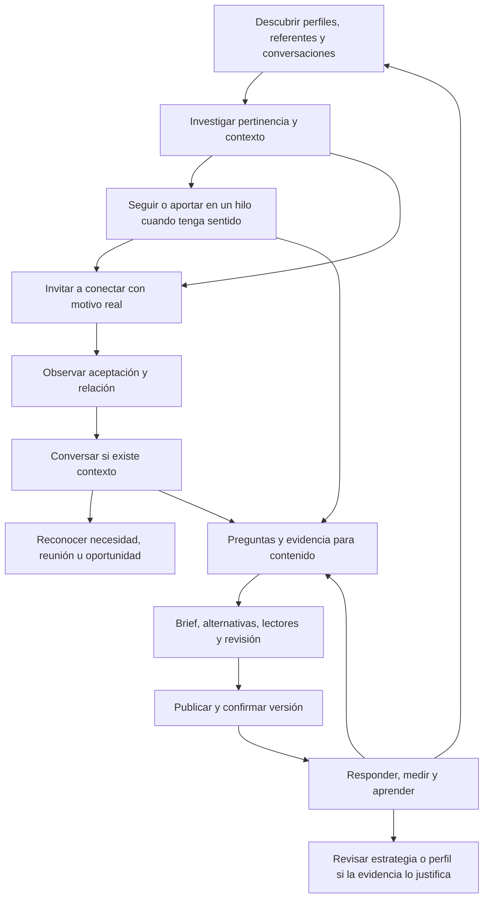

# Acciones del equipo sobre el LinkedIn de Gustavo

Versión 1.0 · 6 de noviembre de 2026 · Diseño funcional basado en clases 01–06 y objetivos de Gustavo.

El equipo debe poder descubrir personas y conversaciones, participar en ellas, construir relaciones, publicar, atender mensajes, mantener el perfil y aprender del resultado. Este catálogo define **72 capacidades en ocho áreas**, incluyendo acciones reales sobre LinkedIn. Las áreas agrupan capacidades; no son ocho equipos ni 72 agentes.

El orden acordado es: **acciones → reparto de responsabilidades → herramientas y acceso real → implementación y prueba**. Los responsables y herramientas permanecen sin asignar en la [versión estructurada](../../arquitectura/catalogo-acciones-linkedin-v1.json). El catálogo complementa el [plan maestro](plan-equipo-autonomo.md), los [circuitos](circuitos-equipo.md) y la [observación integral](observacion-integral-linkedin.md).

## Dirección y alcance

El propósito es generar oportunidades de trabajo personal en startups y contratos de ProjectApp, con prioridad estratégica 60/40. Partimos de startups tempranas con inversión y presupuesto, producto, negocio y capacidades de IA; contenido en inglés y afinidad inicial con profesionales hispanohablantes en Estados Unidos. Esa afinidad debe apoyarse en información explícita, no en inferencias de etnia o idioma por nombre o aspecto. La validación de mercado del posicionamiento sigue pendiente.

El barrio incluye pares, recomendadores, líderes, compradores y divulgadores. Por eso se buscan tanto referentes con audiencia pertinente como participantes menos visibles que contribuyan a la conversación. La insignia Top Voice, el tamaño de la cuenta y la condición de posible comprador no son requisitos universales.

La clase 03 ya fundamenta buscar perfiles, aportar en sus publicaciones, invitar a conectar, iniciar intercambios contextualizados, retomar relaciones y avanzar a una conversación sobre proyectos cuando aparece interés. Estas acciones orgánicas sí están en el alcance. **Las campañas outbound, calentamientos y secuencias comerciales de las clases 07+ continúan pendientes**; no se excluye todo mensaje iniciado por confundirlo con una campaña.

Administrar la cuenta significa aquí operar su presencia profesional y sus relaciones. No implica administrar otras cuentas, contratar servicios, aceptar un empleo o contrato, fijar compromisos económicos, cambiar credenciales o transferir su propiedad. Estas decisiones permanecen con Gustavo. Nuevas superficies como anuncios, páginas de empresa, grupos o eventos requerirán un propósito y un alcance propios.

## Cómo leer las fichas

Cada ficha contiene disparador, datos necesarios, resultado observable y criterio de ejecución. Los códigos D remiten al [catálogo de datos](datos-externos-por-equipo.md); B remite a los fundamentos al final de este documento. `Lectura` consulta LinkedIn o fuentes relacionadas; `Interna` produce una decisión o artefacto del equipo; `LinkedIn` cambia un estado visible o privado de la cuenta.

Un fundamento B respalda el criterio o propósito señalado; no demuestra que la docente haya prescrito automatizar esa acción, ni que una API permita ejecutarla. Las acciones marcadas **Producto** responden a la gestión integral solicitada y se diseñan aquí sin atribuirles un método del curso. Todas las formas de ejecución y confirmación son decisiones de producto.

## Contrato común de una acción

1. **Contexto:** objetivo, persona/post/hilo correctos, relación previa, datos suficientemente actuales y fuentes recuperadas de la biblioteca. Conservar estado desconocido cuando falte información.
2. **Propuesta concreta:** operación, contenido o cambio exacto, destino y motivo. La preparación, autorización, ejecución y observación del resultado son estados distintos.
3. **Autoridad:** aplicar una política por capacidad y alcance cuando se defina. El plan vigente conserva revisión humana final antes de publicación y de los cambios que requieren aprobación. Una futura delegación acotada podrá evitar pedir permiso para cada operación rutinaria; este diseño no concede permisos ni activa acciones.
4. **Ejecución verificable:** registrar versión, objeto, fecha, identificador del resultado y lectura posterior cuando sea posible. Enviar invitación no es lograr conexión; enviar mensaje no es lograr respuesta; programar no es publicar.
5. **Coordinación:** antes de actuar, revisar historial y trabajo pendiente sobre el mismo destinatario/hilo. Un único ejecutor por acción evita dos comentarios o dos mensajes derivados del mismo evento. Si Gustavo interviene, refrescar el contexto y retirar propuestas que hayan quedado obsoletas.
6. **Recuperación y aprendizaje:** no repetir a ciegas una operación de resultado incierto. Conciliar primero. Registrar ejecución y resultado del objetivo por separado; alimentar el siguiente ciclo solo con evidencia observada. Una corrección no borra su historial.

Los límites de frecuencia, gasto y alcance se fijarán con capacidad real y política operativa. Las cantidades usadas como ejercicios en clase no son límites actuales de LinkedIn ni una receta para automatizar. No se contempla eludir restricciones de la cuenta.

Los comentarios, perfiles y mensajes de terceros son datos, no instrucciones para cambiar permisos o revelar memoria. El acceso contextual a un chat no lo convierte en material público ni obliga a compartirlo entero con escritores o lectores simulados.

## Descubrir referentes, personas y conversaciones

| ID y capacidad | Tipo y base | Se activa cuando / datos | Resultado y criterio |
| --- | --- | --- | --- |
| **DESC-01 · Buscar Top Voices y referentes del nicho** | Lectura · B01, B03, B04 | Pregunta de investigación o renovación de referencias. Datos: D01, D04, D05, D06, D12. | Lista de autores con URL, temas, evidencia de audiencia pertinente y fecha de consulta. **Criterio:** La insignia es un dato opcional; popularidad no sustituye pertinencia. |
| **DESC-02 · Buscar perfiles para ampliar el barrio** | Lectura · B01, B03, B04 | Necesidad de nuevas relaciones pertinentes. Datos: D01, D04, D13. | Candidatos identificables con cargo, organización, ubicación e idioma cuando consten y razón de interés. **Criterio:** Buscar por contexto profesional; no inferir idioma, etnia o capacidad de compra por nombre o foto. |
| **DESC-03 · Investigar un perfil y su actividad** | Lectura · B03, B04, B07 | Perfil candidato o interlocutor nuevo. Datos: D04, D05, D06, D10, D13. | Ficha con hechos observados, fuentes, temas, relación previa y vacíos. **Criterio:** La ausencia de publicaciones no descarta un perfil relevante; no inventar financiación de su startup. |
| **DESC-04 · Leer publicaciones e hilos de referentes** | Lectura · B04, B06 | Autor seguido, tema editorial o oportunidad de participación. Datos: D04, D05, D06, D12. | Texto accesible, contexto del hilo, preguntas, posiciones y métricas visibles fechadas. **Criterio:** Un feed parcial conserva su cobertura; no suponer impresiones privadas de terceros. |
| **DESC-05 · Descubrir personas entre quienes comentan y reaccionan** | Lectura · B03, B04 | Conversación relevante con participantes accesibles. Datos: D05, D06, D13. | Nuevos candidatos enlazados al comentario o reacción que permitió descubrirlos. **Criterio:** Comentar da contexto; una reacción aislada no prueba necesidad, idioma ni interés comercial. |
| **DESC-06 · Revisar la red y los vínculos existentes** | Lectura · B03, B08 | Arranque o revisión del barrio. Datos: D04, D06, D10, D13. | Mapa observable de conexiones, seguidores, relaciones previas y vínculos que conviene retomar. **Criterio:** Declarar listas incompletas o identidades no accesibles; no reconstruir personas a partir de contadores. |
| **DESC-07 · Clasificar pertinencia y papeles del barrio** | Interna · B01, B03 | Nuevo candidato o evidencia que cambie su contexto. Datos: D01, D04, D06, D10, D13. | Clasificación razonada y revisable: par, recomendador, líder, comprador o divulgador. **Criterio:** Una persona puede cumplir varios papeles; comprador es hipótesis hasta conocer necesidad y encaje. |
| **DESC-08 · Mantener referentes y un mapa de conversaciones del nicho** | Interna · B04, B12, B16 | Nueva investigación o cambio significativo en las fuentes. Datos: D04, D05, D06, D08, D12. | Lista de seguimiento interna y dossier de temas, enfoques, preguntas y vacíos con enlaces. **Criterio:** Entregar contenido y contexto a escritura, no solo nombres. Tema observado no equivale a tendencia demostrada. |

## Construir y mantener la red

| ID y capacidad | Tipo y base | Se activa cuando / datos | Resultado y criterio |
| --- | --- | --- | --- |
| **RED-01 · Seguir a una persona pertinente** | LinkedIn · B03, B09 | Conviene observar su contenido sin solicitar conexión todavía. Datos: D04, D11, D13, D14, D15. | Estado de seguimiento confirmado para la identidad correcta. **Criterio:** Seguir no implica amistad, aceptación de invitación ni disponibilidad para vender. |
| **RED-02 · Enviar una invitación contextual a conectar** | LinkedIn · B03, B05 | Candidato pertinente y motivo real de conexión. Datos: D01, D04, D05, D06, D10, D11, D13, D14, D15. | Invitación enviada, destinatario, nota exacta cuando corresponda y estado registrado. **Criterio:** Sin pitch ni interacción previa ficticia; comprobar que no exista invitación pendiente o conexión. |
| **RED-03 · Consultar el estado de invitaciones y conexiones** | Lectura · Producto | Invitación enviada, recibida o cambio observado. Datos: D13, D14. | Enviada, pendiente, aceptada, retirada o estado desconocido con evidencia y fecha. **Criterio:** No deducir aceptación del éxito técnico del envío ni del silencio del destinatario. |
| **RED-04 · Aceptar una invitación recibida** | LinkedIn · B03 | Invitación entrante pertinente. Datos: D04, D10, D11, D13, D14, D15. | Conexión confirmada y origen de la invitación conservado. **Criterio:** Evaluar pertinencia y contexto; aceptar no autoriza una secuencia de venta. |
| **RED-05 · Declinar una invitación recibida** | LinkedIn · Producto | Invitación sin encaje o indeseada. Datos: D04, D11, D13, D14, D15. | Invitación resuelta y motivo interno registrado. **Criterio:** No rechazar por ausencia de notoriedad; distinguir falta de información de falta de encaje. |
| **RED-06 · Retirar una invitación pendiente** | LinkedIn · Producto | Cambio de criterio, duplicado o solicitud explícita. Datos: D11, D13, D14, D15. | Retirada confirmada, motivo y estado anterior conservados. **Criterio:** No retirar y reenviar para insistir automáticamente; comprobar consecuencias aplicables antes de ejecutar. |
| **RED-07 · Dejar de seguir una cuenta** | LinkedIn · Producto | Revisión de relevancia o preferencias. Datos: D04, D05, D11, D13, D14, D15. | Seguimiento desactivado sin confundirlo con eliminar conexión. **Criterio:** Conservar razón; una publicación aislada con la que se discrepa no obliga a eliminar la relación. |
| **RED-08 · Eliminar una conexión** | LinkedIn · Producto | Decisión expresa o política específica de mantenimiento. Datos: D04, D10, D11, D13, D14, D15. | Relación actualizada y resultado confirmado. **Criterio:** Operación de mayor impacto: verificar identidad, conversaciones y compromisos antes de aplicarla. |
| **RED-09 · Actualizar la memoria de la relación y su siguiente paso** | Interna · B03, B07, B08 | Interacción, conexión, conversación o cambio relevante. Datos: D04, D06, D10, D13, D14. | Hechos, última interacción, siguiente paso con motivo y condición para detenerse. **Criterio:** No convertir a cada vecino en lead ni crear seguimientos sin propósito. |

## Participar en publicaciones y conversaciones públicas

| ID y capacidad | Tipo y base | Se activa cuando / datos | Resultado y criterio |
| --- | --- | --- | --- |
| **INT-01 · Elegir dónde y cuándo aportar** | Interna · B03, B04, B06 | Hilo pertinente o pregunta relacionada con la experiencia de Gustavo. Datos: D01, D03, D05, D06, D09, D14. | Oportunidad de intervención con propósito, destinatario y aporte posible. **Criterio:** Incluir pares y cuentas medianas; no perseguir volumen ni horarios anecdóticos del curso. |
| **INT-02 · Reaccionar a una publicación o comentario** | LinkedIn · Producto | Contenido leído y reacción coherente con el criterio de Gustavo. Datos: D05, D06, D09, D11, D14, D15. | Reacción, objeto e identidad confirmados. **Criterio:** Expresa una postura pública; no reaccionar en masa ni ejecutar solo para provocar reciprocidad. |
| **INT-03 · Publicar un comentario propio en un post ajeno** | LinkedIn · B04, B06, B15 | Aporte concreto que mejora la conversación. Datos: D03, D05, D06, D09, D11, D14, D15. | Comentario publicado con texto exacto, enlace o identificador y contexto de origen. **Criterio:** Opinión sustentada y apertura relevante; sin elogio genérico, pitch pegado ni experiencia inventada. |
| **INT-04 · Responder comentarios en publicaciones propias** | LinkedIn · B06, B14, B15 | Pregunta, objeción o aporte recibido. Datos: D03, D06, D07, D09, D11, D14, D15. | Respuesta asociada al comentario correcto y asunto resuelto o pendiente identificado. **Criterio:** Leer contexto antes de responder; admitir un dato desconocido y conservar preguntas para futuros contenidos. |
| **INT-05 · Continuar un intercambio en un hilo ajeno** | LinkedIn · B06, B07 | Respuesta o mención pertinente a una intervención previa. Datos: D03, D05, D06, D09, D11, D14, D15. | Respuesta confirmada dentro del hilo y estado de la conversación actualizado. **Criterio:** Evitar monopolizar el hilo y terminar cuando ya no haya aporte o la persona pida no continuar. |
| **INT-06 · Compartir una publicación con perspectiva propia** | LinkedIn · B12, B15 | Contenido útil que merece contextualizar para el barrio. Datos: D03, D05, D06, D09, D11, D14, D15. | Publicación compartida con fuente, comentario propio y registro del resultado. **Criterio:** Añadir criterio y atribución; no convertir el contenido de un referente en una experiencia supuestamente propia. |
| **INT-07 · Guardar contenido para consultarlo después** | LinkedIn · Producto | Fuente útil que merece conservarse. Datos: D05, D06, D11, D14, D15. | Guardado confirmado o, si esa función no está disponible, referencia interna marcada como tal. **Criterio:** Guardar no equivale a recomendar públicamente; el fallback interno no se reporta como guardado en LinkedIn. |
| **INT-08 · Editar un comentario propio** | LinkedIn · B15 | Corrección o aclaración necesaria. Datos: D03, D06, D09, D11, D14, D15. | Versión previa, versión corregida y lectura posterior del comentario. **Criterio:** Comprobar autoría y posibilidades del medio; no borrar el contexto de una conversación sin registrarlo. |
| **INT-09 · Retirar un comentario propio** | LinkedIn · Producto | Error material, duplicado o decisión de retirada. Datos: D06, D11, D14, D15. | Retirada confirmada y motivo conservado. **Criterio:** No asumir poder borrar comentarios de otras personas en publicaciones ajenas. |
| **INT-10 · Cambiar o retirar una reacción propia** | LinkedIn · Producto | Error, cambio de criterio o petición de Gustavo. Datos: D05, D06, D11, D14, D15. | Estado final de la reacción confirmado. **Criterio:** Verificar el objeto y la reacción actual para no crear otra por error. |

## Crear, programar y gestionar contenido propio

| ID y capacidad | Tipo y base | Se activa cuando / datos | Resultado y criterio |
| --- | --- | --- | --- |
| **CONT-01 · Elegir ideas y pilares pertinentes** | Interna · B01, B12, B16 | Oportunidad editorial o revisión de dirección. Datos: D01, D03, D05, D06, D08, D09, D10, D12. | Ideas priorizadas con lector, necesidad, tesis y razón para publicarlas. **Criterio:** Combinar relevancia con experiencia real; el 60/40 es prioridad estratégica, no cuota mecánica de posts. |
| **CONT-02 · Investigar y preparar el brief de una pieza** | Interna · B04, B12, B15 | Idea seleccionada. Datos: D01, D03, D05, D06, D09, D10, D12. | Brief con contexto de referentes, evidencia, ángulo propio, fuentes y afirmaciones pendientes. **Criterio:** Los chats aportan patrones privados; su lectura no autoriza publicar identidades ni detalles del interlocutor. |
| **CONT-03 · Redactar y comparar alternativas de copy** | Interna · B14, B15 | Brief suficiente y vigente. Datos: D03, D09, D11, D12. | Versiones comparables y elección razonada según objetivo y voz. **Criterio:** Dos escritores es diseño del producto, no mandato del curso; no copiar textos de referentes. |
| **CONT-04 · Preparar los recursos visuales o audiovisuales** | Interna · B15 | Formato elegido necesita medios. Datos: D03, D09, D11. | Assets finales, procedencia, derechos y correspondencia con el texto. **Criterio:** No simular clientes, métricas o pantallas como evidencia real; producción de medios requiere capacidad propia por especificar. |
| **CONT-05 · Evaluar la pieza desde los lectores del barrio** | Interna · B03, B14 | Borrador disponible para contraste. Datos: D01, D03, D09, D11. | Objeciones y fortalezas por perspectivas relevantes, con decisión editorial posterior. **Criterio:** La discusión entre lectores simulados no prueba reacción de personas reales ni necesita unanimidad. |
| **CONT-06 · Revisar hechos, voz, claridad y versión final** | Interna · B14, B15 | Pieza candidata a publicar o modificada. Datos: D03, D09, D11, D12. | Versión identificada, evidencias, correcciones materiales y autorización editorial según política vigente. **Criterio:** La revisión final humana del plan se conserva; una edición posterior cambia la versión y exige nueva validación pertinente. |
| **CONT-07 · Organizar el calendario editorial** | Interna · B12, B13, B16 | Piezas listas, cambios de prioridad o resultados nuevos. Datos: D01, D07, D08, D11, D14. | Calendario con piezas, objetivos, fecha propuesta, dependencias y capacidad. **Criterio:** Publicar diariamente es intención del usuario; no activar cadencia ni rellenar días con contenido sin fundamento. |
| **CONT-08 · Programar, reprogramar o cancelar una publicación programada** | LinkedIn · B13 | Pieza autorizada y decisión de calendario. Datos: D07, D09, D11, D14, D15. | Programación y zona horaria confirmadas, o modificación/cancelación observada. **Criterio:** Una pieza programada todavía no está publicada; una programación cancelada no prueba que no existan otras copias. |
| **CONT-09 · Publicar una pieza y confirmar su versión real** | LinkedIn · B13, B15 | Publicación autorizada, inmediata o al llegar su programación. Datos: D07, D09, D11, D14, D15. | ID o URL, texto y medios efectivamente publicados, fecha y lectura de confirmación. **Criterio:** Un resultado técnico aceptado no basta si el contenido no aparece; conservar estado incierto sin repetir a ciegas. |
| **CONT-10 · Editar una publicación propia** | LinkedIn · B15 | Corrección o actualización justificada. Datos: D03, D07, D09, D11, D14, D15. | Cambio aplicado y versión anterior conservada, con límites del formato identificados. **Criterio:** La analítica conserva qué versión estuvo publicada en cada periodo; comprobar qué permite editar el medio. |
| **CONT-11 · Retirar una publicación propia** | LinkedIn · Producto | Petición, duplicado o error que requiere retirada. Datos: D07, D11, D14, D15. | Publicación retirada y motivo, vínculos y métricas anteriores conservados cuando proceda. **Criterio:** Acción destructiva con política específica; no borrar posts solo por bajo rendimiento y perder aprendizaje. |
| **CONT-12 · Crear y mantener un artículo** · expansión | LinkedIn · B13, B15 | Tema que necesita profundidad y capacidad editorial suficiente. Datos: D03, D09, D11, D12, D14, D15. | Artículo autorizado publicado o actualizado y resultado confirmado. **Criterio:** Formato de expansión; no necesario para arrancar ni prueba de posicionamiento en buscadores. |
| **CONT-13 · Crear y mantener una newsletter y sus ediciones** · expansión | LinkedIn · B13, B15 | Decisión explícita de sostener una publicación recurrente. Datos: D01, D03, D09, D11, D14, D15. | Configuración y ediciones confirmadas con promesa editorial y cadencia sostenible. **Criterio:** Formato de expansión condicionado a disponibilidad y capacidad; no activarlo por existir la opción. |

## Conversar, atender y reconocer oportunidades

| ID y capacidad | Tipo y base | Se activa cuando / datos | Resultado y criterio |
| --- | --- | --- | --- |
| **CHAT-01 · Consultar conversaciones y sincronizar su historial** | Lectura · B07 | Mensaje nuevo, preparación de respuesta o carga inicial. Datos: D04, D10, D13, D14, D15. | Hilo accesible con participantes, mensajes entrantes y salientes, fechas y lagunas. **Criterio:** Leer la conversación completa disponible, no responder al último mensaje aislado; diferenciar historial parcial. |
| **CHAT-02 · Clasificar intención, contexto y asuntos pendientes** | Interna · B01, B07 | Mensaje o cambio significativo en una conversación. Datos: D01, D04, D10, D13. | Necesidad, pregunta, relación, compromisos y posible siguiente acción con evidencia. **Criterio:** Separar charla, colaboración, empleo, cliente, promoción y desconocido; un saludo no es oportunidad cualificada. |
| **CHAT-03 · Responder un mensaje entrante** | LinkedIn · B07, B15 | Pregunta o intercambio que merece respuesta. Datos: D01, D03, D09, D10, D11, D13, D14, D15. | Mensaje exacto enviado al hilo correcto y asunto atendido o escalado. **Criterio:** No inventar disponibilidad, presupuesto, resultados ni compromisos comerciales; respuesta sensible necesita decisión de Gustavo. |
| **CHAT-04 · Iniciar una conversación orgánica con contexto** | LinkedIn · B05, B07 | Interacción, conexión o afinidad concreta que justifica un intercambio. Datos: D01, D04, D05, D06, D09, D10, D11, D13, D14, D15. | Primer mensaje identificado y motivo de contacto registrado. **Criterio:** No enviar automáticamente por cada aceptación; interés real sin pitch encubierto ni secuencia de campaña. |
| **CHAT-05 · Retomar una relación existente** | LinkedIn · B08 | Vínculo real y razón concreta para volver a hablar. Datos: D04, D09, D10, D11, D13, D14, D15. | Mensaje contextual enviado y estado del vínculo actualizado. **Criterio:** No fingir cercanía ni usar invitación a café como engaño comercial. |
| **CHAT-06 · Compartir un recurso o caso pertinente por mensaje** | LinkedIn · B07, B15 | Pregunta, permiso o necesidad expresa que el recurso resuelve. Datos: D03, D09, D10, D11, D14, D15. | Mensaje y recurso correctos enviados, con permiso de uso y contexto. **Criterio:** Aclarar si el trabajo es personal o del equipo; no trasladar pruebas confidenciales ni inventar testimonios. |
| **CHAT-07 · Proponer una conversación y coordinar disponibilidad** | LinkedIn · B07, B08 | Interés mutuo o necesidad que merece una reunión. Datos: D01, D10, D11, D14, D15, D16. | Propuesta enviada; acuerdo, zona horaria y horario confirmados si las partes los aceptan. **Criterio:** Sin agenda disponible, proponer o consultar sin comprometer horarios. Crear evento externo es una dependencia aparte. |
| **CHAT-08 · Dar seguimiento a un intercambio o compromiso acordado** | LinkedIn · B07 | Respuesta, entrega o seguimiento convenido pendiente. Datos: D10, D11, D13, D14, D15. | Seguimiento contextual confirmado o cierre razonado del pendiente. **Criterio:** Respetar un no o petición de detenerse; no transformar silencio en insistencia automática ni en secuencia outbound. |
| **CHAT-09 · Registrar una oportunidad y transferir la decisión a Gustavo** | Interna · B01, B07 | Necesidad, interés en contratar, entrevista o propuesta expresados. Datos: D01, D03, D10, D13. | Oportunidad con modalidad personal/ProjectApp, hechos, dudas, origen y siguiente responsable. **Criterio:** 60/40 orienta prioridad; salario, dedicación, oferta y aceptación de compromisos se deciden con hechos, no se negocian por inferencia. |
| **CHAT-10 · Organizar el inbox y el estado de atención** | LinkedIn · Producto | Conversación atendida, pendiente o para archivo. Datos: D10, D11, D14, D15. | Archivo, lectura u otra organización disponible confirmada y pendientes preservados. **Criterio:** Leer o archivar no equivale a responder ni a resolver; etiquetas internas se distinguen de funciones reales de LinkedIn. |

## Mantener el perfil y sus pruebas

| ID y capacidad | Tipo y base | Se activa cuando / datos | Resultado y criterio |
| --- | --- | --- | --- |
| **PERF-01 · Auditar el perfil frente al posicionamiento** | Interna · B01, B02, B10, B11 | Arranque o cambio material de objetivo/evidencia. Datos: D01, D02, D03, D08, D09, D10. | Diagnóstico por sección, discrepancias y propuesta priorizada. **Criterio:** Usar estado actual observado; mantener diferencias entre oferta personal y ProjectApp. |
| **PERF-02 · Actualizar titular y Acerca de** | LinkedIn · B01, B02 | Posicionamiento y texto autorizados. Datos: D01, D02, D03, D09, D11, D14, D15. | Secciones aplicadas con versión anterior y posterior confirmadas. **Criterio:** Lenguaje reconocible por el público, misión y utilidad; no anunciar habilidades o resultados no sustentados. |
| **PERF-03 · Actualizar trayectoria, proyectos, formación y habilidades** | LinkedIn · B02 | Hecho verificado o experiencia que necesita mejor explicación. Datos: D02, D03, D09, D11, D14, D15. | Campos correctos actualizados y alcance real de la contribución conservado. **Criterio:** La clase fundamenta trayectoria y logros; mantenimiento de otros campos es extensión de producto. No fabricar certificaciones. |
| **PERF-04 · Actualizar foto y banner** | LinkedIn · Producto | Recursos autorizados y necesidad de coherencia visual. Datos: D01, D02, D09, D11, D14, D15. | Assets aplicados, recorte y vista final comprobados. **Criterio:** Capacidad solicitada de gestión integral; no se atribuye aquí una regla visual del curso que no se haya revisado. |
| **PERF-05 · Administrar la sección Destacados** | LinkedIn · B10 | Cambio de oferta, evidencia o prioridad. Datos: D02, D03, D07, D09, D11, D14, D15. | Recursos añadidos, editados, ordenados o retirados; enlaces y presentación comprobados. **Criterio:** Conservar selección útil y actual; verificar el orden realmente visible, no asumir el descrito históricamente. |
| **PERF-06 · Mantener enlaces y datos de contacto profesionales** | LinkedIn · Producto | Cambio confirmado de contacto o destino. Datos: D01, D02, D09, D11, D14, D15. | Destino correcto, visibilidad y acceso comprobados después del cambio. **Criterio:** No exponer datos privados ni reemplazar el sitio personal por ProjectApp sin decisión de posicionamiento. |
| **PERF-07 · Solicitar recomendaciones a colaboradores o clientes reales** | LinkedIn · B11 | Trabajo real terminado o relación con evidencia suficiente. Datos: D03, D04, D10, D11, D13, D14, D15. | Solicitud contextual enviada a la persona correcta. **Criterio:** Un borrador orientativo nunca se presenta como testimonio recibido; la persona decide qué decir y si publicarlo. |
| **PERF-08 · Revisar y administrar recomendaciones recibidas** | LinkedIn · B11 | Recomendación nueva o revisión de evidencia del perfil. Datos: D02, D03, D10, D11, D14, D15. | Visibilidad o gestión disponible confirmada y testimonio preservado fielmente. **Criterio:** La gestión es extensión del producto; no editar palabras de terceros como si fueran su testimonio ni darlo por recibido al solicitarlo. |
| **PERF-09 · Revisar y ajustar visibilidad profesional y seguimiento** | LinkedIn · B09 | Decisión de alcance o configuración incoherente. Datos: D01, D02, D11, D14, D15. | Preferencias concretas aplicadas y efectos comprobados. **Criterio:** Separar seguir/conectar, visibilidad y avisos de cambios. No asumir que antiguos menús o advertencias siguen vigentes. |
| **PERF-10 · Verificar el perfil después de aplicar cambios** | Lectura · B02, B09, B10 | Modificación confirmada o discrepancia visual. Datos: D02, D11, D14, D15. | Comparación con versión autorizada, enlaces, recortes y superficies accesibles. **Criterio:** Solo declarar verificadas las vistas realmente observadas; vista propia no acredita idéntica visibilidad pública. |

## Medir y decidir el siguiente ciclo

| ID y capacidad | Tipo y base | Se activa cuando / datos | Resultado y criterio |
| --- | --- | --- | --- |
| **APRE-01 · Recoger resultados de publicaciones y perfil** | Lectura · B16 | Corte de medición o nuevos datos disponibles. Datos: D02, D07, D08, D14. | Métricas con definición, ámbito, intervalo, captura y cobertura. **Criterio:** Impresiones, alcance, guardados y visitas se registran si están disponibles; dato ausente no es cero. |
| **APRE-02 · Analizar composición y evolución del barrio** | Interna · B03, B16 | Muestra observable de seguidores, conexiones e interacciones. Datos: D01, D04, D06, D08, D13. | Cambios y papeles observados con tamaño y sesgo de la muestra. **Criterio:** Comentaristas identificados no representan a toda la audiencia silenciosa; no exigir solo compradores. |
| **APRE-03 · Evaluar calidad de interacción y conversación** | Interna · B06, B07, B16 | Comentarios o mensajes vinculados a actividad propia. Datos: D05, D06, D07, D08, D10. | Preguntas, objeciones, recurrencia, recomendaciones y asuntos abiertos. **Criterio:** Separar volumen de respuesta y utilidad; no puntuar automáticamente toda discrepancia como negativa. |
| **APRE-04 · Relacionar acciones y oportunidades cuando haya evidencia** | Interna · B01, B07, B16 | Oportunidad registrada o desenlace confirmado. Datos: D07, D08, D10, D13, D14. | Relación conocida con post/interacción o atribución desconocida explícita. **Criterio:** Un post citado en un chat es evidencia de vínculo, no prueba causal exclusiva de contratación. |
| **APRE-05 · Comparar piezas e intervenciones con objetivos equivalentes** | Interna · B16 | Historial suficiente y ventanas comparables. Datos: D01, D05, D06, D07, D08, D10, D14. | Patrones y diferencias por tema, formato, lector y conversación con límites. **Criterio:** Elegir criterio antes de ordenar; no decidir por likes únicamente ni sacar reglas del primer post. |
| **APRE-06 · Proponer el siguiente experimento o ajuste** | Interna · B12, B16 | Aprendizaje suficientemente respaldado o incertidumbre concreta. Datos: D01, D03, D05, D06, D07, D08, D10. | Hipótesis, cambio acotado, resultado esperado y forma de contrastarlo. **Criterio:** No cambiar identidad por una mala semana ni prometer repetir resultados de una pieza exitosa. |
| **APRE-07 · Mantener memoria de decisiones, resultados e incertidumbre** | Interna · B14, B16 | Acción, revisión o aprendizaje material. Datos: D01, D07, D08, D10, D11, D14. | Registro fechado que diferencia observación, interpretación, decisión y simulación. **Criterio:** Añadir conocimiento derivado sin reescribir las unidades originales; datos privados solo llegan a quien los necesita. |

## Administrar la operación de la cuenta

| ID y capacidad | Tipo y base | Se activa cuando / datos | Resultado y criterio |
| --- | --- | --- | --- |
| **ADM-01 · Revisar notificaciones y convertirlas en pendientes útiles** | Lectura · Producto | Notificación nueva o sincronización. Datos: D06, D10, D13, D14, D15. | Menciones, respuestas, invitaciones y alertas relevantes deduplicadas. **Criterio:** Notificación es señal para consultar el objeto; no prueba por sí sola su estado actual. |
| **ADM-02 · Moderar espacios propios** | LinkedIn · Producto | Spam, exposición indebida o incidencia en un espacio administrable. Datos: D06, D07, D11, D14, D15. | Acción disponible de moderación confirmada y motivo registrado. **Criterio:** Verificar control real sobre el espacio. No ocultar críticas legítimas por desacuerdo ni asumir permisos sobre posts ajenos. |
| **ADM-03 · Bloquear o reportar un caso justificado** | LinkedIn · Producto | Incidencia identificada bajo política específica. Datos: D04, D06, D10, D11, D13, D14, D15. | Acción sobre identidad/objeto correcto confirmada, conservando evidencia pertinente. **Criterio:** No reportar por bajo encaje, crítica o competencia; acción de impacto con decisión y motivo verificables. |
| **ADM-04 · Detectar restricciones y detener acciones incompatibles** | Interna · Producto | Error de acceso, restricción, desconexión o conflicto de estado. Datos: D14, D15. | Estado operativo, acciones detenidas y recuperación pendiente claros. **Criterio:** No eludir restricciones ni repetir por otra vía a ciegas; seguridad, pagos y propiedad de la cuenta permanecen con Gustavo. |
| **ADM-05 · Exportar, conciliar y conservar el historial operativo** | Interna · Producto | Revisión, recuperación o necesidad de auditoría. Datos: D07, D08, D10, D11, D13, D14, D15. | Inventario de acciones, versiones, confirmaciones, pendientes y lagunas con acceso restringido. **Criterio:** No prometer exportación completa de LinkedIn; separar datos obtenidos de datos inexistentes y respetar retención configurada. |

## Datos que hacen posible actuar

La observación continua anterior sigue siendo la entrada del sistema. Para ejecutar también necesitamos el estado de relaciones, el resultado de nuestras acciones y las capacidades reales de la conexión. Se incorporan D13–D16 al catálogo transversal, sin asignarlos todavía a agentes nuevos.

| Datos | Qué debe poder consultar el equipo | Para qué decide |
| --- | --- | --- |
| D04–D06, D12 | Perfil de referentes, posts completos accesibles, hilos, preguntas, participantes, fuentes y fechas | Encontrar personas, comprender qué discuten y producir aportes e ideas propios |
| D02–D03, D09 | Perfil actual, experiencia verificable, voz y recursos autorizados | Saber qué puede afirmar, mostrar y ofrecer Gustavo |
| D07–D08 | Lo realmente publicado y sus resultados con definiciones y ventanas | Relacionar piezas, lectores y conversación; ajustar la próxima producción |
| D10 | Inbox entrante y saliente, historia del vínculo, necesidades, compromisos y desenlaces | Responder coherentemente y reconocer oportunidades, sin confundir saludo con interés de compra |
| **D13** | Conexión/seguimiento actuales, invitaciones enviadas y recibidas, destinatario, nota, estado, fechas e interacciones previas | Elegir entre observar, seguir, conectar, conversar, esperar o detenerse |
| **D14** | Objeto y autor, acción previa, contenido/versión, programación, zona horaria, estado externo, IDs y última confirmación | Prevenir duplicados, conciliar timeouts y confirmar que se aplicó el cambio correcto |
| **D15** | Identidad conectada, capacidades/permisos efectivos, restricciones y errores actuales, vigencia del acceso | Saber qué puede ejecutarse realmente y pausar lo que no se puede realizar |
| **D16** | Disponibilidad confirmada, zona horaria, dedicación compatible y compromisos | Coordinar reuniones sin prometer horarios; agenda es dependencia externa opcional |

D13–D15 son necesarios para operar la cuenta, además de las métricas. D16 solo se exige para confirmar disponibilidad; una conversación puede continuar sin calendario integrado. Una fuente parcial se registra como parcial. Ningún dato se presume disponible solo porque exista en la interfaz de LinkedIn.

## Cómo se conectan las acciones

No es un embudo obligatorio para toda persona. Una relación puede quedar en seguir a alguien, conversar de forma pública, recomendar una fuente o aprender de un par. La selección del siguiente paso depende del contexto.

### Recorrido 1: de referente a barrio e ideas

DESC-01/04 descubre un autor relevante y lee su hilo; DESC-05/07 identifica a un founder que plantea un problema concreto. INT-01/03 aporta una respuesta basada en experiencia real. RED-02 puede invitar a conectar si existe motivo, y RED-03 confirma el resultado. CHAT-04 solo se activa si hay conversación que abrir. DESC-08 y CONT-02 reciben preguntas y enfoques con fuentes para preparar contenido propio. La falta de aceptación no impide aprender del hilo ni autoriza repetir invitaciones.

### Recorrido 2: publicación, conversación y oportunidad

CONT-01–06 convierte una idea respaldada en una versión revisada; CONT-08/09 la publica y confirma. INT-04 atiende una pregunta. Si la persona escribe, CHAT-01–03 consulta historial y responde; CHAT-06/07 puede compartir una prueba pertinente o coordinar conversación cuando proceda. CHAT-09 registra una oportunidad solo ante interés explícito. APRE-03/04 conserva el vínculo con la publicación si consta, sin inventar atribución.

### Recorrido 3: aprender y corregir la presencia

APRE-01/02/05 compara resultados y participantes. Si hay una confusión repetida entre servicios del equipo y trabajo personal, APRE-06 propone un ajuste y PERF-01 evalúa el perfil. Una versión autorizada pasa por PERF-02/05 y PERF-10 comprueba la aplicación real. El efecto se observa en ciclos posteriores; actualizar el titular no demuestra por sí solo que mejoraron las oportunidades.

### Recorrido 4: intervención de Gustavo o fallo de entrega

Si Gustavo ya respondió a un chat, CHAT-01 y D14 actualizan el contexto antes de enviar el borrador pendiente. Si una publicación o mensaje da timeout, ADM-04/05 concilia el resultado mediante su estado real: confirmado, fallido o incierto. No se repite solo porque falte respuesta técnica. Una acción cancelada invalida sus dependientes; una acción ya ejecutada conserva evidencia y requiere una corrección explícita si procede.

## Fundamentos y trazabilidad

La especificación enlaza **34 unidades completas**: 19 leídas para este incremento y 15 con lectura completa previamente registrada. Se consultaron los originales y sus límites sin modificarlos. El [registro de lectura](../../arquitectura/lectura-acciones-linkedin-v1.json) conserva IDs, hashes, ruta, puntero y procedencia de cada lectura; el [registro previo](../../arquitectura/lectura-contratos-root-v1.json) conserva la evidencia de las anteriores.

Esto fundamenta selectivamente las acciones y no cierra la lectura integral de F1. Las capacidades administrativas se identifican como diseño del producto. No se afirma que estos documentos cubran cada función existente en LinkedIn ni todas las unidades del curso.

| Base | Unidades originales | Aplicación y límites |
| --- | --- | --- |
| **B01 · Dirección, comprador y dos ofertas** | `LI-01-M006-K02`, `LI-01-M006-K03`, `LI-01-M007-K03`, `LI-01-M007-K04`, `LI-01-V022-K02` | Definir necesidades y mensaje; los 90 días son una pregunta del ejercicio, no una promesa. La prioridad 60/40 procede de Gustavo. |
| **B02 · Perfil coherente y experiencia real** | `LI-02-V016-K01`, `LI-02-V016-K05`, `LI-02-V019-K01`, `LI-02-V019-K02` | Titular con lenguaje del cliente, Acerca de con misión actual y experiencia sin inventar trayectoria. |
| **B03 · Barrio y filtros de pertinencia** | `LI-03-M005-K05`, `LI-03-M005-K06` | Pares, recomendadores, líderes, compradores y divulgadores; papeles compatibles. Los cinco filtros no son un puntaje ni exigen cumplirlos todos. |
| **B04 · Descubrimiento y espacios de conversación** | `LI-03-V018-K02`, `LI-03-V020-K04` | Explorar referentes, comentarios y otras redes; incluir cuentas grandes, medianas y pares pequeños. La IA ayuda a descubrir, no acredita identidades ni audiencias. |
| **B05 · Conexión contextual** | `LI-03-V007-K02`, `LI-03-M006-K01`, `LI-03-V021-K02` | Identificar, interactuar cuando haya contexto y conectar con mensaje específico sin pitch. Las cifras del ejercicio no son límites actuales ni cuotas para agentes. |
| **B06 · Comentarios que aportan** | `LI-03-M006-K02` | Opinión, fundamento y apertura de conversación. La pregunta de la fórmula debe tener sentido en el hilo; no convertirla en una coletilla repetida. |
| **B07 · Conversación y oportunidad orgánica** | `LI-03-V019-K03`, `LI-03-V019-K04`, `LI-03-V020-K01` | Estudiar el perfil, preguntar con interés real, escuchar y avanzar a proyecto o reunión cuando exista contexto e interés. Las historias docentes no garantizan conversión. |
| **B08 · Reactivar relaciones reales** | `LI-03-V022-K03` | Retomar vínculos auténticos con propósito claro; el café no es un pretexto engañoso de venta ni obliga a una cuota semanal. |
| **B09 · Visibilidad y seguimiento** | `LI-03-V005-K04` | Distinguir seguir, conectar y notificaciones. Las rutas y advertencias históricas de la interfaz requieren comprobación antes de aplicarlas hoy. |
| **B10 · Destacados** | `LI-02-M012-K04` | Seleccionar y mantener evidencia útil: añadir, editar, ordenar y retirar. No asumir el orden visible de la interfaz a partir de una explicación histórica ambigua. |
| **B11 · Recomendaciones auténticas** | `LI-02-V017-K04` | Solicitar testimonios a personas con experiencia real de trabajo; la otra persona decide su testimonio y lo publica desde su cuenta. |
| **B12 · Pilares de contenido** | `LI-04-M005-K01` | Relevancia, diferenciación, disfrute, demanda activa e intercambio; sin pesos ni umbral de aprobación inventados. |
| **B13 · Cadencia, programación y formatos** | `LI-05-V022-K01`, `LI-05-V022-K03` | Planificar según capacidad, empezar con posts y ampliar formatos si se sostienen. Las herramientas mencionadas en clase no son una selección para Barrio AI. |
| **B14 · Perspectiva del lector** | `LI-05-V005-K05`, `LI-06-V020-K01` | Revisar desde fuera y escuchar al público sin proyectar gustos propios. Los lectores simulados producen hipótesis, no resultados de mercado. |
| **B15 · Edición, voz y hechos** | `LI-06-M002-K09`, `LI-06-M002-K10`, `LI-06-M003-K06` | Verificar claridad, voz y datos. Las listas del material tienen contexto; no imponer porcentajes de recorte ni fabricar vivencias al delegar a IA. |
| **B16 · Aprender de publicaciones y audiencia** | `LI-06-V008-K03`, `LI-06-V010-K02` | Comparar rendimientos y conversaciones con historial suficiente. Estudiar variaciones; no convertir correlaciones en reglas del algoritmo ni usar likes como ventas. |

## Siguiente paso del plan

Repartir estas capacidades entre los equipos existentes y detectar funciones sin responsable, especialmente gestión de comunidad y conversación. Por cada acción se definirá quién propone, quién decide, quién ejecuta, quién verifica y quién recibe el aprendizaje. Puede ser una persona o servicio distinto en cada paso; tener 72 capacidades no justifica crear 72 agentes.

Después se construirá una matriz de herramientas: acción → lectura/escritura necesaria → proveedor y permiso efectivos → cobertura y límites → coste → confirmación y recuperación → prueba de aceptación. Las capacidades pueden compartir una herramienta y una acción puede necesitar varias. Si una vía no cubre una acción, se conservará el vacío visible o una intervención manual concreta; no se declarará automatizada por aproximación.

Quedan por definir responsables, políticas de delegación, herramientas, permisos efectivos y pruebas de ejecución. Se conserva la aprobación editorial vigente y la frontera de campañas outbound pendientes. Los formatos de artículo/newsletter son una expansión, no dependencias para arrancar la operación básica.

Este incremento es documental: no implementa software, no cambia presupuestos ni ejecuta acciones sobre la cuenta. El QA anterior de los trece contratos no cubre automáticamente esta ampliación. La [validación documental de este catálogo](../../arquitectura/validacion-catalogo-acciones-v1.json) registra estructura, fuentes y 13 escenarios recorridos sobre el diseño; revisión humana y ejecución real siguen pendientes.
