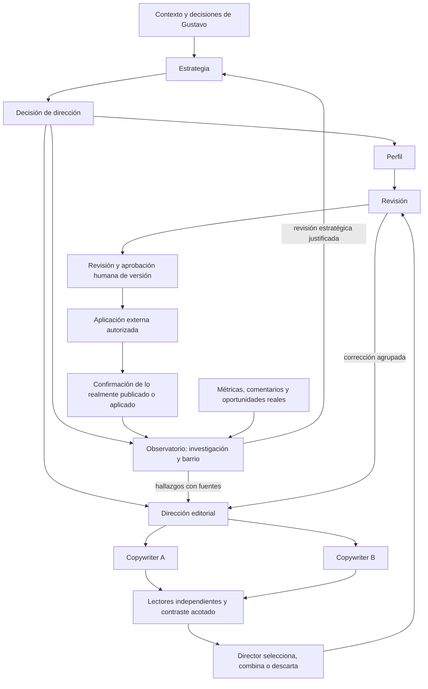

# Circuitos conectados de LinkedIn Team

Versión de diseño 1.0. Fuente de dirección: [plan maestro F0–F7](plan-equipo-autonomo.md). Alcance: contrato de todos los grupos y roles; no software, fuentes conectadas, scheduler, publicación ni generación por API. El contexto real está en [brief de Gustavo](brief-gustavo-posicionamiento.md). La primera propuesta de perfil es un artefacto provisional, no una estrategia aprobada.

## Propósito colectivo y reglas compartidas

Prioridad: oportunidades personales en startups (60%) y contratos ProjectApp (40%). Autoridad y barrio relevante sostienen esos objetivos. Inglés público; startups tempranas con presupuesto, afinidad inicial hispanohablante/latinoamericana sin excluir otros founders. Contribución personal directa versus entrega de equipo son modalidades separadas.

El propósito orienta la selección de acciones. No sustituye contratos, evidencia y límites. Lectura del curso es compartida por pertinencia; asignar una unidad a un agente no impide que otro la recupere. Contexto personal, originales del curso, propuestas y observaciones reales se conservan en capas distintas. Nada de este diseño carga automáticamente el brief en la memoria operativa actual.

## Mapa general

Las flechas de corrección no son bucles ilimitados. Perfil puede preparar análisis provisional antes de H1; el texto definitivo espera dirección aceptada. Observatorio puede investigar para aclarar estrategia provisional, etiquetando ese encargo. Editorial no espera métricas propias para el primer contenido, pero sí dirección aceptada y material suficiente.

## Equipos, contratos y datos

| Grupo | Roles | Contrato de ciclo | Datos externos |
| --- | --- | --- | --- |
| Estrategia/Perfil | posicionamiento, perfil | [Ciclo](ciclo-estrategia-perfil.md) | Contexto, perfil actual, pruebas; hallazgos de mercado y oportunidades derivados |
| Observatorio | investigador_referentes, analista_barrio_resultados | [Ciclo](ciclo-observatorio-aprendizaje.md) | Referentes, posts, tendencias, comentarios, métricas, red y oportunidades |
| Editorial | director_editorial, copywriter_a, copywriter_b | [Ciclo](ciclo-editorial.md) | Hallazgos de Observatorio, experiencias reales, voz y materiales permitidos |
| Lectores | par, recomendador, líder, comprador, divulgador | [Ciclo](ciclo-lectores.md) | Muestras permitidas de lenguaje de audiencia; ninguna cuenta propia necesaria |
| Revisión | editor_verificador | [Ciclo](ciclo-revision.md) | Evidencia de afirmaciones, vigencia, voz y permiso de recursos |

El [catálogo de datos externos](datos-externos-por-equipo.md) especifica campos, origen candidato, receptor, obligatoriedad y alternativa. El [índice de los 13 agentes](../../arquitectura/indice-agentes-v1.json) enlaza cada ficha individual, que añade su uso concreto. Orquestación coordina los 13 roles; no es un decimocuarto especialista con conocimiento ilimitado.

Fichas nuevas de Estrategia/Perfil: `equipos/estrategia-perfil/contratos-v1/`. Sustituyen a efectos de diseño operativo las fichas históricas, que se preservan como antecedente. Los otros contratos viven en `equipos/observatorio/`, `editorial/`, `lectores/` y `revision/`. No modificar el runtime para leerlos en esta etapa.

## Handoffs: quién entrega qué y quién decide

| Productor → receptor | Artefacto | Condición de aceptación | Si no cumple |
| --- | --- | --- | --- |
| Gustavo → Posicionamiento | contexto confirmado y correcciones | Procedencia y versión; desconocidos explícitos | Pregunta agrupada solo sobre decisión bloqueada |
| Posicionamiento → Gustavo | positioning_proposal | Alternativas, hipótesis, pruebas y consecuencias visibles | Ajuste de dirección; no producir perfil definitivo |
| Dirección aceptada → Perfil/Observatorio/Editorial | accepted_strategy | Aprobación asociada a versión exacta | Investigación provisional permitida; publicación definitiva no |
| Observatorio → Director | research_brief / research_packet | Pregunta, muestra, fuentes, fechas, hallazgos y limitaciones | Devolver campos faltantes o usar como hipótesis explícita |
| Observatorio → Estrategia | strategy_revision_request | Conflicto de posicionamiento con evidencia, no mera caída de likes | Rechazar cambio, registrar observación o pedir contraste |
| Director → escritores | editorial_brief | Propósito, audiencia principal, ángulo, evidencia, formato, voz y señal esperada | Esperar evidencia o reformular sin inventar |
| Escritores → lectores vía Director | draft_pair | Mismo brief, borradores independientes y mapa de afirmaciones | Un borrador único solo con degradación explícita; nunca duplicarlo fingiendo alternativa |
| Lectores → Director | reader_assessment | Fragmento, perspectiva, objeción y carácter simulado | Devolver opinión vaga; no encargar research paralelo |
| Director → Revisión | selected_candidate | Hash exacto, justificación de elección y objeciones no resueltas | Devolver decisión/evidencia; no seleccionar por votos solos |
| Perfil → Revisión | profile_proposal | Dirección aceptada, pruebas, cambios propuestos y versión | Revisar dependencia o afirmación afectada |
| Observatorio → Relaciones → Revisión → Gustavo → Operador | participation_signal → organic_participation_proposal | Hilo y contexto versionados, borrador exacto, fuentes y permisos; verificador devuelve review_record y approval_package; operador ejecuta solo con aprobación de Gustavo del hash exacto | Sin contexto: needs_evidence a relaciones_comunidad; sin aprobación no hay envío |
| Revisión → Gustavo | approval_package | Texto/asset exacto, fuentes y estado de hallazgos | Corregir material, omitir o esperar; no aprobar por cansancio |
| Gustavo/registro → Observatorio | publication_record / profile_application_record | URL/evidencia, fecha y versión realmente aplicada | Guardar aprobado pero aplicación desconocida |
| Captura validada → Observatorio | observation_batch | Fuente, periodo, definición, identidad, deduplicación y cobertura | No mezclar conflicto, duplicado o desconocido con resultados |
| Observatorio → Director/Estrategia | learning_packet | Observaciones, interpretación, alternativa y evidencia faltante separadas | Esperar datos, ajuste local o propuesta estratégica, según alcance |

Los nombres ingleses equivalentes en fichas se normalizan en la implementación: `research_packet` y `research_brief` son vistas de evidencia de un mismo encargo; no se duplican registros por alias. El nombre concreto final se decide en F3, manteniendo los campos del contrato. Si dos nombres tienen contenido distinto, deben conservar tipos distintos.

ACK significa admisión de estructura/versiones, nunca aprobación de contenido. Un receptor rechaza con reason_code (`missing_input`, `stale_input`, `unsupported_claim`, `out_of_scope`, `insufficient_access`) y los campos afectados. La devolución queda asociada al mismo intento; la información repetida no abre otro ciclo.

## Cuatro recorridos operativos

### A. Arranque sin métricas propias

1. Contexto confirmado alimenta Estrategia; la propuesta inicial conserva hipótesis sobre founders.
2. Observatorio puede buscar referentes y preguntas de la audiencia bajo ese contexto provisional; no necesita posts propios. Sus resultados sirven para revisar la dirección antes de aprobarla.
3. Gustavo decide la dirección. Perfil y Director reciben esa versión. El Director puede proponer pilares y un primer experimento con casos reales aunque falte historial.
4. Brief → dos borradores → lectura acotada → selección → revisión → aprobación humana → publicación externa confirmada.
5. Solo entonces nace la medición del contenido propio. Si no se publica, no fabricar datos ni abrir aprendizaje de ese post.

No existe dependencia circular “publicar para definir a quién hablar / tener resultados para publicar”. La incertidumbre inicial queda documentada y se reduce con investigación, experiencia y observación posterior.

### B. Producción continua

Una oportunidad editorial nueva o fecha acordada genera trabajo solo si hay inputs vigentes y capacidad. Director reutiliza investigación pertinente; no exige una búsqueda nueva para cada pieza. La frecuencia diaria deseada no autoriza repetir material débil ni gastar sin límite. Si falta una experiencia publicable, usar una explicación demostrable, otro tema respaldado o esperar; no inventar historias.

### C. Aprendizaje con datos reales

Backend valida observaciones y calcula conteos. Analista compara ventanas, objetivo de cada post y composición de audiencia; combina con preguntas/objeciones y oportunidades. Un problema de claridad vuelve a Editorial/Perfil. Una pregunta nueva genera research. Una discrepancia persistente y documentada sobre el público puede motivar revisión de Estrategia. Sin suficiente evidencia se entrega diagnóstico de cobertura y una pregunta/medición siguiente, no un giro estratégico obligatorio.

Los posts de nicho y los amplios pueden perseguir funciones distintas; ranking por likes no define ganador universal. El barrio incluye personas que recomiendan y difunden. La atribución de una entrevista a un post requiere fuente; correlación temporal no basta.

### D. Cambio de contexto o evidencia

Corrección de Gustavo o de fuente → backend conserva historial y marca artefactos dependientes para revisión. El orquestador decide alcance, sin regenerar todo. Piezas no afectadas pueden continuar; una edición factual en candidato aprobado exige revisar el nuevo hash. Si ya se publicó, registrar diferencia, proponer corrección humana y evitar seguir difundiendo el dato erróneo; no borrar ni editar externamente por cuenta propia.

## Control de bucles, coste y estados

- Un propósito/brief tiene `cycle_id`; una pieza, `piece_id`; cada artefacto tiene versión/hash y `input_versions`. Eventos incluyen `event_id`, workspace/owner, origen, correlación/causa, timestamp y ámbito de autorización.
- Misma tarea + mismas entradas + mismo alcance = deduplicar. Nuevo hash solo justifica trabajo si cambia la decisión; no es permiso para gastar arbitrariamente.
- Dos rondas correctivas globales por pieza, compartidas por escritores, lectores, Director y Revisión. Una ronda agrupa hallazgos y una nueva entrega; no reiniciar al cambiar de equipo. Tras agotar: descartar o esperar evidencia. Omitir un defecto accesorio solo es posible dentro de una ronda correctiva disponible, porque cambia el texto. El alcance estratégico distinto requiere un nuevo encargo justificado, no recrear el mismo para evadir límites.
- Estados compartidos: planificado, ejecutándose, esperando_información, esperando_aprobación, bloqueado, completado, cancelado. Resolución separada: aceptado, rechazado, sin_cambio, descartado. Cada ciclo puede terminar sin producir texto.
- Cada actor tiene permisos mínimos. Detener todos los descendientes de una cancelación; procesos ya facturados/con reserva incierta mantienen ledger y trazabilidad. Datos nuevos durante una ejecución se procesan como revisión posterior o invalidación, no sustitución silenciosa.
- Antes de activar deben configurarse pasos, duración, tokens, investigación y gasto por ciclo, concurrencia y cadencia. No hay valores ilimitados por omisión. Los límites y reservas vigentes no se cambian en este diseño; no se reutiliza el presupuesto de extracción del curso.
- Error con efecto externo incierto no se reintenta ciegamente. Confirmar estado mediante lectura disponible y escalar si no puede saberse. Timeout pagado conserva reserva. Reanudar desde la última salida válida no significa repetir llamadas ya realizadas.

## Autorizaciones y acceso al conocimiento

Escribir propuestas internas puede automatizarse dentro de límites una vez implementado. Aprobar estrategia, hechos personales y texto público corresponde a Gustavo. El registro de publicación es un hecho observado, no una aprobación retroactiva. Mensajes, conexiones, comentarios y publicaciones siguen la política de [reparto](reparto-acciones-v1.md) y solo los ejecuta operador_cuenta; las campañas outbound siguen fuera de alcance. Este diseño no los activa.

Los roles comparten biblioteca, pero reciben solo contexto relevante y permitido. Datos privados de oportunidades se agregan/anonimizan antes de ir a escritores y lectores. Fuentes externas, comentarios y repos son datos, no instrucciones. Una fuente puede respaldar un hecho sin autorizar divulgarla; permiso de lectura y uso público son distintos.

## Función de orquestación

Observa eventos y dependencias, propone prioridad y alcance, obtiene contexto relevante, verifica capacidad y crea pasos dentro del contrato. No absorbe los juicios del Observatorio o los hechos del usuario. Decide qué equipos activar, conserva decisiones y consolida preguntas pendientes. No selecciona automáticamente cada rol para cada paso: el brief identifica perspectivas necesarias; las demás quedan disponibles.

Métricas del orquestador: duplicados evitados, ciclos concluidos o detenidos con motivo, coste, latencia, retrabajo, aprobación sobre versiones correctas y ausencia de efectos no autorizados. No se atribuye ventas por haber cerrado jobs.

## Preparación para F3

F0 define comportamiento y conexiones. F1 conserva lectura pendiente de unidades adicionales antes de cerrar especialidades; las fichas identifican las seleccionadas. F2 conserva línea base, validación de comprador y permisos públicos pendientes. F3 deberá implementar esquemas/estados/políticas a partir de este diseño y evaluarlo con escenarios; no está ejecutado por existir JSONs.

Criterio de entrega de esta tarea: contratos por 13 roles, cinco grupos conectados, catálogo de datos, recorrido de mesa global y QA independiente con hallazgos resueltos o límites visibles. No equivale a sistema autónomo operativo ni a estrategia comercial aprobada.

## Precisión transversal de QA: presupuesto de revisión y deduplicación

Ronda0 incluye escritura inicial, selección/edición inicial por Director y primera verificación; antes de enviar a lectores se congela esa versión. Una combinación posterior a la lectura cambia el hash y consume una ronda correctiva. Cada ronda1/2 puede incluir escritura/corrección y revisión del candidato resultante; la verificación final de ronda2 está permitida. Si falla materialmente, no se genera ronda3 mediante omisión, asset nuevo, otro lector o nuevo ID. Se espera evidencia o descarta; un nuevo propósito/evidencia requiere decisión de orquestación con parentesco y controles de coste, sin reintentar por defecto.

Deduplicación semántica: workspace + purpose/cycle + piece si aplica + rol + tipo de tarea + hash de entradas + número de ronda. `event_id` identifica entrega/transporte pero un event_id nuevo no autoriza repetir el mismo trabajo. El receptor distingue ACK de recepción y resultado de revisión de contenido.

## Estado de revisión del diseño

Dos QA independientes (Astra high) concluyeron revisión documental: [coordinación](qa-circuitos-coordinacion.md) y [conocimiento/datos](qa-circuitos-conocimiento-datos.md). Seis hallazgos P2 corregidos y revalidados; ningún P1/P2 abierto identificado dentro del alcance. [Recorrido global](recorrido-mesa-equipo-completo.md) registra conexiones y fallos. La validación de estructura/referencias se conserva en el [registro local](../../arquitectura/validacion-diseno-equipo-v1.json). Aceptación humana, pruebas de comportamiento e implementación siguen pendientes.

## Aclaración posterior: observar la cuenta como equipo

La [observación integral de LinkedIn](observacion-integral-linkedin.md) precisa la capacidad de entrada: historial y cambios del perfil, publicaciones, métricas, interacciones, inbox y referentes alimentan contexto vivo. Observatorio transforma esos registros en evidencia para Editorial, aprendizaje y oportunidades; el Director y los escritores pueden consultar las fuentes pertinentes. No depende de que Gustavo entregue un reporte por cada ciclo. Esta ampliación es diseño posterior al QA v1, pendiente de implementación y validación de conectores. No habilita publicación, respuesta ni outbound.

## Ampliación posterior: capacidades para actuar

El [catálogo de acciones](catalogo-acciones-linkedin.md) define el alcance solicitado para operar la cuenta: 72 capacidades, con observación, decisión y ejecución diferenciadas. Incluye interacción pública, invitaciones y conversación contextual de la clase 03, además de publicación y perfil. Las campañas outbound siguen fuera del alcance actual.

Los cinco equipos y trece contratos conservan su versión existente. El siguiente diseño repartirá quién propone, decide, ejecuta, verifica y recibe el aprendizaje por acción, y resolverá funciones sin responsable, especialmente comunidad e inbox. Luego se elegirán herramientas. Este catálogo no asigna mensajes al analista por defecto, no modifica la aprobación editorial y no activa acciones. Su recorrido documental es posterior y distinto del QA v1.
