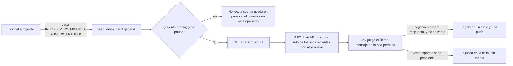

# Conversaciones e inbox (solo lectura)

El agente `conversaciones_inbox` lee el inbox de LinkedIn de Gustavo y le propone las conversaciones que merecen su atención: las que parecen negocio y las que esperan su respuesta. Es el punto «Agente de inbox de solo lectura que proponga oportunidades» de la fase 3 de la [auditoría](auditoria-arquitectura-ia.md), el mayor hueco frente al objetivo 60/40.

El código vive en `src/team_backend/conversaciones.py`. La tarjeta de Tu turno se arma en `rediseno_views.py` y la conversación de la ficha, en `ContactOutput` (`serializers.py`).

## Límites

- **Solo lee.** El conector tiene dos lecturas, `list_chats` y `list_chat_messages`, y ningún método para enviar, marcar como leído ni editar un mensaje. Una prueba falla si aparece alguno.
- **No responde.** Responder o comprometer términos sigue siendo de Gustavo (nivel C). La tarjeta lo dice: «La app nunca envía mensajes: respondes tú en LinkedIn».
- **No crea oportunidades.** Las propone. La tarjeta ofrece «Marcar como oportunidad», que abre el formulario de siempre (`POST /api/v1/oportunidades`) ya relleno, y nada se guarda hasta que Gustavo pulsa «Registrar oportunidad».
- **Los mensajes son datos de terceros.** Se guardan, se muestran y se juzgan como datos, nunca como instrucciones. El estado que recibe Jev lo advierte (`aviso`) y las preguntas solo hablan del contenido. Jev no genera texto, así que un mensaje no puede hacer que el equipo escriba nada.
- **La push no lleva el texto del mensaje.** Solo lleva el nombre y la lectura del equipo, porque la alerta puede salir también por `OPERATOR_ALERT_WEBHOOK`.

## Recorrido

1. **Programar.** El tick encola `read_inbox` por cuenta Unipile sin pausa, una a la vez y cada `INBOX_EVERY_MINUTES`, con un id determinista por franja. Corre en el carril general (`worker`), nunca en el de acciones.
2. **Comprobar la cuenta.** El trabajo refresca su estado con `check_account`. Solo lee si queda `running` y sin pausa. Un conector no operativo pausa la cuenta, como en la ejecución.
3. **Listar.** Lee hasta `INBOX_CHATS_LIMIT` chats y guarda cada chat 1 a 1 como una `Conversation`: nombre, id del otro miembro, hora y vista previa del último mensaje, y quién lo mandó. Los grupos y canales se ignoran. La persona se enlaza con su `Contact` por id de proveedor o por identificador público.
4. **Leer los hilos nuevos.** Solo lee los mensajes de un hilo si el último mensaje cambió desde la última lectura y tiene menos de `INBOX_MAX_AGE_DAYS` días, hasta `INBOX_THREADS_PER_RUN` hilos por vuelta. Guarda los últimos `INBOX_SNAPSHOT_MESSAGES`, del más antiguo al más reciente. Los eventos (reacciones, anuncios) y los mensajes borrados quedan marcados como ocultos: no se muestran ni se juzgan, pero así la vuelta siguiente sabe que ya los leyó.
5. **Juzgar.** Jev juzga el último mensaje de la otra persona una sola vez, con hasta `INBOX_ASSESS_PER_RUN` conversaciones por vuelta (ver abajo).
6. **Proponer.** Si la conversación le toca a Gustavo, aparece la tarjeta y sale una push. Así se envía una sola por cada mensaje nuevo.

## La lectura de Jev

Jev recibe las líneas de negocio de Gustavo, la persona (nombre, y si es contacto también su titular, etapa y clasificación) y los últimos 6 mensajes visibles. Responde cinco preguntas sí/no con probabilidad (`purpose='inbox-assess'`, en el ledger de `typesafe`):

| Pregunta | Qué juzga |
| --- | --- |
| `oportunidad` | ¿Hay una oportunidad de negocio real: asesoría a una startup, software a la medida con ProjectApp o una alianza? |
| `espera` | ¿La persona espera una respuesta de Gustavo a su último mensaje? |
| `venta` | ¿Intenta venderle algo, o es spam o un mensaje automático? |
| `startups` | Si hay oportunidad, ¿es de la línea personal de startups? |
| `projectapp` | Si hay oportunidad, ¿es un proyecto que ProjectApp podría construir? |

El código aplica los umbrales y guarda todo en `Conversation.assessment`: las probabilidades, los umbrales usados, el veredicto, el modelo, el costo y el id del mensaje juzgado.

- `pitch` es verdadero si `venta` supera `INBOX_PITCH_MAX` (0,4). Sin respuesta cuenta como duda, y con duda no se propone nada.
- `opportunity`: no es venta y `oportunidad` ≥ `INBOX_OPPORTUNITY_MIN` (0,6).
- `awaiting_reply`: no es venta y `espera` ≥ `INBOX_REPLY_MIN` (0,6).
- `modality` sirve para rellenar el formulario. Es `projectapp` si esa probabilidad es ≥ 0,5 y mayor que la de startups, `personal_startups` si la de startups es ≥ 0,5, y `por_clasificar` en otro caso (las alianzas no tienen modalidad propia en Oportunidades).

Si Jev no responde, la conversación queda sin juzgar, con el error anotado, y se reintenta en la vuelta siguiente. Sin juicio no hay tarjeta.

Jev no escribe texto, así que no hay «resumen del hilo» ni «borrador sugerido», dos piezas que pide DISENO-VISTAS (C2). En su lugar, la tarjeta y la ficha muestran la lectura del equipo («Posible oportunidad: ProjectApp (86 %) · Espera tu respuesta (81 %)») y los mensajes literales.

## Tu turno

Una conversación es tarjeta (`type: conversacion`, prioridad Importante, agente `conversaciones_inbox`) mientras se cumplan estas condiciones:
- el último mensaje visible es de la otra persona;
- Jev juzgó ese mensaje como negocio o como respuesta pendiente, y no como venta;
- el mensaje tiene menos de `INBOX_MAX_AGE_DAYS` días;
- Gustavo no la cerró;
- `INBOX_ENABLED` está activo (si se apaga, las tarjetas desaparecen).

El id es `conversation:<id>:<huella del mensaje>`: un mensaje nuevo la vuelve a mostrar como Nueva.

La tarjeta trae:
- la persona, con su enlace a la ficha si está en Personas;
- «Por qué importa», que es la lectura del equipo;
- el último mensaje con su hora;
- estas acciones:
  - **Abrir en LinkedIn** (principal): el hilo, cuando el id del chat es un id de hilo de LinkedIn (`2-…`); si no, el inbox.
  - **Hecho, respondí:** `POST /api/v1/conversaciones/<id>/cerrar {"how": "respondi"}`.
  - **Marcar como oportunidad:** solo si la persona es contacto y no tiene una oportunidad abierta. Abre el formulario con la persona, la modalidad leída, el canal LinkedIn y la nota «Detectada por el equipo en una conversación de LinkedIn». Oportunidades no tiene un campo de origen, así que el origen va en la nota y no se inventa un valor que la oficina no sepa nombrar.
  - **No responder:** con motivo opcional.

Cerrar la tarjeta la quita hasta que llegue un mensaje nuevo de la persona. Si Gustavo responde en LinkedIn, la vuelta siguiente lo ve y la tarjeta desaparece sola. Las dos cosas pasan a «Hecho recientemente» («Respondiste», «Sin responder» o «Respondiste en LinkedIn»).

## Ficha de la persona

`ContactOutput` suma `conversation`: su conversación más reciente, con los últimos 3 mensajes visibles, la lectura de Jev, la frase `why`, `chat_url` y `needs_you`. Mientras la conversación sea tarjeta:
- `your_turn` es verdadero;
- el siguiente paso pasa a ser de Gustavo: «Te toca: responder su mensaje»;
- en el Recorrido, «En conversación» queda alcanzado.

## Volumen de lectura

Con los valores por defecto, en el peor caso:

| Lectura | Por vuelta | Al día |
| --- | --- | --- |
| Lista de chats (`GET chats`) | 1 | 24 (una por hora, tope `chats=24`) |
| Mensajes de un hilo (`GET chats/{id}/messages`) | hasta 5, solo hilos con algo nuevo | tope `messages=60` |
| Estado de la cuenta (`GET accounts`, no toca LinkedIn) | 1 | 24 |

En la práctica, los mensajes son tantos como hilos recientes con mensajes nuevos: unos pocos al día. La primera vuelta pone al día como mucho 5 hilos de los últimos 14 días, y las siguientes, el resto. Jev cuesta unos $0,0001 por conversación juzgada.

## Configuración

Todo está apagado por defecto: desplegar no cambia nada hasta encender `INBOX_ENABLED`.

| Variable | Por defecto | Qué hace |
| --- | --- | --- |
| `INBOX_ENABLED` | `false` | Interruptor general: programa la lectura y muestra las tarjetas |
| `INBOX_EVERY_MINUTES` | `60` | Reloj de `read_inbox`; `0` lo apaga |
| `INBOX_MAX_AGE_DAYS` | `14` | Solo se leen, juzgan, proponen y notifican mensajes más nuevos |
| `INBOX_CHATS_LIMIT` | `20` | Chats por lista (de 1 a 50) |
| `INBOX_THREADS_PER_RUN` | `5` | Hilos cuyos mensajes se leen por vuelta |
| `INBOX_SNAPSHOT_MESSAGES` | `10` | Mensajes guardados por conversación (de 1 a 20) |
| `INBOX_ASSESS_PER_RUN` | `5` | Conversaciones que Jev juzga por vuelta |
| `INBOX_READ_CAPS` | `chats=24,messages=60` | Topes diarios de lectura (`inbox.read` en la auditoría) |
| `INBOX_OPPORTUNITY_MIN` | `0.6` | Umbral de `oportunidad` |
| `INBOX_REPLY_MIN` | `0.6` | Umbral de `espera` |
| `INBOX_PITCH_MAX` | `0.4` | Por encima, es venta o spam y nunca se propone |

Además, Jev necesita `LIVE_PROVIDERS=true`, `TYPESAFE_API_KEY` y saldo en `TYPESAFE_LIMIT_USD`, las mismas variables que usa el líder. Sin ellas, el inbox se lee pero nada se juzga ni se propone.

## Por comprobar contra la cuenta real

La forma de las respuestas sale de la referencia de Unipile v2 («List all Chats» y «List all Chat Messages», consultada el 2026-11-07). Falta verificar con la primera lectura real:
- que el `id` de un chat de LinkedIn es el id del hilo (`2-…`), que es lo que permite enlazar directamente al hilo; si no lo es, el enlace lleva al inbox;
- que `user_id` y `sender_id` usan el mismo id de miembro que `Contact.provider_user_id`; si no, el enlace con la persona se hace por identificador público cuando el remitente lo trae;
- que la lista no mezcla InMails patrocinados ni conversaciones archivadas que convenga filtrar por `folders`.
