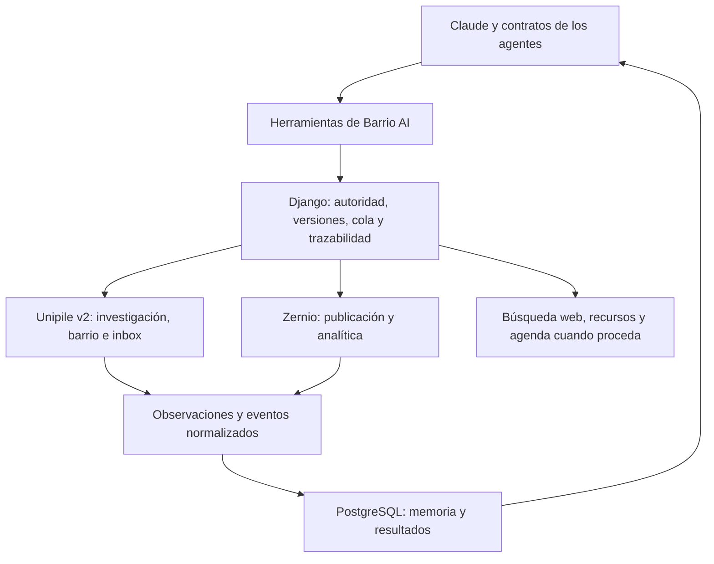

# Herramientas para operar Barrio AI sobre LinkedIn

Investigación del 6 de noviembre de 2026. Recomendación para implementar después, sin contratar, conectar cuentas ni ejecutar acciones. Cubre las 72 capacidades del [catálogo](catalogo-acciones-linkedin.md); el reparto entre agentes continúa pendiente. Gustavo llevará la ejecución del trabajo con Claude.

## Combinación propuesta

**Unipile API v2 para investigación, relaciones, interacción e inbox; Zernio para publicación y analítica; Django/PostgreSQL para coordinar; búsqueda web de Claude para contrastar contexto externo.** Canva y agenda se incorporan cuando una tarea las necesite.

Es una recomendación de arquitectura basada en documentación, no una integración aprobada por una prueba real. Ningún proveedor consultado demuestra cubrir cada acción del catálogo. Los huecos se mantienen visibles en la matriz.

| Componente | Uso propuesto | Por qué encaja |
| --- | --- | --- |
| Unipile API v2 | Buscar personas y posts; leer perfiles/hilos; conexiones; interacción; mensajes; cambios concretos del perfil | Reúne acceso contextual a la cuenta y operaciones sobre ella. La matriz distingue LinkedIn Classic de Sales Navigator y Recruiter. [Cobertura](https://developer.unipile.com/v2.0/docs/list-provider-features). |
| Zernio, antes Late | Programar/publicar y recoger resultados de publicaciones propias | Tiene endpoints para agregados de perfiles personales y para una publicación identificada por URN. [Analítica de LinkedIn](https://docs.zernio.com/platforms/linkedin/analytics). |
| Claude + herramientas de búsqueda y lectura web | Investigar industria, compañías, financiación y contrastar hechos de un brief | Son capacidades del proveedor de modelos; no sustituyen acceso al inbox ni contenido de LinkedIn que exija sesión. [Search](https://platform.claude.com/docs/en/agents-and-tools/tool-use/web-search-tool), [Fetch](https://platform.claude.com/docs/en/agents-and-tools/tool-use/web-fetch-tool). |
| Django/PostgreSQL y cola existente | Objetivos, memoria compartida, calendario, permisos, deduplicación, observaciones y costes | Reutilizar la infraestructura propia y añadir los adaptadores que faltan. Es diseño de Barrio AI, no una función que aporte el conector de LinkedIn. |
| Canva MCP, opcional | Diseñar y exportar recursos visuales editables | Permite trabajar desde Claude; funciones y recursos dependen del plan. [Capacidades](https://www.canva.dev/docs/apps/mcp/), [disponibilidad](https://www.canva.com/help/mcp-agent-setup/). |
| Agenda Google/Microsoft, opcional | Consultar disponibilidad y registrar reuniones acordadas | Unipile documenta métodos de calendario; reutilizar la agenda autorizada elegida. Mandar una propuesta por chat no requiere crear un evento. [Cobertura de calendario](https://developer.unipile.com/v2.0/docs/list-provider-features). |

La investigación debe encontrar referentes por temas y audiencia, leer publicaciones y observar quién participa. No existe aquí una herramienta verificada que entregue automáticamente «los mejores Top Voices para Gustavo». Esa selección sigue siendo criterio de nuestros agentes sobre evidencia recuperada.

## Qué cambia frente a las referencias anteriores

Unipile v2 documenta edición y retirada de posts, edición de comentarios y retirada de reacciones. Para esos cambios hay [guía de posts](https://developer.unipile.com/v2.0/docs/linkedin-edit-delete-posts), [comentarios](https://developer.unipile.com/v2.0/docs/linkedin-manage-post-comments) y [reacciones](https://developer.unipile.com/v2.0/docs/linkedin-manage-post-reactions). No debe usarse el índice v1 anterior para concluir que faltan todas esas operaciones.

La guía actual también separa seguimiento, invitaciones y eliminación de conexiones. [Relaciones e invitaciones](https://developer.unipile.com/v2.0/docs/linkedin-manage-invitations).

En el perfil se documentan titular, educación, experiencia y habilidades mediante campos específicos de LinkedIn; el esquema expone además bio, foto y fondo. Esto no acredita automáticamente destacados, recomendaciones o toda la configuración de privacidad. [Guía de edición](https://developer.unipile.com/v2.0/docs/linkedin-edit-own-profile), [campos](https://developer.unipile.com/v2.0/reference/updateuserprofile).

## La analítica necesita una vía propia

No se encontró una garantía documental de que Unipile entregue todo el panel privado de rendimiento por post. Un contador de reacciones no equivale a alcance, impresiones o guardados. Zernio es el candidato complementario para ese vacío:

- Su endpoint general de analítica advierte una limitación para posts personales publicados fuera de Zernio. Por ello conviene publicar las nuevas piezas por la misma vía que registra su rendimiento. [Analítica general](https://docs.zernio.com/analytics/get-analytics).
- El endpoint específico `GET /v1/accounts/{accountId}/linkedin-post-analytics` recibe una URN y documenta métricas de posts propios personales y de organización; distingue campos que solo existen para cada modalidad. Su funcionamiento sobre piezas históricas se probará de forma explícita. [Contrato por publicación](https://docs.zernio.com/analytics/get-linkedin-post-analytics).
- El agregado personal declara incluir todas las publicaciones del miembro, también las creadas fuera del proveedor, con permiso `r_member_postAnalytics`. [Contrato agregado](https://docs.zernio.com/analytics/get-linkedin-aggregate-analytics).

Conservar `account_id`, ID interno del proveedor, URL, URN nativa cuando exista, fecha y definición de cada dato. Los IDs codificados de Unipile, activity URN y share/ugcPost URN no se intercambian cambiando un prefijo. El adaptador debe resolverlos y verificarlos; [Unipile explica sus identificadores](https://developer.unipile.com/v2.0/docs/linkedin-retrieve-posts).

Impresiones, alcance, reacciones, comentarios, compartidos, guardados y envíos no tienen necesariamente la misma ventana ni disponibilidad. Los desgloses demográficos de una página de empresa no se atribuyen al perfil personal. Las cifras privadas de otros autores permanecen fuera de alcance. La fuente, estado ausente y fórmula de cada métrica se conservan en Django.

La API oficial de LinkedIn es otra vía para analítica si obtenemos el acceso necesario. No la trataría como dependencia segura de arranque: Community Management requiere evaluación y `r_member_social` continúa cerrado a nuevas solicitudes. Tener permisos de analítica tampoco equivale a listar cualquier post o leer mensajes. [Acceso oficial](https://learn.microsoft.com/en-us/linkedin/marketing/community-management/community-management-overview), [métricas del miembro](https://learn.microsoft.com/en-us/linkedin/marketing/community-management/members/post-statistics).

## Claude, MCP y nuestra infraestructura

Para desarrollar o probar con Claude Code, Unipile ofrece MCP con modo documental sin clave y modo de acciones con una clave limitada a cuentas seleccionadas. [Configuración oficial v2](https://developer.unipile.com/v2.0/docs/mcp). Zernio ofrece su propio [MCP para Claude](https://docs.zernio.com/for-you/mcp). Ninguno de ellos se ha conectado en esta tarea.

Para operar los ciclos de Barrio AI, propongo conservar esta estructura:

Herramientas propias como `buscar_perfiles`, `leer_hilo`, `consultar_relacion`, `proponer_invitacion`, `ejecutar_accion_autorizada`, `consultar_conversacion`, `programar_pieza` y `consultar_metricas` son contratos a implementar. No son nombres de endpoints existentes ni un servidor MCP ya construido.

El MCP conecta el cliente con herramientas; no define objetivos, responsables o memoria colectiva. Conectar Claude directamente a un proveedor puede servir para una prueba, pero no registra por sí solo lo que exige nuestro plan. La ejecución habitual debe pasar por Barrio AI o reconciliarse con su registro. Una misma cuenta la usan muchos agentes: no se necesita una conexión de pago por cada personaje.

Una pieza tiene un único ejecutor seleccionado. Propuesta: publicar y programar nuevas piezas mediante Zernio; usar Unipile para explorar, relacionarse, leer hilos e inbox. Si se usa Unipile para una publicación, registrarlo como decisión explícita. Un timeout nunca activa automáticamente el segundo proveedor.

La sincronización combina eventos disponibles con consultas periódicas. No se presupone un webhook para cada notificación, comentario o cambio de analítica. Un evento inicia una comprobación; la evidencia observada actualiza D13/D14/D15 y los ciclos pertinentes.

## Alternativas y decisiones que no añadiría por defecto

**Linked API** es una alternativa real a Unipile: su [MCP](https://linkedapi.io/mcp/available-tools) documenta búsqueda, contenido, conexiones, comentarios e inbox. Encaja especialmente para usar herramientas directamente desde Claude. No contrataría ambos para repetir las mismas funciones; compararía Linked API si el piloto de Unipile deja una carencia material.

Su función `retrievePerformance` documenta seguidores totales, vistas de posts de siete días, visitas al perfil de 90 días y apariciones en búsqueda de la semana anterior. Es útil, pero no demuestra todas las métricas privadas por pieza. [Campos exactos](https://linkedapi.io/docs/action-st-retrieve-performance).

**Sales Navigator** puede ampliar filtros cuando nuestras búsquedas lo requieran; no es obligatorio para comenzar con LinkedIn Classic. El conector no incluye la suscripción de LinkedIn. [Búsqueda y dependencia del tipo de cuenta](https://developer.unipile.com/docs/linkedin-search).

**n8n/Make y un buscador adicional** no son necesarios de entrada: ya tenemos backend y cola, y Claude ofrece búsqueda web si usamos su API. Es una elección de simplicidad del proyecto, no una afirmación de que esas herramientas no sirvan. Los conectores actuales de este chat tampoco se transfieren automáticamente al entorno de Claude.

No usaría una ruta genérica de llamadas internas ni automatización de navegador para declarar resueltos los huecos sin contrato probado. El nombre «API» no garantiza compatibilidad total o estabilidad de una función.

## Coste de partida

Precios públicos consultados el 6 de noviembre de 2026; no se contrataron planes ni se autorizó gasto nuevo.

| Componente | Precio publicado | Consecuencia para una cuenta |
| --- | --- | --- |
| Unipile | Mínimo **49 EUR/mes**, hasta diez cuentas conectadas; prueba de siete días. [Precio](https://www.unipile.com/pricing-api/). | Una cuenta de LinkedIn ya cae en el mínimo. Los agentes no son cuentas facturables separadas. Los límites de LinkedIn siguen aplicando. |
| Zernio | Publica **dos cuentas gratuitas** y funciones incluidas; facturación por cuentas/uso al ampliar. [Precio](https://zernio.com/pricing). | Un perfil puede probar publicación y analítica dentro de esa oferta, sujeto a las condiciones efectivas del alta. No asumir gratuidad ilimitada de todos sus productos. |
| Claude Web Search | **USD 10 por 1.000 búsquedas**, más tokens. [Precio de la herramienta](https://platform.claude.com/docs/en/agents-and-tools/tool-use/web-search-tool). | Registrar consumo por ciclo; esta tarifa es de la API, no una promesa sobre lo incluido en una suscripción de Claude. |
| Linked API, alternativa | Publica Core **USD 49/cuenta/mes** y Plus **USD 74/cuenta/mes**, con diferencias de Sales Navigator; revisar modalidad de facturación. [Precio](https://linkedapi.io/pricing). | Sustituye al conector principal si se elige; no sumar por defecto al coste de Unipile. |
| Canva / agenda / Sales Navigator | Depende del plan y cuentas existentes | Opcionales; no presupuestados como contratados. |

Referencia inicial: **49 EUR/mes de integración principal, más consumo de Claude**, si Zernio confirma la oferta gratuita aplicable y no añadimos planes opcionales. Es una estimación de composición, no un techo de gasto ni un cambio del presupuesto histórico del curso.

## Restricción material para decidir

Unipile y Linked API son proveedores independientes: tener un endpoint no acredita una integración autorizada por LinkedIn. LinkedIn declara que la automatización no autorizada mediante terceros puede provocar restricciones de cuenta. Este riesgo afecta precisamente a las capacidades amplias de búsqueda, conexión y participación que queremos. No existe una cuota de uso que garantice evitarlo. [Política de LinkedIn](https://www.linkedin.com/help/linkedin/answer/a1340567/automated-activity-on-linkedin).

La selección es técnica y provisional. El piloto debe distinguir la vía oficial de publicación/analítica de las capacidades de terceros, y el sistema debe detenerse ante restricciones; no simular humanidad ni sortear bloqueos. Esta investigación no habilita acciones en la cuenta.

## Matriz de las 72 capacidades

`Documentada` significa que existe una función explícita en la documentación consultada; no que la probamos con Gustavo. `Parcial` conserva campos o efectos sin confirmar. `Interna` requiere nuestros ciclos y datos, no otra API de LinkedIn. `Sin contrato específico` mantiene la capacidad pendiente/manual. La [matriz estructurada](../../arquitectura/matriz-herramientas-linkedin-v1.json) conserva las fuentes por acción y marca todas las integraciones como no probadas.

| Acción | Componente propuesto | Cobertura documental | Alcance y límite |
| --- | --- | --- | --- |
| **DESC-01** · Buscar Top Voices y referentes del nicho | Unipile v2 + búsqueda web de Claude | Documentada | Búsqueda de personas/posts y contraste externo; elegir referentes es razonamiento del equipo, no un ranking de Top Voices proporcionado por la API. |
| **DESC-02** · Buscar perfiles para ampliar el barrio | Unipile v2 + búsqueda web de Claude | Documentada | Búsqueda de personas/posts y contraste externo; elegir referentes es razonamiento del equipo, no un ranking de Top Voices proporcionado por la API. |
| **DESC-03** · Investigar un perfil y su actividad | Unipile v2 + fuentes web primarias | Parcial | Perfil y actividad accesibles; financiación e idioma declarado requieren evidencia externa cuando no figuren en el perfil. |
| **DESC-04** · Leer publicaciones e hilos de referentes | Unipile v2 | Documentada | Leer posts, comentarios, respuestas y reacciones accesibles, con paginación; no métricas privadas de terceros. |
| **DESC-05** · Descubrir personas entre quienes comentan y reaccionan | Unipile v2 | Documentada | Leer posts, comentarios, respuestas y reacciones accesibles, con paginación; no métricas privadas de terceros. |
| **DESC-06** · Revisar la red y los vínculos existentes | Unipile v2 + memoria de Barrio AI | Parcial | Relaciones, seguidores y seguidos según acceso; la calidad del vínculo se reconstruye con actividad e inbox, no con el listado solo. |
| **DESC-07** · Clasificar pertinencia y papeles del barrio | Claude + Django/PostgreSQL | Interna | Recuperar contexto, decidir y conservar artefactos con los contratos del equipo; los datos externos siguen siendo dependencias. No implica que el ciclo autónomo ya esté implementado. |
| **DESC-08** · Mantener referentes y un mapa de conversaciones del nicho | Claude + Django/PostgreSQL | Interna | Recuperar contexto, decidir y conservar artefactos con los contratos del equipo; los datos externos siguen siendo dependencias. No implica que el ciclo autónomo ya esté implementado. |
| **RED-01** · Seguir a una persona pertinente | Unipile v2 | Documentada | Seguir, dejar de seguir y eliminar una relación son operaciones distintas; confirmar estado después. |
| **RED-02** · Enviar una invitación contextual a conectar | Unipile v2 | Documentada | Invitaciones enviadas/recibidas, aceptación y retirada; contrastar listas y relación actual. No fijar cuotas desde cifras orientativas del proveedor. |
| **RED-03** · Consultar el estado de invitaciones y conexiones | Unipile v2 | Documentada | Invitaciones enviadas/recibidas, aceptación y retirada; contrastar listas y relación actual. No fijar cuotas desde cifras orientativas del proveedor. |
| **RED-04** · Aceptar una invitación recibida | Unipile v2 | Documentada | Invitaciones enviadas/recibidas, aceptación y retirada; contrastar listas y relación actual. No fijar cuotas desde cifras orientativas del proveedor. |
| **RED-05** · Declinar una invitación recibida | Unipile v2 | Documentada | Invitaciones enviadas/recibidas, aceptación y retirada; contrastar listas y relación actual. No fijar cuotas desde cifras orientativas del proveedor. |
| **RED-06** · Retirar una invitación pendiente | Unipile v2 | Documentada | Invitaciones enviadas/recibidas, aceptación y retirada; contrastar listas y relación actual. No fijar cuotas desde cifras orientativas del proveedor. |
| **RED-07** · Dejar de seguir una cuenta | Unipile v2 | Documentada | Seguir, dejar de seguir y eliminar una relación son operaciones distintas; confirmar estado después. |
| **RED-08** · Eliminar una conexión | Unipile v2 | Documentada | Seguir, dejar de seguir y eliminar una relación son operaciones distintas; confirmar estado después. |
| **RED-09** · Actualizar la memoria de la relación y su siguiente paso | Claude + Django/PostgreSQL | Interna | Recuperar contexto, decidir y conservar artefactos con los contratos del equipo; los datos externos siguen siendo dependencias. No implica que el ciclo autónomo ya esté implementado. |
| **INT-01** · Elegir dónde y cuándo aportar | Claude + Django/PostgreSQL | Interna | Recuperar contexto, decidir y conservar artefactos con los contratos del equipo; los datos externos siguen siendo dependencias. No implica que el ciclo autónomo ya esté implementado. |
| **INT-02** · Reaccionar a una publicación o comentario | Unipile v2 | Documentada | Añadir o retirar reacción en post/comentario; un cambio puede necesitar retirada y nueva reacción, con conciliación intermedia. |
| **INT-03** · Publicar un comentario propio en un post ajeno | Unipile v2 | Documentada | Crear, responder, editar y borrar comentarios propios; comprobar hilo, autoría y permisos concretos. |
| **INT-04** · Responder comentarios en publicaciones propias | Unipile v2 | Documentada | Crear, responder, editar y borrar comentarios propios; comprobar hilo, autoría y permisos concretos. |
| **INT-05** · Continuar un intercambio en un hilo ajeno | Unipile v2 | Documentada | Crear, responder, editar y borrar comentarios propios; comprobar hilo, autoría y permisos concretos. |
| **INT-06** · Compartir una publicación con perspectiva propia | Unipile v2 o Zernio, con un único ejecutor | Documentada | Repost con comentario propio. La pieza elige una sola vía para evitar duplicar publicación. |
| **INT-07** · Guardar contenido para consultarlo después | Biblioteca interna; LinkedIn manual por ahora | Sin contrato específico | Conservar referencia en Barrio AI es viable; no se verificó un método para Guardar en LinkedIn. El guardado interno no se reporta como guardado nativo. |
| **INT-08** · Editar un comentario propio | Unipile v2 | Documentada | Crear, responder, editar y borrar comentarios propios; comprobar hilo, autoría y permisos concretos. |
| **INT-09** · Retirar un comentario propio | Unipile v2 | Documentada | Crear, responder, editar y borrar comentarios propios; comprobar hilo, autoría y permisos concretos. |
| **INT-10** · Cambiar o retirar una reacción propia | Unipile v2 | Documentada | Añadir o retirar reacción en post/comentario; un cambio puede necesitar retirada y nueva reacción, con conciliación intermedia. |
| **CONT-01** · Elegir ideas y pilares pertinentes | Claude + Django/PostgreSQL | Interna | Recuperar contexto, decidir y conservar artefactos con los contratos del equipo; los datos externos siguen siendo dependencias. No implica que el ciclo autónomo ya esté implementado. |
| **CONT-02** · Investigar y preparar el brief de una pieza | Claude + Django/PostgreSQL | Interna | Recuperar contexto, decidir y conservar artefactos con los contratos del equipo; los datos externos siguen siendo dependencias. No implica que el ciclo autónomo ya esté implementado. |
| **CONT-03** · Redactar y comparar alternativas de copy | Claude + Django/PostgreSQL | Interna | Recuperar contexto, decidir y conservar artefactos con los contratos del equipo; los datos externos siguen siendo dependencias. No implica que el ciclo autónomo ya esté implementado. |
| **CONT-04** · Preparar los recursos visuales o audiovisuales | Canva MCP, opcional; assets autorizados | Parcial | Diseño, edición y exportación; validar formatos y funciones del plan. No presupone generación audiovisual completa ni evidencia visual auténtica. |
| **CONT-05** · Evaluar la pieza desde los lectores del barrio | Claude + Django/PostgreSQL | Interna | Recuperar contexto, decidir y conservar artefactos con los contratos del equipo; los datos externos siguen siendo dependencias. No implica que el ciclo autónomo ya esté implementado. |
| **CONT-06** · Revisar hechos, voz, claridad y versión final | Claude + Django/PostgreSQL | Interna | Recuperar contexto, decidir y conservar artefactos con los contratos del equipo; los datos externos siguen siendo dependencias. No implica que el ciclo autónomo ya esté implementado. |
| **CONT-07** · Organizar el calendario editorial | Claude + Django/PostgreSQL | Interna | Recuperar contexto, decidir y conservar artefactos con los contratos del equipo; los datos externos siguen siendo dependencias. No implica que el ciclo autónomo ya esté implementado. |
| **CONT-08** · Programar, reprogramar o cancelar una publicación programada | Zernio + registro de calendario en Django | Documentada | Programación/cancelación en el proveedor y confirmación posterior. No equivale a tener el post en el programador nativo de LinkedIn. |
| **CONT-09** · Publicar una pieza y confirmar su versión real | Zernio; Unipile v2 como alternativa explícita | Documentada | Publicar texto y medios, guardar IDs/URN/URL y confirmar contenido. Una sola vía por pieza; timeout no dispara envío alternativo. |
| **CONT-10** · Editar una publicación propia | Zernio para sus piezas; Unipile v2 según origen | Parcial | Edición de texto y retirada; validar origen y propiedad. No asumir que editar permite reemplazar todos los medios. |
| **CONT-11** · Retirar una publicación propia | Zernio para sus piezas; Unipile v2 según origen | Parcial | Edición de texto y retirada; validar origen y propiedad. No asumir que editar permite reemplazar todos los medios. |
| **CONT-12** · Crear y mantener un artículo | LinkedIn nativo, intervención manual | Sin contrato específico | No se verificó creación/mantenimiento de artículos nativos ni newsletters. Publicar un enlace a un artículo no cumple estas capacidades. |
| **CONT-13** · Crear y mantener una newsletter y sus ediciones | LinkedIn nativo, intervención manual | Sin contrato específico | No se verificó creación/mantenimiento de artículos nativos ni newsletters. Publicar un enlace a un artículo no cumple estas capacidades. |
| **CHAT-01** · Consultar conversaciones y sincronizar su historial | Unipile v2 | Documentada | Enumerar inboxes, chats y mensajes; historial inicial más eventos incrementales. No usar la antigua ruta genérica de chats como si fuera el contrato v2 de LinkedIn. |
| **CHAT-02** · Clasificar intención, contexto y asuntos pendientes | Claude + Django/PostgreSQL | Interna | Recuperar contexto, decidir y conservar artefactos con los contratos del equipo; los datos externos siguen siendo dependencias. No implica que el ciclo autónomo ya esté implementado. |
| **CHAT-03** · Responder un mensaje entrante | Unipile v2 + decisión de Claude | Documentada | Enviar o responder en un hilo; contexto, recursos y oportunidad de intervenir corresponden al equipo. Confirmar resultado por lectura/evento. |
| **CHAT-04** · Iniciar una conversación orgánica con contexto | Unipile v2 + decisión de Claude | Documentada | Enviar o responder en un hilo; contexto, recursos y oportunidad de intervenir corresponden al equipo. Confirmar resultado por lectura/evento. |
| **CHAT-05** · Retomar una relación existente | Unipile v2 + decisión de Claude | Documentada | Enviar o responder en un hilo; contexto, recursos y oportunidad de intervenir corresponden al equipo. Confirmar resultado por lectura/evento. |
| **CHAT-06** · Compartir un recurso o caso pertinente por mensaje | Unipile v2 + decisión de Claude | Documentada | Enviar o responder en un hilo; contexto, recursos y oportunidad de intervenir corresponden al equipo. Confirmar resultado por lectura/evento. |
| **CHAT-07** · Proponer una conversación y coordinar disponibilidad | Unipile v2 + agenda de Google/Microsoft opcional | Parcial | El mensaje puede coordinar disponibilidad. Consultar/crear evento requiere conexión y autoridad de agenda separadas; sin ellas no prometer horarios. |
| **CHAT-08** · Dar seguimiento a un intercambio o compromiso acordado | Unipile v2 + decisión de Claude | Documentada | Enviar o responder en un hilo; contexto, recursos y oportunidad de intervenir corresponden al equipo. Confirmar resultado por lectura/evento. |
| **CHAT-09** · Registrar una oportunidad y transferir la decisión a Gustavo | Claude + Django/PostgreSQL | Interna | Recuperar contexto, decidir y conservar artefactos con los contratos del equipo; los datos externos siguen siendo dependencias. No implica que el ciclo autónomo ya esté implementado. |
| **CHAT-10** · Organizar el inbox y el estado de atención | Unipile v2 + estado interno de atención | Parcial | Update Chat y lectura según campos soportados. Verificar archive/mute/read por proveedor; etiquetas de Barrio AI no son etiquetas nativas. |
| **PERF-01** · Auditar el perfil frente al posicionamiento | Claude + Django/PostgreSQL | Interna | Recuperar contexto, decidir y conservar artefactos con los contratos del equipo; los datos externos siguen siendo dependencias. No implica que el ciclo autónomo ya esté implementado. |
| **PERF-02** · Actualizar titular y Acerca de | Unipile v2 | Documentada | Titular mediante specifics de LinkedIn; Acerca de mediante bio. Confirmar esquema exacto y comprobar lectura posterior. |
| **PERF-03** · Actualizar trayectoria, proyectos, formación y habilidades | Unipile v2 + edición manual de campos no cubiertos | Parcial | Educación, experiencia y habilidades documentadas; proyectos y cada campo concreto se verifican por separado. |
| **PERF-04** · Actualizar foto y banner | Unipile v2 | Documentada | picture y background_picture; verificar recortes y aspecto final en las vistas observables. |
| **PERF-05** · Administrar la sección Destacados | LinkedIn nativo, intervención manual por ahora | Sin contrato específico | No se verificó contrato específico para destacados, contacto, gestión de recomendaciones o preferencias generales de visibilidad; no inferirlo de Edit profile. |
| **PERF-06** · Mantener enlaces y datos de contacto profesionales | LinkedIn nativo, intervención manual por ahora | Sin contrato específico | No se verificó contrato específico para destacados, contacto, gestión de recomendaciones o preferencias generales de visibilidad; no inferirlo de Edit profile. |
| **PERF-07** · Solicitar recomendaciones a colaboradores o clientes reales | Unipile para mensaje contextual; solicitud nativa manual | Parcial | Pedir por chat está cubierto; activar el formulario y solicitud formal de recomendaciones de LinkedIn no quedó verificado. |
| **PERF-08** · Revisar y administrar recomendaciones recibidas | LinkedIn nativo, intervención manual por ahora | Sin contrato específico | No se verificó contrato específico para destacados, contacto, gestión de recomendaciones o preferencias generales de visibilidad; no inferirlo de Edit profile. |
| **PERF-09** · Revisar y ajustar visibilidad profesional y seguimiento | LinkedIn nativo, intervención manual por ahora | Sin contrato específico | No se verificó contrato específico para destacados, contacto, gestión de recomendaciones o preferencias generales de visibilidad; no inferirlo de Edit profile. |
| **PERF-10** · Verificar el perfil después de aplicar cambios | Lectura de perfil Unipile + revisión visual en LinkedIn | Parcial | Comparar campos leídos; verificación pública/móvil completa necesita observar esas vistas, no solo un JSON. |
| **APRE-01** · Recoger resultados de publicaciones y perfil | Zernio + observación de cuenta; API oficial alternativa | Parcial | Métricas agregadas y por URN de publicaciones propias. Visitas, apariciones, desgloses y cada campo adicional requieren contraste; no se promete toda la analítica de la interfaz. |
| **APRE-02** · Analizar composición y evolución del barrio | Claude + Django/PostgreSQL | Interna | Recuperar contexto, decidir y conservar artefactos con los contratos del equipo; los datos externos siguen siendo dependencias. No implica que el ciclo autónomo ya esté implementado. |
| **APRE-03** · Evaluar calidad de interacción y conversación | Claude + Django/PostgreSQL | Interna | Recuperar contexto, decidir y conservar artefactos con los contratos del equipo; los datos externos siguen siendo dependencias. No implica que el ciclo autónomo ya esté implementado. |
| **APRE-04** · Relacionar acciones y oportunidades cuando haya evidencia | Claude + Django/PostgreSQL | Interna | Recuperar contexto, decidir y conservar artefactos con los contratos del equipo; los datos externos siguen siendo dependencias. No implica que el ciclo autónomo ya esté implementado. |
| **APRE-05** · Comparar piezas e intervenciones con objetivos equivalentes | Claude + Django/PostgreSQL | Interna | Recuperar contexto, decidir y conservar artefactos con los contratos del equipo; los datos externos siguen siendo dependencias. No implica que el ciclo autónomo ya esté implementado. |
| **APRE-06** · Proponer el siguiente experimento o ajuste | Claude + Django/PostgreSQL | Interna | Recuperar contexto, decidir y conservar artefactos con los contratos del equipo; los datos externos siguen siendo dependencias. No implica que el ciclo autónomo ya esté implementado. |
| **APRE-07** · Mantener memoria de decisiones, resultados e incertidumbre | Claude + Django/PostgreSQL | Interna | Recuperar contexto, decidir y conservar artefactos con los contratos del equipo; los datos externos siguen siendo dependencias. No implica que el ciclo autónomo ya esté implementado. |
| **ADM-01** · Revisar notificaciones y convertirlas en pendientes útiles | Eventos Unipile + consultas periódicas + LinkedIn manual | Parcial | Hay eventos de mensajes, relaciones y seguidores; no se verificó un espejo completo del centro de notificaciones ni eventos para cada comentario nuevo. |
| **ADM-02** · Moderar espacios propios | Unipile v2 con permisos concretos; manual para el resto | Parcial | Borrar comentarios propios y administrar comentarios de posts según control real. No asumir borrar cualquier comentario de terceros por existir Delete comment. |
| **ADM-03** · Bloquear o reportar un caso justificado | Unipile v2 para bloqueo; reporte manual | Parcial | Block/unblock documentados. No se verificó denuncia/report de contenido o cuenta; conservar esa parte manual. |
| **ADM-04** · Detectar restricciones y detener acciones incompatibles | Claude + Django/PostgreSQL | Interna | Recuperar contexto, decidir y conservar artefactos con los contratos del equipo; los datos externos siguen siendo dependencias. No implica que el ciclo autónomo ya esté implementado. |
| **ADM-05** · Exportar, conciliar y conservar el historial operativo | Claude + Django/PostgreSQL | Interna | Recuperar contexto, decidir y conservar artefactos con los contratos del equipo; los datos externos siguen siendo dependencias. No implica que el ciclo autónomo ya esté implementado. |

## Prueba mínima que debe cerrar la elección

El piloto futuro tendrá una ficha por caso: fuente, cuenta/tipo, entrada, respuesta, estado observado, coste, limitación y decisión de cobertura. Ninguno de estos casos se ejecutó durante la investigación:

1. Buscar referentes y candidatos, recuperar un perfil, sus posts y un hilo paginado. Confirmar que el contexto permita juzgar pertinencia.
2. Leer relaciones e invitaciones existentes; comprobar un caso aceptado sin deducirlo de la desaparición de la lista de pendientes.
3. Sincronizar un chat con mensajes entrantes y salientes. Una respuesta de Gustavo debe invalidar un borrador obsoleto.
4. Con una pieza y destino autorizados, probar la operación de publicación o interacción que se habilite; conservar IDs y confirmar la versión exacta. No probar comentarios o invitaciones contra terceros al azar.
5. Contrastar analítica de una pieza nueva y una histórica propia con LinkedIn: impresiones, alcance, reacciones, comentarios y guardados/envíos cuando estén disponibles. Resolver IDs entre proveedores; distinguir cero de ausencia.
6. Leer perfil antes/después de un cambio concreto autorizado. No vaciar campos omitidos ni asumir que la API reproduce la vista pública.
7. Comprobar cancelación, desconexión y resultado incierto con simulaciones locales; no inducir bloqueos ni repetir acciones públicas para probar reintentos.

Criterio de cierre: una capacidad pasa de documentada a validada solo con evidencia del resultado y de sus límites. Los huecos actuales incluyen guardado nativo, artículos/newsletters, destacados, gestión formal de recomendaciones y algunas preferencias de cuenta; bloqueo y denuncia también se evalúan por separado. El reparto entre agentes y sus políticas de delegación se conserva como trabajo pendiente del plan.
