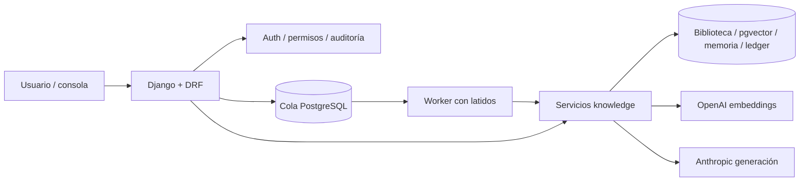

# Arquitectura
Navegador/API → autenticación Django y permisos → serializers/servicios → biblioteca compartida o Job persistente → worker → knowledge.agents → proveedores. Las tablas históricas permanecen; Django añade tablas de autenticación, credenciales hash, trabajos y auditoría. Las unidades y evidencias son de solo lectura en Admin.

El grafo muestra también consultas directas de biblioteca desde DRF. Solo los trabajos de agentes van por la cola. Los proveedores siguen sujetos a LIVE_PROVIDERS, permisos, caché y reservas monetarias existentes. Cada Job pertenece a un usuario; las unidades son compartidas por el equipo. Ningún modelo de Django reescribe el contenido extraído. Los registros originales se adoptan mediante SQL idempotente y modelos unmanaged.

## Evolución planificada

El [plan maestro del equipo autónomo](../plan-equipo-autonomo.md) define ciclos,
fases y criterios de aceptación para la siguiente etapa. Es arquitectura prevista;
no implica que la coordinación multiagente esté implementada.

Diseño de coordinación pendiente de implementación: [circuitos de todos los equipos](../circuitos-equipo.md) y [datos externos necesarios](../datos-externos-por-equipo.md). Los contratos individuales no alteran la arquitectura en ejecución.
