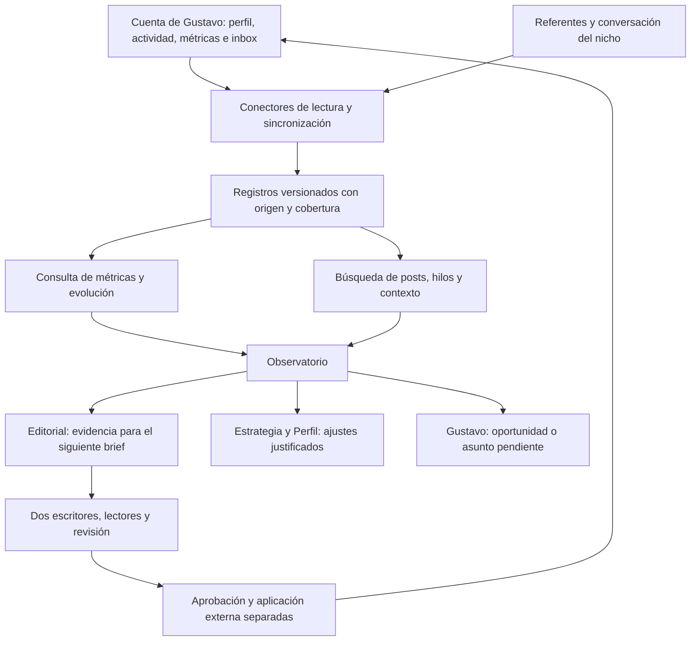

# Observar la cuenta de LinkedIn como un equipo que trabaja dentro de ella

Revisión de diseño del 6 de noviembre de 2026, a partir de la aclaración de Gustavo. Complementa el [circuito colectivo](circuitos-equipo.md) y precisa el significado de [datos externos](datos-externos-por-equipo.md). No implementa conectores ni activa acciones en la cuenta. Esta ampliación es posterior al QA documental de los ciclos v1 y no hereda una nueva validación de funcionamiento.

## El cambio de enfoque

El objetivo es que el equipo pueda observar de forma continua la actividad profesional de Gustavo en LinkedIn: qué comunica, qué publica, quién responde, cómo evoluciona su audiencia, qué conversa por mensajes y qué están discutiendo las personas del nicho. La experiencia buscada se parece a un equipo con visibilidad de la cuenta, que consulta contexto y detecta cambios sin depender de que Gustavo prepare un informe manual para cada decisión.

Diseñamos primero esa capacidad de observación completa. Después comprobamos qué parte podemos obtener mediante cada integración. Una importación manual es una alternativa de arranque o recuperación, no el funcionamiento objetivo del equipo. El contexto profesional y las pruebas de proyectos siguen siendo insumos necesarios, pero no sustituyen esta observación.

La cuenta es accesible como fuente común; cada rol consulta lo relevante para su decisión. No hace falta introducir todo el inbox en cada solicitud al modelo. La capacidad de observar y el permiso para ejecutar acciones externas se mantienen separados. Esta aclaración no activa respuestas, comentarios, invitaciones ni campañas.

## Qué necesita ver y para qué

| Superficie observable | Datos que queremos capturar | Decisión que permite tomar | Responsable principal |
| --- | --- | --- | --- |
| Perfil y su evolución | Titular, acerca de, experiencias, destacados, recursos, cambios y fecha | Si el mensaje corresponde al posicionamiento y si el público entiende las dos modalidades | Perfil y Posicionamiento |
| Publicaciones propias | Historial, texto completo, medios, formato, fecha, enlaces, versiones y contexto del brief | Qué estamos diciendo, qué se repite, qué promesa hacemos y qué experiencias respaldan el contenido | Director, escritores y Revisión |
| Rendimiento por publicación | Impresiones, alcance, reacciones, comentarios, republicaciones, guardados, envíos, clics y conversiones disponibles; fecha de cada corte | Qué piezas ayudan a descubrirnos, profundizar interés, visitar el perfil o abrir conversación | Analista de barrio y resultados |
| Audiencia y red | Evolución de seguidores/conexiones, datos profesionales disponibles, composición agregada, participantes recurrentes y nuevos vínculos | Si estamos formando el barrio deseado y qué papeles están representados | Observatorio y Posicionamiento |
| Comentarios y actividad pública | Hilos completos pertinentes, preguntas, respuestas de Gustavo, menciones, reacciones y contexto de publicaciones ajenas donde participa | Qué dudas existen, qué se entendió mal, quién conversa y qué vínculos se están desarrollando | Observatorio; hallazgos a Editorial y Perfil |
| Inbox entrante y saliente | Historial pertinente de cada hilo, remitente, mensajes de ambas partes, fechas, adjuntos relevantes, última respuesta, preguntas y compromisos | Comprender interés real, detectar una oportunidad, evitar proponer respuestas sin contexto y recoger objeciones | Analista; escalamiento a Gustavo, Estrategia o Editorial |
| Referentes del nicho | Búsqueda, lista de seguimiento, posts completos accesibles, medios, comentarios, temas, argumentos, ejemplos y señales públicas | Entender la conversación del público deseado y construir un ángulo propio con evidencia | Investigador de referentes |
| Resultados fuera de la plataforma | Reunión, entrevista, propuesta, contrato y resultado confirmado, con procedencia | Saber si la actividad aporta a oportunidades personales y ProjectApp | Analista y Gustavo; fuente externa complementaria |

Las celdas describen necesidades del producto, no capacidades ya conectadas. Una métrica no disponible se conserva como desconocida. El acceso a la cuenta de Gustavo tampoco proporciona las métricas privadas de otros autores; para referentes se distingue contenido visible de rendimiento privado.

## Métricas: observar efectos distintos

### Descubrimiento

Impresiones, miembros alcanzados, visitas al perfil, apariciones en búsqueda y crecimiento de seguidores, según campos accesibles. Interesa la evolución en ventanas comparables y en relación con la actividad publicada. Impresiones y personas únicas son medidas diferentes.

### Utilidad e interés

Guardados, clics, envíos, republicaciones, preguntas y profundidad de conversación. Para video, vistas y tiempo de reproducción cuando exista esa medición. No suponer tiempo de lectura de un post o datos de retención que la fuente no entregue.

La tasa de interacción que calculemos debe indicar su fórmula. Por ejemplo, `(reacciones + comentarios + republicaciones) / impresiones` es una definición propia y explícita, no una métrica intercambiable con cualquier porcentaje mostrado por un proveedor. Guardados e impresiones también pueden compararse por pieza cuando sus ventanas son compatibles. Si falta el denominador o es cero, no calcular una tasa ficticia.

### Composición y relación

Quién vuelve a comentar, qué funciones profesionales aparecen, cuántas conversaciones involucran founders o referentes pertinentes y qué personas recomiendan o difunden. Los cinco papeles del barrio son funcionales y pueden coexistir. Las categorías inferidas llevan evidencia y grado de certeza; no se infieren idioma o identidad cultural por nombre o foto.

Un porcentaje de founders entre comentaristas identificados describe esa muestra, no toda la audiencia silenciosa. El número de seguidores por sí solo no mide encaje comercial.

### Oportunidad

Conversaciones con necesidad expresa, preguntas por disponibilidad o servicios, reuniones, entrevistas, solicitudes de propuesta y resultados confirmados. Registrar modalidad personal/ProjectApp, etapa y hechos necesarios para cualificar. Un saludo o un mensaje promocional no se cuenta automáticamente como oportunidad.

Si alguien cita un post en el chat, conservar ese vínculo. Si el origen es desconocido, mantenerlo desconocido. Un dato de visita al perfil procedente de contenido puede apoyar una relación medida por la plataforma; no prueba por sí solo que un contrato se deba a esa publicación.

El Director recibe el conjunto de señales y el propósito de cada pieza. No se maximiza una única puntuación de engagement ni se cambia de nicho cada vez que una publicación obtiene poco alcance.

## Investigación de referentes que sí alimenta a los escritores

La herramienta de investigación debe permitir descubrir autores y recuperar sus publicaciones e hilos, no limitarse a una lista de nombres. La selección considera afinidad temática, problemas discutidos y evidencia sobre quién participa. Una insignia Top Voice es opcional. La dirección inicial de Gustavo delimita hipótesis de investigación; no se presenta el nicho como ya validado por el mercado.

El investigador recorre esta secuencia:

1. Buscar autores y conversaciones relacionadas con la audiencia y sus problemas.
2. Justificar su inclusión en una lista de seguimiento; conservar también pares y cuentas pequeñas relevantes.
3. Leer publicaciones recientes y ejemplos históricos pertinentes, con fecha, enlace y contexto.
4. Analizar qué pregunta responden, qué afirman, qué evidencia usan y qué objeciones aparecen en los comentarios.
5. Separar asuntos recurrentes de una señal aislada y contrastar autores y fuentes; varias copias de una noticia no son corroboraciones independientes.
6. Entregar al Director un paquete útil para decidir y escribir.

Ese paquete incluye: pregunta de audiencia, posts de referencia, extractos pertinentes, argumentos y desacuerdos, muestra observada, señales de respuesta, ángulos ya saturados, posible aporte de Gustavo, experiencia propia necesaria y vacíos de evidencia. Los copywriters pueden abrir las fuentes pertinentes o solicitar ampliación por medio del Director. No quedan reducidos a escribir a partir de un título de tendencia o un resumen sin referencias.

Ambos escritores reciben la misma versión del paquete y del brief. Su independencia consiste en proponer tratamientos diferentes, no en cambiar los hechos. El resultado debe aportar criterio propio; repetir el texto de un referente o imitar su experiencia no demuestra autoridad de Gustavo.

## Los mensajes forman parte de la comprensión del negocio

Observar el inbox incluye leer el contexto necesario de los mensajes que llegan y las respuestas que Gustavo ya dio. El equipo debe reconocer, por ejemplo, que un interlocutor preguntó por contratación personal y que ya recibió una aclaración, en lugar de tratar el siguiente mensaje como una conversación nueva.

El analista identifica preguntas, necesidades expresas, objeciones, compromisos, asuntos pendientes y siguiente responsable. Puede preparar un resumen interno y alertar a Gustavo. Una pregunta recurrente puede informar un brief editorial; una confusión sobre la oferta puede informar una revisión del perfil. Los escritores reciben el problema general y evidencia permitida, sin trasladar automáticamente identidades o detalles privados al contenido público.

La respuesta por DM y la gestión de conversaciones necesitan un contrato específico de respuesta y autoridad. El [catálogo posterior de acciones](catalogo-acciones-linkedin.md) ya incluye respuestas, conversaciones iniciadas con contexto y seguimiento orgánico, fundamentados en la clase 03. Su reparto y política de ejecución siguen pendientes; no se añaden silenciosamente al rol de analista ni se da por procesado el contenido de campañas outbound. Este documento describe la entrada de observación que esas acciones necesitan.

## Herramientas compartidas y contexto vivo

Proponemos herramientas de lectura, no un agente nuevo por cada endpoint:

| Herramienta conceptual | Devuelve | Uso |
| --- | --- | --- |
| Consultar perfil e historial | Estado actual, cambios, procedencia | Perfil / Estrategia |
| Consultar publicaciones propias | Texto, medios, versiones, fechas y brief asociado | Editorial / Revisión / Analista |
| Consultar métricas | Series o cortes con definición, ámbito y cobertura | Analista |
| Consultar conversación | Hilo, participantes, fechas, contexto y último estado | Analista / orquestador |
| Consultar interacciones y barrio | Actividad disponible, vínculos y recurrencia | Observatorio |
| Buscar referentes y contenido | Autores y posts candidatos con evidencia | Investigador |
| Leer post e hilo de referencia | Contenido accesible y contexto suficiente | Investigador; acceso pertinente desde Editorial |
| Consultar aprendizajes | Observaciones, hipótesis y decisiones anteriores | Todos según la tarea |

La capa de sincronización recoge cambios; Django conserva datos normalizados y procedencia. Los contadores y comparaciones temporales se calculan como datos estructurados. Los textos de posts e hilos pueden indexarse para recuperación semántica, conservando el original, su visibilidad y sus referencias. Los embeddings no sustituyen la base de métricas ni la autorización de acceso al texto fuente.

El equipo recibe eventos relevantes: nueva publicación propia, pregunta material, mensaje entrante pertinente, señal editorial o corte de métricas disponible. Un like nuevo no requiere convocar a los trece agentes. Se agrupan señales, se deduplican eventos y se reusan las salidas vigentes.

Una carga inicial del historial permite entender la cuenta antes de aprender de cambios incrementales. Como punto de partida para diseñar la captura, se pueden estudiar 90 días de publicaciones y cortes por pieza a 24 horas, 72 horas y siete días. Son ventanas propuestas, sujetas a acceso y cadencia; no umbrales del curso ni históricos garantizados por una API. Inbox usa eventos cuando el proveedor los soporte; un webhook no sustituye la recuperación del historial inicial.

## Qué está documentado sobre vías de acceso

Verificación documental del 6 de noviembre de 2026; no probamos permisos de una aplicación de Gustavo ni conectamos su cuenta.

| Necesidad | Evidencia encontrada | Qué falta comprobar para Barrio AI |
| --- | --- | --- |
| Métricas de publicaciones del miembro | [LinkedIn documenta](https://learn.microsoft.com/en-us/linkedin/marketing/community-management/members/post-statistics) `memberCreatorPostAnalytics` y permiso `r_member_postAnalytics`, con estadísticas por pieza o agregadas | Acceso de nuestra aplicación, versión, campos, ventanas y diferencias con la interfaz |
| Evolución de seguidores | [LinkedIn documenta](https://learn.microsoft.com/en-us/linkedin/marketing/community-management/members/follower-statistics) `memberFollowersCount` y `r_member_profileAnalytics` | Permisos efectivos; el conteo no acredita acceso a identidades ni a todas las métricas del perfil |
| Lectura de posts, comentarios y reacciones | [Posts API](https://learn.microsoft.com/en-us/linkedin/marketing/community-management/shares/posts-api) distingue lectura y escritura; `r_member_social` es restringido. El [overview consultado](https://learn.microsoft.com/en-us/linkedin/marketing/community-management/community-management-overview) indica que no reciben nuevas solicitudes para ese permiso | No asumir que poder publicar o leer analítica permite enumerar todo el contenido |
| Historial y cambios de inbox | Unipile documenta [lectura paginada de hilos](https://developer.unipile.com/docs/get-messages) y [webhooks de mensajes recibidos/enviados](https://developer.unipile.com/docs/new-messages-webhook) | Cobertura real, sincronización inicial, autenticación, condiciones de uso, límites, costes y estabilidad |
| Descubrir referentes y posts | Unipile documenta [búsquedas de personas y publicaciones](https://developer.unipile.com/docs/linkedin-search) según la cuenta y su suscripción | Recuperación completa del contenido/hilos y campos disponibles; no inferir métricas privadas a partir de campos vacíos o cero del proveedor |

[Community Management requiere evaluación de acceso](https://learn.microsoft.com/en-us/linkedin/marketing/community-management-app-review); un login de LinkedIn no concede por sí solo todas estas capacidades. No se ha confirmado una vía oficial de libre acceso que entregue el inbox y cualquier feed personal completo. Unipile es un candidato documentado a evaluar, distinto de una integración oficial de LinkedIn; no está contratado, conectado ni validado para este proyecto. La capacidad declarada por un proveedor no demuestra aprobación por LinkedIn ni cubre automáticamente todo el acceso deseado.

Fuentes primarias de esta comprobación:

- [LinkedIn: estadísticas de publicaciones del miembro](https://learn.microsoft.com/en-us/linkedin/marketing/community-management/members/post-statistics).
- [LinkedIn: estadísticas de seguidores](https://learn.microsoft.com/en-us/linkedin/marketing/community-management/members/follower-statistics).
- [LinkedIn: Posts API y permisos](https://learn.microsoft.com/en-us/linkedin/marketing/community-management/shares/posts-api).
- [LinkedIn: Community Management y acceso](https://learn.microsoft.com/en-us/linkedin/marketing/community-management/community-management-overview).
- [LinkedIn: revisión de aplicaciones](https://learn.microsoft.com/en-us/linkedin/marketing/community-management-app-review).
- [Unipile: lectura de mensajes](https://developer.unipile.com/docs/get-messages) y [eventos de mensajes](https://developer.unipile.com/docs/new-messages-webhook).
- [Unipile: búsqueda de personas y publicaciones](https://developer.unipile.com/docs/linkedin-search).

## Recorrido ilustrativo

Supuesto, no análisis realizado sobre la cuenta: varios founders preguntan por chat cómo incorporar IA sin rehacer su producto. El investigador encuentra conversaciones pertinentes sobre ese problema y registra enfoques y objeciones. El analista conecta esas señales con el historial propio, sin presentar tres mensajes como una encuesta representativa del mercado.

El Director prepara un brief sobre decisiones de arquitectura apoyado en experiencia comprobable de Gustavo. Los escritores reciben las fuentes, preguntas, casos autorizados, voz y objetivo. Lectores y verificador contrastan el resultado. Después de publicar y confirmar la versión real, Observatorio examina la conversación, la audiencia que participa y las oportunidades registradas, además del alcance.

Eso permite que el siguiente ciclo responda a lo que está ocurriendo, manteniendo separadas observación, interpretación y decisión.

## Consecuencia para el plan

La implementación futura debe proporcionar sincronización de cuenta, investigación de referentes, lectura contextual de conversaciones y consulta de resultados como capacidades centrales. D01/D03/D09 continúan aportando dirección, pruebas y voz; D02/D04–08/D10–12 describen ahora también superficies y flujos que el sistema debe poder consultar.

Antes de contratar o desarrollar conectores, se seguirá el orden precisado por Gustavo: [definir las acciones](catalogo-acciones-linkedin.md), repartir responsabilidades y después mapear cada capacidad a herramientas, proveedor/endpoint, datos accesibles, permisos, actualización, coste y prueba de aceptación. Ninguna fila se marcará implementada solo porque exista documentación de un proveedor. Este documento fija la experiencia objetivo y las decisiones que cada dato debe alimentar; no reinicia extracción, no cambia presupuestos ni ejecuta acciones en LinkedIn.
