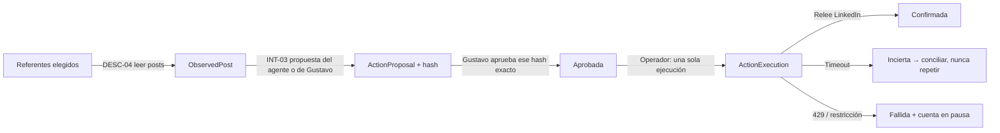

# Operador de cuenta — primer recorrido con manos y ojos

Fecha: 2026-11-06. Estado: **implementado y probado con conector simulado**. La conexión real espera la cuenta de Unipile de Gustavo. Implementa el primer corte vertical del [catálogo de acciones](catalogo-acciones-linkedin.md) con las herramientas elegidas en [herramientas v2](herramientas-linkedin-v2.md).

## Qué hace



| Capacidad | Implementado |
| --- | --- |
| DESC-04 | Leer los posts recientes de referentes con Unipile, sin duplicados. |
| INT-03 | Comentar: el agente de relaciones redacta con Claude a partir de las unidades B04/B06/B15 del curso; también admite texto de Gustavo. |
| INT-02 | Reaccionar con los tipos admitidos por Unipile. |
| ADM-04 | Pausa por cuenta, pausa global, topes diarios y detención ante 401/403/429 o una cuenta no `running`. |
| ADM-05 | Conciliación por lectura y resolución humana de incertidumbres. |

Autoridad: nivel B de la política propuesta. Gustavo aprueba una versión concreta, identificada por el hash de cuenta + capacidad + post + contenido, y el operador la ejecuta automáticamente. Editar el texto crea una versión nueva y anula la aprobación anterior. Un token de servicio puede observar y proponer, pero no aprobar, pausar ni resolver: esas decisiones exigen sesión humana.

## Salvaguardas

- **Una sola ejecución.** `ActionExecution` es `OneToOne` con la propuesta y tiene clave de idempotencia; el trabajo de ejecución tiene un id determinista.
- **Una acción abierta por post y capacidad.** Lo impone una restricción en la base de datos.
- **Sin duplicados.** Antes de comentar se busca un comentario propio idéntico en el hilo; si existe, se confirma sin escribir otro.
- **Sin reintentos a ciegas.** Unipile v2 no documenta claves de idempotencia. Un timeout, un 5xx o una respuesta ilegible tras escribir dejan la acción en `uncertain`, y la conciliación solo lee.
- **Paradas.** `OPERATOR_PAUSED=true` detiene todas las escrituras; `ConnectorAccount.paused` detiene una cuenta. Los topes diarios (`OPERATOR_DAILY_LIMITS`, por defecto prudente `INT-03=3,INT-02=10`) también. Un 429, una reautenticación o una restricción pausan la cuenta hasta que Gustavo la reanude.
- **El conector real está apagado por defecto.** Requiere `LIVE_LINKEDIN=true` y `UNIPILE_API_KEY`. El simulado requiere `OPERATOR_ALLOW_FAKE=true`.
- **Coste.** El agente consulta Claude con el SDK oficial, en streaming, con salida JSON con esquema y sin reintentos automáticos. Antes de generar reserva el peor caso en el registro de gasto. Un post con una acción abierta o ya comentada no dispara otra generación.

## Activación real (pasos para Gustavo)

1. Crear la cuenta en Unipile, conectar LinkedIn (credenciales y 2FA) y anotar el `account_id` (`acc_…`) y una API key limitada a esa cuenta.
2. En el `.env` privado del runtime, añadir `UNIPILE_API_KEY=…`, `LIVE_LINKEDIN=true` y revisar `OPERATOR_DAILY_LIMITS`. Para que el agente redacte se necesitan `LIVE_PROVIDERS=true` y saldo en `ANTHROPIC_LIMIT_USD`: el techo actual de USD 1 es acumulado y cada propuesta con `claude-opus-5-5` reserva unos USD 0,2.
3. Desplegar este código: aplicar la migración `0003_operador` y reiniciar api y worker.
4. Primer uso:
   ```
   python manage.py operador --usuario gustavo cuenta --account-id acc_… --etiqueta "LinkedIn Gustavo"
   python manage.py operador --usuario gustavo comprobar --cuenta <uuid>
   python manage.py operador --usuario gustavo referente --cuenta <uuid> --perfil https://www.linkedin.com/in/… --motivo "…"
   python manage.py operador --usuario gustavo observar --cuenta <uuid>
   ```
5. Pedir una propuesta: `POST /api/v1/operador/posts/<id>/propose-comment`. Revisarla y aprobarla en `/admin/` (Propuestas de acción → «Aprobar») o por la API con sesión. El worker la ejecuta y confirma.
6. Prueba de aceptación: un comentario aprobado aparece una vez en LinkedIn, con `external_id`, estado `confirmed` y eventos de auditoría.

## API (`/api/v1/operador/…`)

| Ruta | Uso |
| --- | --- |
| `accounts` | GET y POST. |
| `accounts/<id>/check` | Comprueba la cuenta. |
| `accounts/<id>/pause` | Pausa o reanuda la cuenta (sesión humana). |
| `referents` | GET y POST. |
| `observe` | Encola una observación (202). |
| `posts` | GET. |
| `posts/<id>/propose-comment` | Encola una propuesta del agente (202). |
| `actions` | GET y POST (propuesta escrita por Gustavo). |
| `actions/<id>` | Detalle. |
| `actions/<id>/revise` | Crea una versión nueva. |
| `actions/<id>/approve` | Aprueba (sesión humana; requiere `expected_hash`). |
| `actions/<id>/reject` | Rechaza (sesión humana). |
| `actions/<id>/execute` | Vuelve a pedir el mismo trabajo de ejecución; es idempotente. |
| `actions/<id>/reconcile` | Concilia por lectura. |
| `actions/<id>/resolve` | Resuelve una incertidumbre (sesión humana). |

Permisos nuevos: `operate_linkedin`, `approve_actions` y `execute_actions`. El rol `operacion` recibe el primero y `revision` los tres.

## Decisiones técnicas

- **Proveedor de Claude.** `knowledge.providers.claude` pasa al SDK oficial `anthropic`. Usa streaming con timeouts separados (conexión 10 s, lectura 90 s por evento), guarda el `request-id` de cada llamada en el registro de gasto y aplica caché al prompt de sistema. Así se corrige la causa probable del ReadTimeout anterior, que esperaba la respuesta completa sin streaming con un límite de 120 s.
- **Modelos.** Por defecto `claude-opus-5-5`, y se puede configurar con `ANTHROPIC_MODEL`. Hay tarifas verificadas para opus-5-5, sonnet-5-5, haiku-5-5 y sonnet-4-6. El runtime conserva el valor de su `.env` hasta que Gustavo lo cambie.
- **Rechazos.** No se activó el `fallbacks` de servidor. Si Claude rechaza una petición, la propuesta falla y no se publica nada. Se dejó así para no tarifar en el registro de gasto una llamada servida por otro modelo.
- **Contexto personal.** Solo se usa la memoria confirmada. Mientras esté vacía, el agente aporta perspectiva o preguntas y no vivencias de Gustavo.

## Pendiente

- Pantalla de aprobación en la oficina publicada (operaciones nuevas del puente).
- Publicación propia con la API oficial (CONT-08/09).
- Invitaciones (RED), inbox (CHAT) y edición de perfil (PERF) con el mismo patrón de propuesta, aprobación, ejecución y confirmación.
- Programador periódico para la observación.
- Unificar el runtime con este repositorio, para que Docker construya desde `barrio-ai`.
- Prueba real con la cuenta de Unipile.
