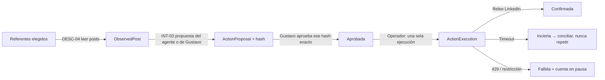

# Operador de cuenta — primer recorrido con manos y ojos

Fecha: 2026-11-06. Estado: **implementado y probado con conector simulado**. La conexión real espera la cuenta de Unipile de Gustavo. Implementa el primer corte vertical del [catálogo de acciones](catalogo-acciones-linkedin.md) con las herramientas elegidas en [herramientas v2](herramientas-linkedin-v2.md).

## Qué hace



| Capacidad | Implementado |
| --- | --- |
| DESC-04 | Leer los posts recientes de referentes con Unipile, sin duplicados. |
| INT-03 | Comentar: el agente de relaciones redacta con Claude a partir de las unidades B04/B06/B15 del curso; también admite texto de Gustavo. |
| INT-02 | Reaccionar con los tipos admitidos por Unipile. |
| ADM-04 | Pausa por cuenta, pausa global, topes diarios y detención ante 401/403/429 o una cuenta no `running`. |
| ADM-05 | Conciliación por lectura y resolución humana de incertidumbres. |

## Máquina autónoma (decisión de Gustavo, 2026-11-06)

«Todo debe funcionar como una máquina autónoma.» Gustavo deja de estar *en* el bucle y pasa a estar *sobre* él: puede pausar, rechazar, resolver y configurar en cualquier momento, pero las acciones no esperan su clic.

El servicio `autopilot` (`python manage.py autopiloto`) ejecuta un ciclo cada 60 s cuando `OPERATOR_AUTOPILOT=true`. Solo encola trabajo; el worker es quien llama a los proveedores. En cada ciclo:

1. **Caduca** las propuestas no ejecutadas tras `OPERATOR_PROPOSAL_TTL_HOURS` (48).
2. **Revisa con la política `autonomia-v1`** cada propuesta pendiente. Una compuerta automática sustituye la aprobación humana por pieza y descarta el texto que:
   - tiene menos de 40 o más de 900 caracteres;
   - contiene pitch o pide contacto (incluida la mención a ProjectApp), enlaces, correos, teléfonos o hashtags;
   - incluye afirmaciones que el agente marcó como pendientes de evidencia;
   - es un borrador del agente sin una unidad del curso citada.

   Lo que pasa la compuerta queda aprobado con su hash, sin `decided_by`. Con el agente líder activo, Jev juzga además cada propuesta ([rediseño](rediseno-backend.md#agente-líder-liderpy)), como máximo `LEAD_MAX_REVIEWS_PER_TICK` (5) por ciclo y empezando por las más antiguas.
3. **Observa** a los referentes cada `OPERATOR_OBSERVE_EVERY_MINUTES` (180).
4. **Redacta**, de uno en uno, sobre el post más reciente de un referente activo:
   - el post tiene menos de `OPERATOR_MAX_POST_AGE_HOURS` (72) y no es un repost;
   - todavía no se le preparó ningún comentario;
   - queda cupo de comentarios en la cuenta;
   - no se superan `OPERATOR_DAILY_PROPOSALS` (6) en el día y queda presupuesto de IA del equipo (`AI_MONTHLY_LIMIT_USD` al mes y el tope de seguridad diario `AI_DAILY_FUSE_USD`; los comentarios no tienen tope propio);
   - con el agente líder activo, Jev confirma antes que el post merece un comentario de Gustavo: tiene sustancia, es de su barrio y no es una vacante, una promoción pura ni un hito personal. Si no, se prueba el siguiente post, y el veredicto se recuerda (prefiltro de comentarios, en el [rediseño](rediseno-backend.md#agente-líder-liderpy)).

   El redactor recibe las instrucciones, la voz y las 6 unidades del curso como bloques de `system` cacheados, y el post con su contexto en el mensaje. Así, los borradores seguidos leen las unidades a precio de caché. Si el borrador solo incumple una regla fija de la compuerta (hashtag, enlace, longitud, pitch, afirmación sin evidencia, falta de cita, filtración), se pide **una** reescritura que nombra cada regla incumplida, dentro del mismo presupuesto de IA y solo en modo `auto`. La propuesta lo anota en sus riesgos. Si la reescritura vuelve a fallar, la compuerta la descarta como antes.
5. **Ejecuta** una acción aprobada por ciclo, solo si se cumplen la ventana `OPERATOR_WINDOW` (07:00–21:00, `OPERATOR_TIMEZONE` America/Bogota), el espaciado fijo `OPERATOR_MIN_SPACING_SECONDS` (1200) y los topes diarios y semanales de tu zona horaria. Los valores por defecto son INT-03 3/12 e INT-02 15/60, como en el reparto v1. El espaciado es fijo: no se aleatoriza para imitar a una persona.
6. **Concilia** por lectura los envíos inciertos o pendientes de confirmar.

Cuando una cuenta se pausa (429, restricción, reautenticación o estado distinto de `running`), se envía una alerta al webhook `OPERATOR_ALERT_WEBHOOK` (ntfy o compatible con Slack). Solo Gustavo la reanuda.

`OPERATOR_AUTONOMY` permite volver a la aprobación humana (`approval`) o apagar (`off`) una capacidad. La aprobación manual desde `/admin/` o la API sigue disponible: un token de servicio puede observar y proponer, pero no aprobar, pausar ni resolver. Cada versión aprobada se identifica por el hash de cuenta + capacidad + post + contenido; editar el texto crea una versión nueva.

## Salvaguardas

- **Una sola ejecución.** `ActionExecution` es `OneToOne` con la propuesta y tiene clave de idempotencia; el trabajo de ejecución tiene un id determinista.
- **Una acción abierta por post y capacidad.** Lo impone una restricción en la base de datos.
- **Sin duplicados.** Antes de comentar se busca un comentario propio idéntico en el hilo; si existe, se confirma sin escribir otro.
- **Sin reintentos a ciegas.** Unipile v2 no documenta claves de idempotencia. Un timeout, un 5xx o una respuesta ilegible tras escribir dejan la acción en `uncertain`, y la conciliación solo lee.
- **Paradas.** `OPERATOR_PAUSED=true` detiene todo, incluido el ciclo autónomo. `ConnectorAccount.paused` detiene una cuenta. También frenan la ejecución la ventana horaria, el espaciado y los topes diarios y semanales. Un 429, una reautenticación o una restricción pausan la cuenta y envían una alerta; solo Gustavo la reanuda. Con el conector `directo`, una parada del servicio navegador (cuenta detenida, 409; sin sesión, 423) pausa igual, y el motivo dice qué hacer en el servicio antes de reanudar. La alerta sale una vez por pausa: los trabajos en cola que chocan con la misma parada solo actualizan el motivo.
- **Prueba diaria (`directo`).** El trabajo `check_linkedin` comprueba una vez al día que las 14 lecturas del conector siguen trayendo sus campos (`canario.py`; detalle en el [plan](../../../docs/plan-linkedin-directo.md)). Una lectura rota no pausa nada: avisa en Notificaciones (`linkedin_canary`) y otra vez cuando vuelve a pasar. Si en la prueba el servicio paró la cuenta, la pausa como cualquier otra lectura.
- **Lo que no salió, espera.** Si el servicio navegador del conector `directo` no deja salir una escritura por algo suyo y no de la cuenta (su tope agotado, `budget`; no enviada, `not_sent`: navegador ocupado o sin abrir, el servicio caído; u otra salida a internet, `egress`), no cuenta como ejecutada ni como fallida, no pausa nada y no la leen las reglas de límite de la red: la ejecución se deshace, la propuesta vuelve a `approved` y su capacidad espera hasta `retry_at` (lo que diga el servicio, o 30 min), en un evento `operator.write_deferred`. El autopiloto y `execute` no la intentan antes. Las lecturas hacen lo mismo a su manera: la vuelta se corta y lo que faltaba se lee en la siguiente (la clasificación deja a la persona sin revisar en vez de juzgarla a ciegas; la captura de métricas se guarda igual, con quién comentó en `null`). Cualquier otro error (un 5xx, no encontrado, el `not_sent` de Unipile) y cualquier otro proveedor siguen como antes (`connectors.deferred`). El post propio (CONT-09) no entra aquí: va por la API oficial. La otra salida a internet es lo único de esa lista que no se arregla solo: avisa una vez en Notificaciones (`navegador_salida`) con qué hacer en el servidor, sin pausar la cuenta (nada llegó a LinkedIn, y una pausa frenaría también las escrituras de las demás cuentas).
- **El conector real está apagado por defecto.** Requiere `LIVE_LINKEDIN=true` y `UNIPILE_API_KEY`. El simulado requiere `OPERATOR_ALLOW_FAKE=true`. El conector `directo` (LinkedIn sin Unipile, por el servicio navegador) requiere `LIVE_LINKEDIN_DIRECTO=true`, `NAVEGADOR_URL` y `NAVEGADOR_TOKEN`; su contrato está en [navegador-contrato.md](navegador-contrato.md).
- **Un comentario por persona a la vez.** Nunca se comenta a un mismo referente más de una vez dentro de `OPERATOR_AUTHOR_COOLDOWN_HOURS` (48 h por defecto). El redactor salta sus posts mientras tenga un comentario abierto o reciente, y la compuerta descarta un segundo comentario si el primero ya está aprobado o publicado.
- **Idioma.** Decisión de Gustavo (12/11/2026): el comentario va en español si la publicación o su conversación están en español; si no, en inglés. Es una regla fija (`idioma.py`, por palabras frecuentes): un comentario del agente en inglés sobre una publicación en español se reescribe una vez y, si sigue igual, se descarta. Español sobre un post en inglés se acepta, porque puede venir de la conversación, que solo ve el redactor. Las respuestas en posts propios van en el idioma de quien comentó. Jev ya no juzga el idioma: puntuaba 0,04 un comentario en inglés sobre un post en inglés.
- **Afirmaciones por verificar.** El redactor marca solo hechos presentados como ciertos sin respaldo en sus hechos públicos ni en la publicación. Las opiniones, las preguntas y las cifras del post atribuidas a su autor no cuentan: antes descartaban 4 de cada 12 comentarios buenos (medición en sombra del 12/11/2026).
- **Sin repetir anécdotas.** El redactor recibe los últimos 8 comentarios públicos de Gustavo (`recent_own_comments`) y no repite una experiencia propia que ya contó, menos aún al mismo autor.
- **Voz.** El redactor de comentarios escribe con el documento «Tono de voz» de Gustavo (`voz.py`; detalle en [publicación diaria](publicacion-diaria.md)). La compuerta descarta además cualquier experiencia en primera persona, en inglés o en español, que no esté respaldada por un hecho público confirmado.
- **Coste.** El agente consulta Claude con el SDK oficial, en streaming, con salida JSON con esquema y sin reintentos automáticos. Antes de generar reserva el peor caso en el registro de gasto. Un post con una acción abierta o ya comentada no dispara otra generación. La única segunda llamada es la reescritura por una regla fija, una vez por borrador y dentro del presupuesto de IA del equipo (`knowledge/presupuesto.py`).

## Activación real (pasos para Gustavo)

1. Crear la cuenta en Unipile, conectar LinkedIn (credenciales y 2FA) y anotar el `account_id` (`acc_…`) y una API key limitada a esa cuenta.
2. En el `.env` privado del runtime, añadir `UNIPILE_API_KEY=…`, `LIVE_LINKEDIN=true`, `OPERATOR_AUTOPILOT=true` y `OPERATOR_ALERT_WEBHOOK=…` (por ejemplo, un tema de ntfy en el móvil), y revisar las variables `OPERATOR_*` de `.env.example`. Para que el agente redacte se necesitan `LIVE_PROVIDERS=true` y saldo en el presupuesto de IA del equipo (`AI_MONTHLY_LIMIT_USD`, 100 USD al mes, y `AI_DAILY_FUSE_USD`, 15 USD al día); `ANTHROPIC_LIMIT_USD` es opcional y, si se fija, añade un techo mensual a Anthropic. Cada propuesta con `claude-opus-5-5` reserva unos USD 0,2.
3. Desplegar este código: aplicar la migración `0003_operador` y reiniciar api y worker.
4. Primer uso:
   ```
   python manage.py operador --usuario gustavo cuenta --account-id acc_… --etiqueta "LinkedIn Gustavo"
   python manage.py operador --usuario gustavo comprobar --cuenta <uuid>
   python manage.py operador --usuario gustavo referente --cuenta <uuid> --perfil https://www.linkedin.com/in/… --motivo "…"
   python manage.py operador --usuario gustavo observar --cuenta <uuid>
   ```
5. Arrancar el servicio `autopilot` de Docker Compose. A partir de ahí el ciclo observa, redacta, aprueba por política, ejecuta y concilia solo. Lo que hace queda en `/admin/` (Propuestas de acción, Auditoría) y se puede rechazar desde allí.
6. Prueba de aceptación: un comentario aprobado por la política aparece una vez en LinkedIn, con `external_id`, estado `confirmed` y eventos de auditoría.

## API (`/api/v1/operador/…`)

| Ruta | Uso |
| --- | --- |
| `accounts` | GET y POST. |
| `accounts/<id>/check` | Comprueba la cuenta. |
| `accounts/<id>/pause` | Pausa o reanuda la cuenta (sesión humana). |
| `referents` | GET y POST. |
| `observe` | Encola una observación (202). |
| `posts` | GET. |
| `posts/<id>/propose-comment` | Encola una propuesta del agente (202). |
| `actions` | GET y POST (propuesta escrita por Gustavo). |
| `actions/<id>` | Detalle. |
| `actions/<id>/revise` | Crea una versión nueva. |
| `actions/<id>/approve` | Aprueba (sesión humana; requiere `expected_hash`). |
| `actions/<id>/reject` | Rechaza (sesión humana). |
| `actions/<id>/execute` | Vuelve a pedir el mismo trabajo de ejecución; es idempotente. |
| `actions/<id>/reconcile` | Concilia por lectura. |
| `actions/<id>/resolve` | Resuelve una incertidumbre (sesión humana). |

Permisos nuevos: `operate_linkedin`, `approve_actions` y `execute_actions`. El rol `operacion` recibe el primero y `revision` los tres.

## Decisiones técnicas

- **Proveedor de Claude.** `knowledge.providers.claude` pasa al SDK oficial `anthropic`. Usa streaming con timeouts separados (conexión 10 s, lectura 90 s por evento), guarda el `request-id` de cada llamada en el registro de gasto y aplica caché al prompt de sistema. Así se corrige la causa probable del ReadTimeout anterior, que esperaba la respuesta completa sin streaming con un límite de 120 s. Quien llama puede añadir contexto estable (`context=`, por ejemplo las unidades del curso) como bloques de `system` cacheados detrás de las instrucciones. El cliente se crea una vez por clave y se reutiliza.
- **Modelos.** Por defecto `claude-opus-5-5`, y se puede configurar con `ANTHROPIC_MODEL`. Hay tarifas verificadas para opus-5-5, sonnet-5-5, haiku-5-5 y sonnet-4-6. El runtime conserva el valor de su `.env` hasta que Gustavo lo cambie.
- **Rechazos.** No se activó el `fallbacks` de servidor. Si Claude rechaza una petición, la propuesta falla y no se publica nada. Se dejó así para no tarifar en el registro de gasto una llamada servida por otro modelo.
- **Contexto personal.** Solo se usa la memoria confirmada. Mientras esté vacía, el agente aporta perspectiva o preguntas y no vivencias de Gustavo.

## Pendiente

- Pantalla de supervisión en la oficina publicada (operaciones nuevas del puente).
- Revisión por modelo (editor_verificador) como segunda compuerta de la política autónoma; hoy la compuerta es determinista.
- Programación nativa y edición o retirada de publicaciones propias (CONT-08/10/11). La publicación diaria (CONT-01..07 y CONT-09) ya está implementada: ver [publicación diaria](publicacion-diaria.md).
- Inbox (CHAT) y edición de perfil (PERF) con el mismo patrón de propuesta, aprobación, ejecución y confirmación. La red (DESC-02/03/05/07, RED-01/02/03/04/09) ya está implementada: ver [red del barrio](red-barrio.md).
- Programador periódico para la observación.
- Unificar el runtime con este repositorio, para que Docker construya desde `barrio-ai`.
- Prueba real con la cuenta de Unipile.
