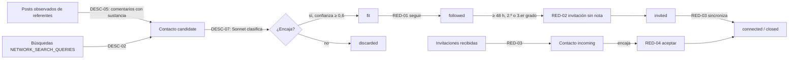

# Red del barrio: descubrir, clasificar y conectar

Este bloque implementa estas capacidades del [catálogo de acciones](catalogo-acciones-linkedin.md) con el reparto v1.1 ([reparto](reparto-acciones-v1.md), sección «Invitaciones sin Premium»):
- descubrimiento: DESC-02, DESC-03, DESC-05 y DESC-07;
- relaciones: RED-01, RED-02, RED-03, RED-04 y RED-09.

El código vive en `src/team_backend/red.py`; la API, en `red_views.py`.

## Recorrido

1. **Descubrir** (`discover_network`, cada `NETWORK_DISCOVER_EVERY_MINUTES`, por defecto 360).
   - **De los comentarios de los referentes.** Lee una sola vez los comentarios de los posts recientes de los referentes: hasta `NETWORK_POSTS_PER_RUN` posts de los últimos `NETWORK_SCAN_DAYS` días. Convierte en candidatos a quienes comentaron con sustancia, es decir, con al menos `NETWORK_MIN_COMMENT_CHARS` caracteres (por defecto 80). Si hay búsquedas configuradas, los comentaristas ocupan como mucho dos tercios del cupo del turno, para que la búsqueda siempre tenga espacio. Quedan fuera los saludos, las cuentas de empresa, los referentes, Gustavo y quien ya es contacto.
   - **De una búsqueda.** Ejecuta además una búsqueda de `NETWORK_SEARCH_QUERIES` por turno, rotando entre ellas, y omite las conexiones de primer grado.
   - **Evidencia.** Cada contacto guarda de dónde salió: el post, el referente y su comentario, o la consulta de búsqueda.
2. **Clasificar** (`classify_contacts`). Una llamada con `NETWORK_CLASSIFIER_MODEL` (por defecto `claude-sonnet-5-5`) clasifica hasta 10 personas.
   - **Perfil antes de clasificar.** Unipile v2 entrega a quien comenta sin titular: solo nombre e id. Sin titular, el clasificador descartaba a gente valiosa. Por eso, antes de clasificar a alguien sin titular, se lee su perfil (DESC-03), lo que gasta una lectura del cupo `profile`. Quien no puede leerse hoy espera a mañana en lugar de juzgarse a ciegas.
   - **Criterio.** Usa los criterios de barrio por modalidad y la orientación privada del brief. La afinidad hispanohablante se toma solo de lo declarado, nunca del nombre ni de la apariencia.
   - **Resultado.** Una persona encaja si el modelo dice que sí con confianza de al menos `NETWORK_MIN_CONFIDENCE`. Si no, queda `discarded`.
   - **Presupuesto propio.** El gasto va contra `NETWORK_DAILY_LLM_USD` (por defecto 0,3 USD) con `purpose='network-classify'`.
3. **Planear** (`plan_network`, cada hora). Convierte a los contactos en propuestas, siempre dentro del cupo de cada capacidad y descontando las propuestas que ya están abiertas.
   - **Antes de cada propuesta se relee el perfil** (DESC-03, sin notificar la visita). Si ya hay conexión, invitación pendiente, invitación previa ignorada o retirada, o restricción, la persona cambia de etapa y no se propone nada.
   - **RED-01 seguir:** a las personas en `fit`.
   - **RED-02 invitar sin nota:** a las personas en `followed` cuando han pasado `NETWORK_INVITE_AFTER_HOURS` (48) y siguen en 2.º o 3.er grado.
   - **RED-04 aceptar:** las invitaciones recibidas de personas que encajan.
4. **Sincronizar** (`sync_network`, cada `NETWORK_SYNC_EVERY_MINUTES`). Lee las invitaciones enviadas y las recibidas.
   - **Invitaciones recibidas:** registran a la persona como `incoming`, pendiente de clasificar.
   - **Invitaciones enviadas que ya no aparecen:** se releen. Pasan a `connected` si hay conexión y a `closed` si no.
5. **Ejecutar.** Pasa por `operador.execute()` con todas las salvaguardas de siempre: parada total, pausa, ventana, espaciado común, topes y una sola ejecución. Cada escritura sigue el mismo esquema:
   - **Comprobación previa:** nunca se sigue dos veces ni se reinvita.
   - **Escritura:** una sola llamada.
   - **Confirmación por relectura del perfil.** Si el resultado es incierto, se concilia leyendo y nunca se repite.

## Lo que nunca hace

- Enviar notas en las invitaciones. La cuenta gratuita tiene unas 5 notas al mes y RED-02 valida que el `payload` sea solo `user_id`.
- Mandar mensajes cuando alguien acepta.
- Reinvitar tras una invitación ignorada o retirada.
- Declinar invitaciones: las que no encajan quedan pendientes.
- Retirar invitaciones, dejar de seguir o eliminar conexiones (RED-05, RED-06, RED-07 y RED-08 siguen pendientes).

## Autonomía y vetos

- **Aprobación por defecto.** `autopiloto.autonomy()` deja en `auto` por defecto solo las capacidades que ya existían cuando Gustavo decidió la máquina autónoma (INT-03, INT-02 y CONT-09). RED-01, RED-02 y RED-04 esperan su aprobación hasta que `OPERATOR_AUTONOMY` los ponga en `auto`.
- **Compuerta en modo `auto`** (`red.network_issues`). Descarta la propuesta cuando:
  - la persona ya no está en curso;
  - la clasificación no confirma que encaja;
  - el destinatario no coincide;
  - la invitación lleva algo más que `user_id`;
  - las invitaciones están en pausa por límite.
- **Pausa por límite.** Si LinkedIn rechaza una invitación por límite (429, o un error cuyo tipo o nota menciona *limit*, *quota*, *throttle* o *exceed*), las invitaciones se detienen 7 días (`red.invites_blocked`).
- **Vetos de Gustavo.**
  - **Rechazar una acción de red** deja a la persona en `discarded`: nunca se vuelve a proponer.
  - **«Descartar» en la oficina** (`POST /api/v1/red/contacts/<id>/discard`, con nota obligatoria) hace lo mismo y rechaza su acción abierta.

## Topes

| Capacidad | Día | Semana | Configuración |
| --- | --- | --- | --- |
| RED-01 seguir | 10 | 40 | `OPERATOR_DAILY_LIMITS` / `OPERATOR_WEEKLY_LIMITS` |
| RED-02 invitar sin nota | 5 | 20 | idem; LinkedIn permite unas 150 a la semana en cuenta gratuita, así que el tope queda muy por debajo |
| RED-04 aceptar | 10 | 40 | idem |
| Lecturas de comentarios | 60 | — | `NETWORK_READ_CAPS` (`comments`) |
| Búsquedas | 20 | — | `NETWORK_READ_CAPS` (`search`) |
| Perfiles | 30 | — | `NETWORK_READ_CAPS` (`profile`) |
| Sincronizaciones | 4 | — | `NETWORK_READ_CAPS` (`sync`) |

Cada lectura se cuenta antes de hacerse, como evento `network.read` en la auditoría. Al agotar un cupo, el trabajo se detiene y lo dice en su error. Las escrituras de red comparten el espaciado mínimo con los comentarios y la publicación, porque todas actúan como el mismo miembro.

## Memoria de la relación (RED-09)

`Contact` guarda:
- la identidad (`provider_user_id`, nombre, titular, URL y ubicación);
- el origen y su evidencia;
- la distancia de red y si Gustavo la sigue;
- la invitación pendiente;
- la clasificación;
- la etapa, con la fecha de cada paso;
- un historial de los últimos 30 eventos.

## API

Ver `oficina/CONTRATO-API.md`, sección Red. Endpoints:
- `GET /api/v1/red/contacts?stage=&source=&account=`;
- `GET /api/v1/red/contacts/<id>`;
- `POST /api/v1/red/contacts/<id>/discard`;
- `GET /api/v1/red/summary`.

Las acciones RED-* aparecen en `/api/v1/operador/actions` con `contact` en lugar de `post`.

## Contrato de Unipile (v2, consultado el 2026-11-07)

| Uso | Llamada |
| --- | --- |
| Perfil | `GET /v2/{account}/users/{id}`. El titular llega en `description`, el grado en `specifics.network_distance` y la invitación en `specifics.relation_request(_status)`. |
| Búsqueda | `POST /v2/{account}/linkedin/search/people` con `{"keywords"}` |
| Seguir | `POST /v2/{account}/users/me/follow/{id}` |
| Invitar | `POST /v2/{account}/users/me/relation-requests` con `{"user_id"}` |
| Listar invitaciones | `GET /v2/{account}/users/me/relation-requests?type=sent\|received` |
| Aceptar | `POST /v2/{account}/users/me/relation-requests/{request_id}/accept` |

Las formas de perfil e invitaciones se comprobaron con lecturas reales de la cuenta el 2026-11-07. Unipile recomienda no encadenar invitaciones, y por eso se aplica el espaciado común.

## Pendiente

- RED-05 (declinar), RED-06 (retirar invitaciones antiguas), RED-07 (dejar de seguir) y RED-08 (eliminar, con política estricta).
- Notas en invitaciones de alto valor, dentro del cupo mensual.
- Aportar en un hilo de la persona antes de invitarla. La secuencia completa del reparto incluye ese paso; hoy el calentamiento es seguir y esperar.
- DESC-01 (Top Voices) y DESC-08 (mapa de conversaciones).
