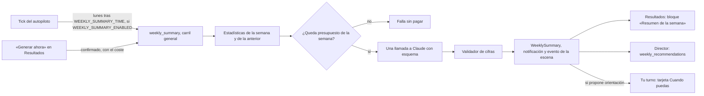

# Resumen semanal de resultados

Cada lunes, el rol `analista_barrio_resultados` escribe para Gustavo el resumen de la semana que terminó: qué funcionó, qué no y qué cambiar, cada cosa atada a una cifra. Cuando los datos respaldan un cambio de rumbo, propone una orientación que Gustavo puede adoptar con un toque. Es la pieza que faltaba de la línea «Resultados de las piezas en el historial del director» de la fase 3 de la [auditoría](auditoria-arquitectura-ia.md). Hasta ahora el rol solo recogía métricas.

El código vive en `src/team_backend/resumen_semanal.py`. La tarjeta de Tu turno se arma en `rediseno_views.py`, la API está en `resultados_views.py` y el bloque de la oficina en `oficina/src/pages/resultados/ResumenSemanal.tsx`.

## Límites

- **Solo Gustavo cambia la orientación.** El resumen propone, y «Usar como orientación» es una decisión suya, deshacible durante 5 s. El director lee las recomendaciones como una pista más, nunca como orientación.
- **Las cifras salen de la base, no del modelo.** Las estadísticas son deterministas. El modelo no calcula nada: las diferencias y variaciones con la semana anterior ya le llegan hechas. Un validador quita cualquier frase que cite un número que no esté en las estadísticas.
- **Un dato que falta es `null`, nunca 0.** Una fuente que no corrió en la semana (la red, el inbox, la máquina) llega como `{disponible: false, motivo}`. Los ceros que sí son ceros, como capturas que Gustavo no envió o gasto sin llamadas, se cuentan como 0.
- **El texto de terceros son datos.** Las primeras líneas y tesis de las piezas y los comentarios de Gustavo van como datos, y el prompt lo dice. No entran nombres de personas ni mensajes del inbox, solo conteos.
- **Un resumen por semana.** `WeeklySummary.week_start` es único, y un resumen guardado nunca se vuelve a pagar.

## Recorrido



1. **Programar.** El tick encola `weekly_summary` cuando ya pasó la hora `WEEKLY_SUMMARY_TIME` (07:30 por defecto, hora de `OPERATOR_TIMEZONE`) del lunes de la semana en curso, para la semana ISO anterior (de lunes a domingo).
   - El id del trabajo es determinista por semana, así que hay un solo intento automático. Si la máquina estuvo parada el lunes, el tick lo encola en cuanto vuelva, dentro de esa misma semana.
   - No encola si ya hay resumen de esa semana o hay otro trabajo en curso, si se gastó el presupuesto de la semana o si la máquina no funcionó en la semana a resumir: no se paga por una semana vacía.
   - Con la parada total (`OPERATOR_PAUSED` o la oficina) el tick no corre, como todo lo demás.
   - Corre en el carril general (`worker`), nunca en el de acciones.
2. **Medir.** `stats(semana)` calcula las cifras de la semana y de la anterior con la misma función, más una tabla de comparación y los avisos de datos (ver abajo).
3. **Comprobar el presupuesto.** Si lo gastado con el propósito `weekly-summary` en la semana ISO local llega a `WEEKLY_SUMMARY_LLM_USD`, el trabajo falla sin llamar a Claude.
4. **Analizar.** Hace una sola llamada a Claude (ver abajo).
5. **Validar.** El validador limpia el análisis.
6. **Guardar y avisar.** Se guarda el `WeeklySummary` (estado `nuevo`, con las cifras, el análisis, el uso y el coste) y después:
   - se envía la Notificación `weekly_summary`;
   - se emite el evento `entrega` del analista al director en la escena;
   - se registra `weekly_summary.created` en la auditoría.

Si el intento automático falla, por presupuesto o porque el modelo no respondió bien, no se repite solo. Resultados lo dice («El último intento no terminó») y ofrece «Generar ahora».

## Las cifras

Todo va por semana local, del lunes a las 00:00 al lunes siguiente a las 00:00 (`OPERATOR_TIMEZONE`). Cada sección es `{disponible: true, …}` o `{disponible: false, motivo}`.

| Sección | Qué cuenta | Sin dato cuando |
| --- | --- | --- |
| `publicaciones` | Posts publicados (CONT-09 `confirmed` o `sent`) y piezas por estado. Por post: fecha, pilar, modalidad, tesis, primera línea y los cortes de 72 h y 7 d. Por corte: medidos, pendientes, medianas de impresiones y de interacción y comentarios con sustancia | La máquina no funcionó y no hubo piezas |
| `comentarios` | Borradores de INT-03 y su destino (publicado, vetado por Gustavo, descartado por el líder o por la política, saltado por el redactor, caducado, fallido o pendiente), los publicados, las decisiones del líder y los posts que el prefiltro saltó | La máquina no funcionó |
| `red` | Descubiertos, clasificados y los que encajan, seguidos, invitados, conectados (y los que encajan), invitaciones recibidas y la aceptación: invitaciones resueltas en la semana que acabaron en conexión | La red no registró actividad |
| `oportunidades` | Creadas por etapa y por modalidad, movidas por etapa de llegada y abiertas al cierre | Aún no había ninguna registrada |
| `conversaciones` | Lecturas del inbox, mensajes juzgados, conversaciones que le tocaron a Gustavo, cerradas (respondió o sin responder) y respondidas en LinkedIn | El inbox no se leyó (`INBOX_ENABLED` apagado) |
| `capturas` | Enviadas, por destino y por estado, comentarios sobre piezas e ideas usadas en piezas de la semana | Siempre disponible: 0 es un cero real |
| `gasto_ia` | Gasto del ledger por área (general, editorial, red, resumen semanal y otros de Anthropic) y por proveedor (Jev, AssemblyAI…), con el presupuesto general de IA en `presupuesto_usd: {mensual, tope_diario_seguridad}` | Siempre disponible |
| `lider` | Aprobadas y descartadas por capacidad y las tres preguntas que más fallan | `LEAD_ENABLED` apagado |
| `pausas_y_bloqueos` | Paradas y reanudaciones de la máquina, pausas de cuenta, piezas bloqueadas, fallidas o sin presupuesto, y ejecuciones fallidas o inciertas | Siempre disponible |
| `compuertas` | Por compuerta: entraron, paradas, pasaron tras reintento, con observaciones, tasa de parada, motivo principal y desacuerdos de Gustavo; días sin post por causa y segundo intento ([`compuertas.md`](compuertas.md)). Sin ids | La auditoría no se pudo leer |

Además:
- `comparacion`: 15 cifras clave con `semana`, `semana_anterior`, `diferencia` y `variacion_pct`, ya calculadas. La variación es `null` si falta alguno de los dos valores o si el anterior es 0.
- `avisos_de_datos`: avisos deterministas, como «Pocos datos: 2 de 3 posts con corte de 72 h» (menos de 3 medidos) o «Sin datos de red: …».
- `al_generar`: si la máquina está detenida y cuántas cuentas están en pausa cuando se genera el resumen.

Los posts del domingo aún no tienen su corte de 72 h el lunes, y casi ningún post de la semana tiene el de 7 d. Por eso la comparación se hace a 72 h, con los medidos a la vista, y la semana anterior aporta sus cortes de 7 d ya completos.

## La llamada

| | |
| --- | --- |
| Modelo · effort | `ANTHROPIC_MODEL` (Opus 5.5) · medium |
| `max_tokens` | 12.000. Opus 5.5 siempre piensa y el pensamiento cuenta aquí; el JSON es corto |
| Ledger | `anthropic`, propósito `weekly-summary` |
| Prompt | `resumen_semanal.SYSTEM`, con el esquema `SCHEMA` |
| Entrada | Las cifras; el posicionamiento (`posicionamiento.py`: versión, estado y dirección editorial); la orientación vigente; y hasta 10 comentarios de Gustavo (captura con contexto «pieza») sobre piezas de la semana o enviados en ella |
| Salida | `titular`, `lo_que_funciono[]`, `lo_que_no[]`, `recomendaciones[]` (como mucho 3 cada una, cada entrada `{texto, cifra}`), `orientacion_propuesta` (vacía salvo que los datos respalden un cambio) y `advertencias[]` |

**Presupuesto.** Tiene un tope propio y pequeño, `WEEKLY_SUMMARY_LLM_USD` (1 USD por semana ISO local), para que un fallo no se pueda repetir sin límite. Toda llamada pasa además por la reserva del ledger y por el presupuesto de IA de todo el equipo (`knowledge/presupuesto.py`: `AI_MONTHLY_LIMIT_USD` al mes y el tope de seguridad diario `AI_DAILY_FUSE_USD`), y por `ANTHROPIC_LIMIT_USD` si está fijado.

**Coste esperado.** Unos 8–12k tokens de entrada (las cifras de dos semanas ocupan la mayor parte) y 3–5k de salida, pensamiento incluido:
- unos 0,10–0,15 USD por semana, es decir, 0,45–0,65 USD al mes;
- la reserva previa ronda los 0,30–0,35 USD y se libera al liquidar;
- con el tope de 1 USD caben unos tres intentos por semana.

Antes de «Generar ahora», la oficina muestra la mediana de los resúmenes anteriores, o 0,13 USD mientras no haya ninguno, y el peor caso de la reserva (0,34 USD).

## El validador de cifras

`validate()` toma cada número del texto, por ejemplo «840», «1.840», «1,840», «3,5 %» o «0,81 USD».
- Lo lee como se escribe en español o en inglés: «1.840» puede ser 1840 o 1,84.
- Lo acepta si coincide, aunque sea redondeado, con algún número de las estadísticas. Cuentan los valores de métricas, las fracciones de cobertura, las edades de los cortes (`72h`, `7d`) y el día, el mes y el año de las fechas. Las marcas de tiempo ISO aportan solo su fecha: no sus horas, minutos, segundos, fracciones ni zona horaria. Los identificadores, versiones, huellas, estado al generar y otros metadatos descriptivos no aportan cifras; tampoco se extraen cifras de texto libre ni de claves ajenas a las edades de los cortes.

Qué hace con lo que no encaja:
- Una entrada de las listas se quita si cita un número que no está o si no cita ninguno, porque cada una debe ir atada a una cifra.
- Si el titular trae un número inventado, se sustituye por «Semana del … al …».
- La orientación propuesta y las advertencias con números inventados se quitan.
- Lo quitado queda en `analysis.validacion.descartado`, con el campo, el texto y las cifras que no aparecieron. Se añade además una advertencia: «Se quitaron N frases del análisis con cifras que no están en los datos de la semana».
- Si el modelo no dejó advertencias válidas, quedan los avisos deterministas.

Es una red de seguridad, no un juez semántico: un número correcto puesto en la frase equivocada pasa.

## Dónde se ve

- **Resultados.** El bloque «Resumen de la semana» va arriba, antes de los controles del periodo, con el ancla `#resumen`. Muestra el último resumen:
  - semana, titular, el retrato del analista, las tres listas con su dato, las advertencias, el coste y la hora;
  - si hay orientación propuesta pendiente, «Usar como orientación» (principal) y «Descartar». Cada una deja 5 s para deshacer en el aviso;
  - un resumen decidido dice cuándo se usó o se descartó;
  - «Ver semanas anteriores», plegado, con hasta 12 semanas;
  - «Generar ahora», si la semana pasada no tiene resumen ni se está preparando. Pide confirmación con el coste estimado, como «Preparar la siguiente pieza» en Calendario;
  - al mostrar un resumen nuevo, lo marca como visto.
- **Notificaciones.** Llega el tipo `weekly_summary`, «Resumen de la semana listo» (capa `tuyo`, con push por defecto), con el titular y el enlace `/resultados#resumen`.
- **Tu turno.** Solo mientras la orientación propuesta del último resumen espera la decisión (estado `nuevo` o `visto`) aparece una tarjeta `resumen`:
  - prioridad Cuando puedas, agente `analista_barrio_resultados`;
  - el texto propuesto como cuerpo;
  - «Ver el resumen» (abre Resultados dentro de la app) y «Descartar».
  Gustavo la adopta en Resultados, donde puede deshacerla.
- **Director.** El brief recibe `weekly_recommendations`, `{semana, recomendaciones[]}` o `null`: las recomendaciones del último resumen no descartado cuya semana empezó hace como mucho 3 semanas. `DIRECTOR_SYSTEM` añade una línea: son una pista más, no una orientación.
- **Escena.** El trabajo aparece en el analista («Escribiendo el resumen de la semana», `JOB_ROLES`). Al terminar, el analista entrega al director («Resumen de la semana del …»).

## Decisiones de Gustavo

| Acción | Efecto |
| --- | --- |
| Usar como orientación | `orientacion.update` (el mismo camino, permiso y auditoría que `PUT /api/v1/orientacion`) pone el texto propuesto. Guarda el anterior en `previous_orientation` y el resumen queda `aplicado` |
| Descartar | Queda `descartado`; desaparece la tarjeta y el director deja de leer sus recomendaciones |
| Deshacer | En un resumen aplicado vuelve a poner la orientación anterior, salvo que alguien la cambiara después (409: «edítala en Ajustes»). En uno descartado lo deja pendiente otra vez. Los dos vuelven a `visto` |

Las decisiones exigen sesión humana y el permiso `approve_actions`; un token de servicio solo puede leer.

## Configuración

| Variable | Por defecto | Qué hace |
| --- | --- | --- |
| `WEEKLY_SUMMARY_ENABLED` | `true` | Si el autopiloto encola el resumen. «Generar ahora» sigue disponible aunque esté apagado, porque es una decisión de Gustavo con el coste a la vista |
| `WEEKLY_SUMMARY_TIME` | `07:30` | Hora local del lunes desde la que se encola (`OPERATOR_TIMEZONE`) |
| `WEEKLY_SUMMARY_LLM_USD` | `1` | Tope de gasto del propósito `weekly-summary` por semana ISO local |

El modelo es el de `ANTHROPIC_MODEL`. Esta versión no tiene una variable propia para cambiarlo.

## Cómo confirmarlo en producción

```sql
-- Resúmenes, su estado y lo que el validador quitó
SELECT week_start, state, cost_usd, jsonb_array_length(analysis->'validacion'->'descartado') AS quitadas,
       analysis->>'orientacion_propuesta' IS NOT NULL AS propone
FROM team_backend_weeklysummary ORDER BY week_start DESC;

-- Gasto y cortes por max_tokens del resumen
SELECT date_trunc('week', created_at) AS semana, status, usage->>'stop_reason' AS stop, sum(actual_usd)
FROM usage_ledger WHERE purpose = 'weekly-summary' GROUP BY 1, 2, 3 ORDER BY 1 DESC;

-- Trabajos del resumen
SELECT params->>'week' AS semana, state, error, created_at FROM team_backend_job
WHERE kind = 'weekly_summary' ORDER BY created_at DESC;
```
