# Grafo del equipo

<!-- Generado por scripts/grafo/mermaid.py. No editar a mano. -->

Versión `3a.1` · SHA-256 `d1e911fd8c49a56e4cef612294811daa3bad2a4fc24d13708321281ef12eb419`.

39 nodos (35 activos), 42 aristas y 11 ciclos.

Inventario descriptivo del runtime actual. Las flechas de pasos y gates pertenecen al workflow determinista; no conceden permisos a los especialistas. Las respuestas vuelven al dueño del ciclo. A/B comparten una llamada, y los cinco lectores otra. Los límites son por intento/subtrigger, no nuevos contadores de ciclo.

Los trazos discontinuos están en diseño. No hay task/progress ledger ni reanudación por checkpoint todavía. Los schemas que existen como contratos Python o preguntas tipadas se identifican como tales en el registro; no se presentan como JSON Schemas ya aplicados.

## Grafo completo

```mermaid
flowchart TD
  classDef planned stroke-dasharray: 5 5,fill:#f5f5f5,color:#555;
  subgraph grupo_editorial["editorial"]
    director_editorial["Director editorial · orchestrator"]
    copywriter_a["Copywriter A · specialist"]
    copywriter_b["Copywriter B · specialist"]
    lector_comprador["Lector · comprador · specialist"]
    lector_recomendador["Lector · recomendador · specialist"]
    lector_divulgador["Lector · divulgador · specialist"]
    lector_lider["Lector · lider · specialist"]
    lector_par["Lector · par · specialist"]
    seleccion_editorial["Selección editorial · specialist"]
    reparacion_editorial["Reparación editorial · specialist"]
    editor_verificador["Verificador editorial · gate"]
    diseno_imagen["Diseño de infografía y carrusel · specialist"]
    edicion_foto["Edición de foto · specialist"]
    revision_visual["Revisión de imagen · gate"]
    editor_visual["Especialista visual · EDI-21 · En diseño · specialist"]
    class editor_visual planned;
  end
  subgraph grupo_relaciones["relaciones"]
    workflow_red["Ciclo de red · orchestrator"]
    relaciones_comunidad["Relaciones y comentarios · specialist"]
    plan_red["Plan de red · specialist"]
    sync_red["Sincronización de red · specialist"]
    workflow_inbox["Ciclo de inbox · orchestrator"]
    conversaciones_inbox["Conversaciones e inbox · specialist"]
  end
  subgraph grupo_observatorio["observatorio"]
    investigador_referentes["Observación de referentes · specialist"]
    descubrimiento_red["Descubrimiento de personas · specialist"]
    clasificador_red["Clasificación de personas · specialist"]
    metricas["Métricas · orchestrator"]
    analista_barrio_resultados["Analista · resumen semanal · orchestrator"]
    investigacion_web["Investigación web · specialist"]
    investigador_lider["Referentes mensuales · En diseño · orchestrator"]
    class investigador_lider planned;
    estudio_comunidad["Estudio de comunidad · En diseño · specialist"]
    class estudio_comunidad planned;
  end
  subgraph grupo_operacion["operacion"]
    lider_jev["Líder · Jev · gate"]
    gustavo["Gustavo · veto · gate"]
    operador_cuenta["Operador de cuenta · executor"]
    capturas["Procesamiento de capturas · orchestrator"]
    ruteador_capturas["Destino de capturas · specialist"]
    intencion_captura["Intención de captura · Jev · specialist"]
    transcripcion["Transcripción de audio · specialist"]
  end
  subgraph grupo_estrategia["estrategia"]
    posicionamiento["Posicionamiento · consulta manual · orchestrator"]
    perfil["Perfil · consulta manual · orchestrator"]
    ciclo_perfil["Ciclo periódico de perfil · En diseño · orchestrator"]
    class ciclo_perfil planned;
  end
  director_editorial -->|"brief · workflow_step · ≤2"| director_editorial
  director_editorial -->|"redactar_a · workflow_step · ≤1 · agrupada redactor"| copywriter_a
  director_editorial -->|"redactar_b · workflow_step · ≤1 · agrupada redactor"| copywriter_b
  director_editorial -->|"seleccionar · workflow_step · ≤1"| seleccion_editorial
  director_editorial -->|"reparar · workflow_step · ≤1"| reparacion_editorial
  director_editorial -->|"verificar · workflow_step · ≤2"| editor_verificador
  director_editorial -->|"investigar_pieza · workflow_step · ≤1"| investigacion_web
  director_editorial -->|"disenar · workflow_step · ≤2"| diseno_imagen
  director_editorial -->|"editar_foto · workflow_step · ≤8"| edicion_foto
  director_editorial -->|"revisar_imagen · workflow_step · ≤8"| revision_visual
  director_editorial -->|"leer_lector_comprador · workflow_step · ≤1 · agrupada lectores"| lector_comprador
  director_editorial -->|"leer_lector_recomendador · workflow_step · ≤1 · agrupada lectores"| lector_recomendador
  director_editorial -->|"leer_lector_divulgador · workflow_step · ≤1 · agrupada lectores"| lector_divulgador
  director_editorial -->|"leer_lector_lider · workflow_step · ≤1 · agrupada lectores"| lector_lider
  director_editorial -->|"leer_lector_par · workflow_step · ≤1 · agrupada lectores"| lector_par
  director_editorial -.->|"visual_futuro · workflow_step · ≤1"| editor_visual
  workflow_red -->|"observar · workflow_step · ≤1"| investigador_referentes
  workflow_red -->|"descubrir · workflow_step · ≤1"| descubrimiento_red
  workflow_red -->|"clasificar · workflow_step · ≤1"| clasificador_red
  workflow_red -->|"comentar · workflow_step · ≤2"| relaciones_comunidad
  workflow_red -->|"planificar_red · workflow_step · ≤1"| plan_red
  workflow_red -->|"sincronizar · workflow_step · ≤1"| sync_red
  workflow_red -->|"prefiltro · workflow_step · ≤3"| lider_jev
  workflow_inbox -->|"evaluar_inbox · workflow_step · ≤INBOX_ASSESS_PER_RUN=5"| conversaciones_inbox
  analista_barrio_resultados -->|"orientacion_propuesta · handoff · ≤1"| gustavo
  capturas -->|"rutear · workflow_step · ≤1"| ruteador_capturas
  capturas -->|"entender · workflow_step · ≤1"| intencion_captura
  capturas -->|"transcribir · workflow_step · ≤1"| transcripcion
  capturas -->|"investigar_captura · workflow_step · ≤1"| investigacion_web
  editor_verificador -->|"pieza_diaria_gate_0 · gate · ≤1"| lider_jev
  lider_jev -->|"pieza_diaria_gate_1 · gate · ≤1"| gustavo
  gustavo -->|"pieza_diaria_gate_2 · gate · ≤1"| operador_cuenta
  workflow_red -->|"politica_red · gate · ≤LEAD_MAX_REVIEWS_PER_TICK=5"| lider_jev
  lider_jev -->|"red_gate_0 · gate · ≤1"| gustavo
  gustavo -->|"red_gate_1 · gate · ≤1"| operador_cuenta
  relaciones_comunidad -->|"entregar_comentario · handoff · ≤1"| lider_jev
  plan_red -->|"entregar_plan · handoff · ≤1"| lider_jev
  capturas -->|"captura_editorial · handoff · ≤1"| director_editorial
  capturas -->|"captura_persona · handoff · ≤1"| relaciones_comunidad
  capturas -->|"captura_memoria · handoff · ≤1"| posicionamiento
  metricas -->|"resultados_editorial · handoff · ≤1"| director_editorial
  analista_barrio_resultados -->|"resumen_editorial · handoff · ≤1"| director_editorial
```

## Pieza diaria

Estado: `active`. Orquestador: `director_editorial`.

- `prepare_piece`: Hueco diario según EDITORIAL_POST_TIME; preparación anticipada EDITORIAL_LEAD_HOURS o manual.
- `execute_action`: Tick 60 s; solo aprobada y a su hora.
- `reconcile_action`: Inciertas/sent tras 10 min; bucket de una hora, hasta 3 por tick.

```mermaid
flowchart TD
  classDef planned stroke-dasharray: 5 5,fill:#f5f5f5,color:#555;
  subgraph grupo_editorial["editorial"]
    director_editorial["Director editorial · orchestrator"]
    copywriter_a["Copywriter A · specialist"]
    copywriter_b["Copywriter B · specialist"]
    lector_comprador["Lector · comprador · specialist"]
    lector_recomendador["Lector · recomendador · specialist"]
    lector_divulgador["Lector · divulgador · specialist"]
    lector_lider["Lector · lider · specialist"]
    lector_par["Lector · par · specialist"]
    seleccion_editorial["Selección editorial · specialist"]
    reparacion_editorial["Reparación editorial · specialist"]
    editor_verificador["Verificador editorial · gate"]
    diseno_imagen["Diseño de infografía y carrusel · specialist"]
    edicion_foto["Edición de foto · specialist"]
    revision_visual["Revisión de imagen · gate"]
    editor_visual["Especialista visual · EDI-21 · En diseño · specialist"]
    class editor_visual planned;
  end
  subgraph grupo_operacion["operacion"]
    lider_jev["Líder · Jev · gate"]
    gustavo["Gustavo · veto · gate"]
    operador_cuenta["Operador de cuenta · executor"]
  end
  subgraph grupo_observatorio["observatorio"]
    investigacion_web["Investigación web · specialist"]
  end
  director_editorial -->|"brief · workflow_step · ≤2"| director_editorial
  director_editorial -->|"redactar_a · workflow_step · ≤1 · agrupada redactor"| copywriter_a
  director_editorial -->|"redactar_b · workflow_step · ≤1 · agrupada redactor"| copywriter_b
  director_editorial -->|"seleccionar · workflow_step · ≤1"| seleccion_editorial
  director_editorial -->|"reparar · workflow_step · ≤1"| reparacion_editorial
  director_editorial -->|"verificar · workflow_step · ≤2"| editor_verificador
  director_editorial -->|"investigar_pieza · workflow_step · ≤1"| investigacion_web
  director_editorial -->|"disenar · workflow_step · ≤2"| diseno_imagen
  director_editorial -->|"editar_foto · workflow_step · ≤8"| edicion_foto
  director_editorial -->|"revisar_imagen · workflow_step · ≤8"| revision_visual
  director_editorial -->|"leer_lector_comprador · workflow_step · ≤1 · agrupada lectores"| lector_comprador
  director_editorial -->|"leer_lector_recomendador · workflow_step · ≤1 · agrupada lectores"| lector_recomendador
  director_editorial -->|"leer_lector_divulgador · workflow_step · ≤1 · agrupada lectores"| lector_divulgador
  director_editorial -->|"leer_lector_lider · workflow_step · ≤1 · agrupada lectores"| lector_lider
  director_editorial -->|"leer_lector_par · workflow_step · ≤1 · agrupada lectores"| lector_par
  director_editorial -.->|"visual_futuro · workflow_step · ≤1"| editor_visual
  editor_verificador -->|"pieza_diaria_gate_0 · gate · ≤1"| lider_jev
  lider_jev -->|"pieza_diaria_gate_1 · gate · ≤1"| gustavo
  gustavo -->|"pieza_diaria_gate_2 · gate · ≤1"| operador_cuenta
```

Bucle `reparacion_actual` (active, máximo 2 rondas): Primera comprobación más una reparación del director, no de copywriters.

Bucle `imagen_actual` (active, máximo 2 rondas): Un diseño inicial y una corrección.

Bucle `copywriters_optimizer` (planned, máximo 2 rondas): Copywriters ⇄ verificador, aún no habilitado.

Gate `publicacion` (CONT-09): editor_verificador → lider_jev → gustavo → operador_cuenta.
- Reglas y verificador sobre el hash exacto; imagen preparada y manifest validado.
- Jev si lider.applies; auto/manual conservan las reglas actuales.
- Gustavo puede vetar o pausar; no hay espera de aprobación por post.
- Operador valida hash aprobado, estado y cuotas justo antes de escribir.

## Red y comentarios

Estado: `active`. Orquestador: `workflow_red`.

- `observe`: OPERATOR_OBSERVE_EVERY_MINUTES (180 min).
- `discover_network`: NETWORK_DISCOVER_EVERY_MINUTES (360 min).
- `classify_contacts`: NETWORK_CLASSIFY_EVERY_MINUTES (30 min), solo backlog.
- `plan_network`: NETWORK_PLAN_EVERY_MINUTES (60 min).
- `sync_network`: NETWORK_SYNC_EVERY_MINUTES (360 min).
- `propose_comment`: Tick 60 s, hasta un borrador por tick y cupo disponible.
- `execute_action`: Tick 60 s; aprobación y capacidad disponible.
- `reconcile_action`: Hasta 3 por tick; bucket de una hora.

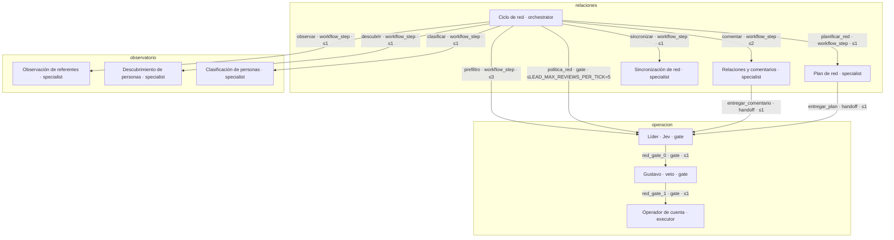

Bucle `comentario_actual` (active, máximo 2 rondas): Un borrador y una reescritura de reglas; no especialistas entre sí.

Gate `comentario` (INT-03): lider_jev → gustavo → operador_cuenta.
- comment_text_issues y content_issues; el verificador editorial no revisa comentarios.
- Jev condicionado por LEAD_ENABLED/capabilities; aprobación manual mantiene permisos.
- Veto y pausa de Gustavo; checks del operador antes de escribir.

Gate `red_social` (RED-01, RED-02, RED-04, INT-02): lider_jev → gustavo → operador_cuenta.
- network_issues y BAR-15 para RED; INT-02 se crea manualmente.
- Jev solo si lider.applies (INT-02 fuera por defecto).
- Ruta manual/autónoma, veto y controles de escritura actuales.

## Inbox

Estado: `active`. Orquestador: `workflow_inbox`.

- `read_inbox`: INBOX_EVERY_MINUTES=60, si INBOX_ENABLED.

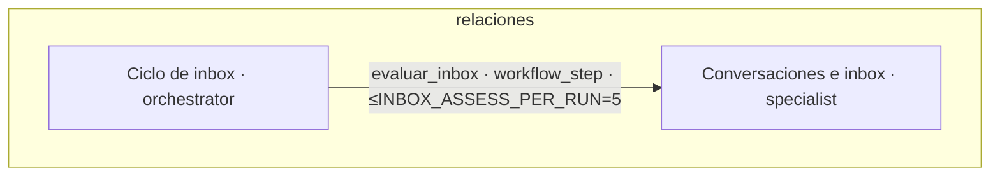

## Métricas

Estado: `active`. Orquestador: `metricas`.

- `collect_metrics`: METRICS_EVERY_MINUTES=180 si hay cortes pendientes; audiencia diaria.

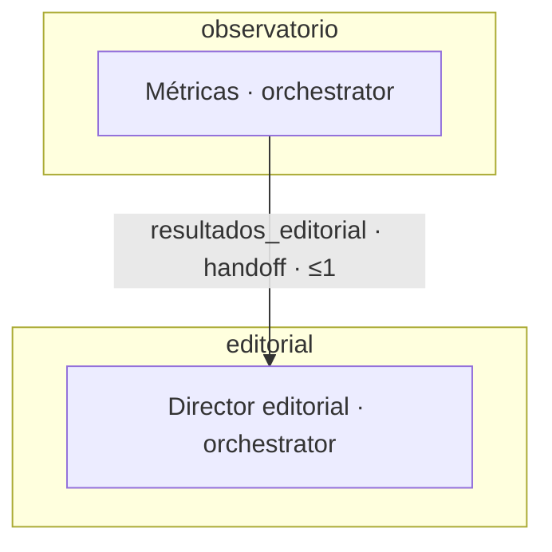

## Resumen semanal

Estado: `active`. Orquestador: `analista_barrio_resultados`.

- `weekly_summary`: Lunes tras WEEKLY_SUMMARY_TIME o solicitud manual; una semana local.

## Capturas

Estado: `active`. Orquestador: `capturas`.

- `process_capture`: Al recibir captura; sin cadencia del autopiloto.

```mermaid
flowchart TD
  classDef planned stroke-dasharray: 5 5,fill:#f5f5f5,color:#555;
  subgraph grupo_editorial["editorial"]
    director_editorial["Director editorial · orchestrator"]
  end
  subgraph grupo_relaciones["relaciones"]
    relaciones_comunidad["Relaciones y comentarios · specialist"]
  end
  subgraph grupo_operacion["operacion"]
    capturas["Procesamiento de capturas · orchestrator"]
    ruteador_capturas["Destino de capturas · specialist"]
    intencion_captura["Intención de captura · Jev · specialist"]
    transcripcion["Transcripción de audio · specialist"]
  end
  subgraph grupo_observatorio["observatorio"]
    investigacion_web["Investigación web · specialist"]
  end
  subgraph grupo_estrategia["estrategia"]
    posicionamiento["Posicionamiento · consulta manual · orchestrator"]
  end
  capturas -->|"rutear · workflow_step · ≤1"| ruteador_capturas
  capturas -->|"entender · workflow_step · ≤1"| intencion_captura
  capturas -->|"transcribir · workflow_step · ≤1"| transcripcion
  capturas -->|"investigar_captura · workflow_step · ≤1"| investigacion_web
  capturas -->|"captura_editorial · handoff · ≤1"| director_editorial
  capturas -->|"captura_persona · handoff · ≤1"| relaciones_comunidad
  capturas -->|"captura_memoria · handoff · ≤1"| posicionamiento
```

## Consulta manual · posicionamiento

Estado: `active`. Orquestador: `posicionamiento`.

- `agent_run`: Manual, agent=posicionamiento

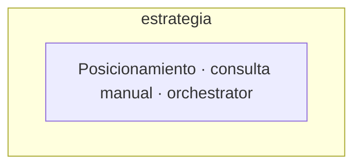

## Consulta manual · perfil

Estado: `active`. Orquestador: `perfil`.

- `agent_run`: Manual, agent=perfil

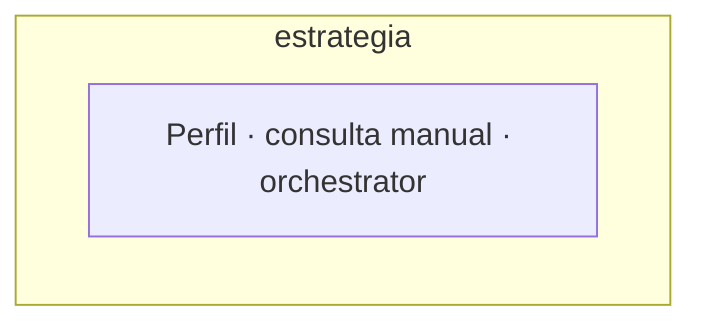

## Referentes mensuales

Estado: `planned`. Orquestador: `investigador_lider`.

- `planned`: Mensual (perfil también semestral); aún sin activar.

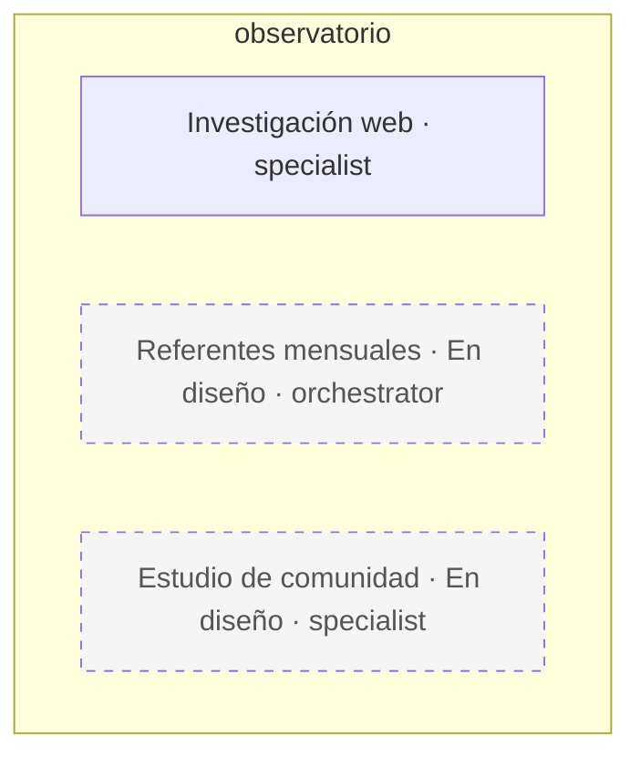

Bucle `fan_out` (planned, máximo 1 rondas): Investigación paralela con gather acotado; no existe fan-out en fase 1.

## Perfil periódico

Estado: `planned`. Orquestador: `ciclo_perfil`.

- `planned`: Mensual (perfil también semestral); aún sin activar.

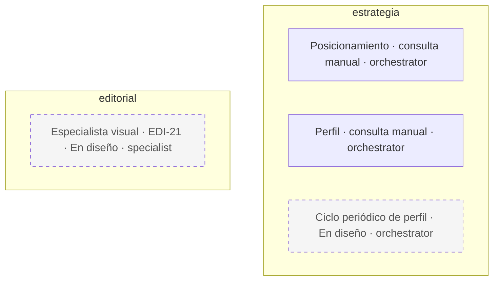

## Estudio mensual de comunidad

Estado: `planned`. Orquestador: `analista_barrio_resultados`.

- `planned`: Mensual; todavía sin activar.

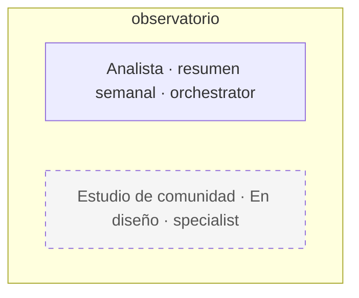

## Contratos referenciados

Los nombres siguientes enlazan las definiciones existentes. `python_payload`, `model`, `serializer`, `dataclass`, `local_schema` y `typed_questions` conservan su naturaleza; no equivalen a validación JSON Schema en runtime. El dispatcher y la normalización de contratos quedan para 3b.

| Nombre | Tipo | Código |
| --- | --- | --- |
| `brief` | `json_schema` | [team_backend.editorial.BRIEF_SCHEMA](../../agentes-linkedin/infra/src/team_backend/editorial.py) |
| `variants` | `json_schema` | [team_backend.editorial.WRITER_SCHEMA](../../agentes-linkedin/infra/src/team_backend/editorial.py) |
| `panel` | `json_schema` | [team_backend.editorial.PANEL_SCHEMA](../../agentes-linkedin/infra/src/team_backend/editorial.py) |
| `selection` | `json_schema` | [team_backend.editorial.SELECTION_SCHEMA](../../agentes-linkedin/infra/src/team_backend/editorial.py) |
| `verification` | `json_schema` | [team_backend.editorial.VERIFIER_SCHEMA](../../agentes-linkedin/infra/src/team_backend/editorial.py) |
| `repair` | `json_schema` | [team_backend.editorial.REPAIR_SCHEMA](../../agentes-linkedin/infra/src/team_backend/editorial.py) |
| `comment` | `json_schema` | [team_backend.operador.COMMENT_SCHEMA](../../agentes-linkedin/infra/src/team_backend/operador.py) |
| `classification` | `json_schema` | [team_backend.red.CLASSIFY_SCHEMA](../../agentes-linkedin/infra/src/team_backend/red.py) |
| `weekly` | `json_schema` | [team_backend.resumen_semanal.SCHEMA](../../agentes-linkedin/infra/src/team_backend/resumen_semanal.py) |
| `image_choice` | `json_schema` | [team_backend.infografias.CHOICE_SCHEMA](../../agentes-linkedin/infra/src/team_backend/infografias.py) |
| `image_design` | `json_schema` | [team_backend.infografias.DESIGN_SCHEMA](../../agentes-linkedin/infra/src/team_backend/infografias.py) |
| `image_check` | `json_schema` | [team_backend.connectors_images.CHECK_SCHEMA](../../agentes-linkedin/infra/src/team_backend/connectors_images.py) |
| `research_request` | `dataclass` | [team_backend.research.ResearchRequest](../../agentes-linkedin/infra/src/team_backend/research.py) |
| `research_result` | `dataclass` | [team_backend.research.ResearchResult](../../agentes-linkedin/infra/src/team_backend/research.py) |
| `piece` | `model` | [team_backend.models.EditorialPiece](../../agentes-linkedin/infra/src/team_backend/models.py) |
| `proposal` | `model` | [team_backend.models.ActionProposal](../../agentes-linkedin/infra/src/team_backend/models.py) |
| `execution` | `model` | [team_backend.models.ActionExecution](../../agentes-linkedin/infra/src/team_backend/models.py) |
| `capture` | `model` | [team_backend.models.Capture](../../agentes-linkedin/infra/src/team_backend/models.py) |
| `conversation` | `model` | [team_backend.models.Conversation](../../agentes-linkedin/infra/src/team_backend/models.py) |
| `contact` | `model` | [team_backend.models.Contact](../../agentes-linkedin/infra/src/team_backend/models.py) |
| `post` | `model` | [team_backend.models.ObservedPost](../../agentes-linkedin/infra/src/team_backend/models.py) |
| `job` | `model` | [team_backend.models.Job](../../agentes-linkedin/infra/src/team_backend/models.py) |
| `metric` | `model` | [team_backend.models.PostMetric](../../agentes-linkedin/infra/src/team_backend/models.py) |
| `photo` | `model` | [team_backend.models.GalleryPhoto](../../agentes-linkedin/infra/src/team_backend/models.py) |
| `piece_image` | `model` | [team_backend.models.PieceImage](../../agentes-linkedin/infra/src/team_backend/models.py) |
| `editorial_input` | `python_payload` | [team_backend.editorial._run](../../agentes-linkedin/infra/src/team_backend/editorial.py) |
| `route` | `local_schema` | [team_backend.capturas.classify](../../agentes-linkedin/infra/src/team_backend/capturas.py) |
| `intent` | `typed_questions` | [team_backend.capture_intent.jev](../../agentes-linkedin/infra/src/team_backend/capture_intent.py) |
| `lead` | `typed_questions` | [team_backend.lider.review](../../agentes-linkedin/infra/src/team_backend/lider.py) |
| `prefilter` | `typed_questions` | [team_backend.lider.comment_worthy](../../agentes-linkedin/infra/src/team_backend/lider.py) |
| `inbox_assessment` | `typed_questions` | [team_backend.conversaciones.assess](../../agentes-linkedin/infra/src/team_backend/conversaciones.py) |
| `metrics_result` | `python_payload` | [team_backend.metricas.collect](../../agentes-linkedin/infra/src/team_backend/metricas.py) |
| `network_plan` | `python_payload` | [team_backend.red.plan](../../agentes-linkedin/infra/src/team_backend/red.py) |
| `read_result` | `python_payload` | [team_backend.operador.run_job](../../agentes-linkedin/infra/src/team_backend/operador.py) |
| `transcript` | `python_payload` | [knowledge.providers.assemblyai_transcribe](../../agentes-linkedin/infra/src/knowledge/providers.py) |
| `manual_request` | `serializer` | [team_backend.serializers.RunInput](../../agentes-linkedin/infra/src/team_backend/serializers.py) |
| `manual_result` | `python_payload` | [knowledge.agents.run](../../agentes-linkedin/infra/src/knowledge/agents.py) |
| `image_bytes` | `python_payload` | [team_backend.connectors_images.ImageConnector.edit](../../agentes-linkedin/infra/src/team_backend/connectors_images.py) |
| `veto` | `python_payload` | [team_backend.operador.reject](../../agentes-linkedin/infra/src/team_backend/operador.py) |
| `orientation_decision` | `python_payload` | [team_backend.resumen_semanal.apply](../../agentes-linkedin/infra/src/team_backend/resumen_semanal.py) |

## Aristas y contratos

| Arista | Solicitud | Respuesta |
| --- | --- | --- |
| `brief` | `editorial_input` | `brief` |
| `redactar_a` | `editorial_input` | `variants` |
| `redactar_b` | `editorial_input` | `variants` |
| `seleccionar` | `editorial_input` | `selection` |
| `reparar` | `editorial_input` | `repair` |
| `verificar` | `editorial_input` | `verification` |
| `investigar_pieza` | `research_request` | `research_result` |
| `disenar` | `piece` | `image_design` |
| `editar_foto` | `photo` | `image_bytes` |
| `revisar_imagen` | `piece_image` | `image_check` |
| `leer_lector_comprador` | `editorial_input` | `panel` |
| `leer_lector_recomendador` | `editorial_input` | `panel` |
| `leer_lector_divulgador` | `editorial_input` | `panel` |
| `leer_lector_lider` | `editorial_input` | `panel` |
| `leer_lector_par` | `editorial_input` | `panel` |
| `visual_futuro` | `piece` | `image_choice` |
| `observar` | `job` | `read_result` |
| `descubrir` | `job` | `read_result` |
| `clasificar` | `contact` | `classification` |
| `comentar` | `post` | `comment` |
| `planificar_red` | `job` | `network_plan` |
| `sincronizar` | `job` | `read_result` |
| `prefiltro` | `post` | `prefilter` |
| `evaluar_inbox` | `conversation` | `inbox_assessment` |
| `orientacion_propuesta` | `weekly` | `orientation_decision` |
| `rutear` | `capture` | `route` |
| `entender` | `capture` | `intent` |
| `transcribir` | `capture` | `transcript` |
| `investigar_captura` | `research_request` | `research_result` |
| `pieza_diaria_gate_0` | `proposal` | `lead` |
| `pieza_diaria_gate_1` | `proposal` | `veto` |
| `pieza_diaria_gate_2` | `proposal` | `execution` |
| `politica_red` | `proposal` | `lead` |
| `red_gate_0` | `proposal` | `veto` |
| `red_gate_1` | `proposal` | `execution` |
| `entregar_comentario` | `proposal` | `lead` |
| `entregar_plan` | `proposal` | `lead` |
| `captura_editorial` | `capture` | `capture` |
| `captura_persona` | `contact` | `contact` |
| `captura_memoria` | `capture` | `capture` |
| `resultados_editorial` | `metrics_result` | `metrics_result` |
| `resumen_editorial` | `weekly` | `weekly` |
