# Grafo del equipo

<!-- Generado por scripts/grafo/mermaid.py. No editar a mano. -->

Versión `6.2-fase8` · SHA-256 `878304aaa2e762f31295ea70798e8495e4f159a4075a866345fed0558a2e6df5`.

46 nodos (46 activos), 69 aristas y 13 ciclos.

Pieza diaria, red, consulta de evidencia, referentes mensuales, experimentos de referentes, comunidad mensual y Perfil ejecutan sus llamadas mediante el registro y un ledger persistido. Las flechas de pasos y gates pertenecen al workflow determinista; no conceden permisos a los especialistas. Las respuestas vuelven al dueño del ciclo. Las variantes A/B de redacción comparten una llamada y los cinco lectores otra; sus contadores sobreviven a un reinicio.

Los trazos discontinuos siguen en diseño. Los ciclos migrados reutilizan checkpoints confirmados y detienen llamadas inciertas para conciliación. Referentes activa su fan-out mensual y experimentos; comunidad entrega un estudio público versionado al panel de lectores. Perfil entrega propuestas privadas y no escribe LinkedIn.

## Grafo completo

```mermaid
flowchart TD
  classDef planned stroke-dasharray: 5 5,fill:#f5f5f5,color:#555;
  subgraph grupo_editorial["editorial"]
    director_editorial["Director editorial · orchestrator"]
    copywriter_a["Copywriter A · specialist"]
    copywriter_b["Copywriter B · specialist"]
    lector_comprador["Lector · comprador · specialist"]
    lector_recomendador["Lector · recomendador · specialist"]
    lector_divulgador["Lector · divulgador · specialist"]
    lector_lider["Lector · lider · specialist"]
    lector_par["Lector · par · specialist"]
    seleccion_editorial["Selección editorial · specialist"]
    reparacion_editorial["Reparación editorial · specialist"]
    editor_verificador["Verificador editorial · gate"]
    revision_visual["Revisión de imagen · gate"]
    editor_visual["Editor visual · specialist"]
  end
  subgraph grupo_observatorio["observatorio"]
    investigador_referentes["Observación de referentes · specialist"]
    descubrimiento_red["Descubrimiento de personas · specialist"]
    clasificador_red["Clasificación de personas · specialist"]
    metricas["Métricas · orchestrator"]
    analista_barrio_resultados["Analista · resultados y comunidad · orchestrator"]
    investigacion_web["Investigación web · specialist"]
    investigador_lider["Referentes mensuales · orchestrator"]
    estudio_comunidad["Estudio de comunidad · specialist"]
    evidencia_compartida["Evidencia compartida · specialist"]
    investigador_producto["Investigación · producto y startups · specialist"]
    investigador_ia["Investigación · IA aplicada · specialist"]
    investigador_audiencia["Investigación · audiencias del nicho · specialist"]
    seleccion_referentes["Selección mensual de referentes · specialist"]
    analista_experimentos["Análisis de experimentos · specialist"]
    senales_referentes["Señales de referentes para Relaciones · specialist"]
  end
  subgraph grupo_relaciones["relaciones"]
    relaciones_comunidad["Relaciones y comentarios · orchestrator"]
    plan_red["Plan de red · specialist"]
    sync_red["Sincronización de red · specialist"]
    workflow_inbox["Ciclo de inbox · orchestrator"]
    conversaciones_inbox["Conversaciones e inbox · specialist"]
  end
  subgraph grupo_operacion["operacion"]
    lider_jev["Líder · Jev · gate"]
    gustavo["Gustavo · veto · gate"]
    operador_cuenta["Operador de cuenta · executor"]
    capturas["Procesamiento de capturas · orchestrator"]
    ruteador_capturas["Destino de capturas · specialist"]
    intencion_captura["Intención de captura · Jev · specialist"]
    transcripcion["Transcripción de audio · specialist"]
  end
  subgraph grupo_estrategia["estrategia"]
    posicionamiento["Posicionamiento · orchestrator"]
    perfil["Perfil · orchestrator"]
    ciclo_perfil["Perfil · preparación de copy · specialist"]
    biblioteca_perfil["Biblioteca de Perfil · specialist"]
    lectura_perfil["Lectura del perfil propio · specialist"]
    revision_perfil["Revisión de fundamentos del perfil · specialist"]
  end
  director_editorial -->|"brief · workflow_step · ≤2"| director_editorial
  director_editorial -->|"redactar_a · workflow_step · ≤1 · agrupada redactor"| copywriter_a
  director_editorial -->|"redactar_b · workflow_step · ≤1 · agrupada redactor"| copywriter_b
  director_editorial -->|"seleccionar · workflow_step · ≤1"| seleccion_editorial
  director_editorial -->|"reparar · workflow_step · ≤1"| reparacion_editorial
  director_editorial -->|"verificar · workflow_step · ≤2"| editor_verificador
  director_editorial -->|"investigar_pieza · workflow_step · ≤1"| investigacion_web
  director_editorial -->|"disenar · workflow_step · ≤2"| editor_visual
  director_editorial -->|"editar_foto · workflow_step · ≤8"| editor_visual
  director_editorial -->|"revisar_imagen · workflow_step · ≤8"| revision_visual
  director_editorial -->|"leer_lector_comprador · workflow_step · ≤1 · agrupada lectores"| lector_comprador
  director_editorial -->|"leer_lector_recomendador · workflow_step · ≤1 · agrupada lectores"| lector_recomendador
  director_editorial -->|"leer_lector_divulgador · workflow_step · ≤1 · agrupada lectores"| lector_divulgador
  director_editorial -->|"leer_lector_lider · workflow_step · ≤1 · agrupada lectores"| lector_lider
  director_editorial -->|"leer_lector_par · workflow_step · ≤1 · agrupada lectores"| lector_par
  director_editorial -->|"proponer_visual · call · ≤1"| editor_visual
  relaciones_comunidad -->|"observar · workflow_step · ≤1"| investigador_referentes
  relaciones_comunidad -->|"descubrir · workflow_step · ≤1"| descubrimiento_red
  relaciones_comunidad -->|"clasificar · workflow_step · ≤1"| clasificador_red
  relaciones_comunidad -->|"comentar · workflow_step · ≤2"| relaciones_comunidad
  relaciones_comunidad -->|"planificar_red · workflow_step · ≤1"| plan_red
  relaciones_comunidad -->|"sincronizar · workflow_step · ≤1"| sync_red
  relaciones_comunidad -->|"prefiltro · workflow_step · ≤3"| lider_jev
  workflow_inbox -->|"evaluar_inbox · workflow_step · ≤INBOX_ASSESS_PER_RUN=5"| conversaciones_inbox
  analista_barrio_resultados -->|"orientacion_propuesta · handoff · ≤1"| gustavo
  capturas -->|"rutear · workflow_step · ≤1"| ruteador_capturas
  capturas -->|"entender · workflow_step · ≤1"| intencion_captura
  capturas -->|"transcribir · workflow_step · ≤1"| transcripcion
  capturas -->|"investigar_captura · workflow_step · ≤1"| investigacion_web
  editor_verificador -->|"pieza_diaria_gate_0 · gate · ≤5"| lider_jev
  lider_jev -->|"pieza_diaria_gate_1 · gate · ≤1"| gustavo
  gustavo -->|"pieza_diaria_gate_2 · gate · ≤1"| operador_cuenta
  relaciones_comunidad -->|"politica_red · gate · ≤5"| lider_jev
  lider_jev -->|"red_gate_0 · gate · ≤1"| gustavo
  gustavo -->|"red_gate_1 · gate · ≤1"| operador_cuenta
  relaciones_comunidad -->|"entregar_comentario · handoff · ≤1"| lider_jev
  plan_red -->|"entregar_plan · handoff · ≤1"| lider_jev
  capturas -->|"captura_editorial · handoff · ≤1"| director_editorial
  capturas -->|"captura_persona · handoff · ≤1"| relaciones_comunidad
  capturas -->|"captura_memoria · handoff · ≤1"| posicionamiento
  metricas -->|"resultados_editorial · handoff · ≤1"| director_editorial
  analista_barrio_resultados -->|"resumen_editorial · handoff · ≤1"| director_editorial
  director_editorial -->|"entregar_visual · call · ≤1"| editor_visual
  perfil -->|"perfil_biblioteca · call · ≤2"| biblioteca_perfil
  perfil -->|"perfil_lectura · call · ≤8"| lectura_perfil
  perfil -->|"perfil_posicionamiento · call · ≤2"| posicionamiento
  perfil -->|"perfil_copy · call · ≤2"| ciclo_perfil
  perfil -->|"perfil_revision_copy · call · ≤2"| revision_perfil
  perfil -->|"perfil_web · call · ≤1"| investigacion_web
  perfil -->|"perfil_editar_persona · call · ≤6"| editor_visual
  perfil -->|"perfil_render · call · ≤2"| editor_visual
  perfil -->|"perfil_revision_visual · call · ≤6"| revision_visual
  capturas -->|"captura_perfil · handoff · ≤1"| perfil
  perfil -->|"perfil_orientacion_editorial · handoff · ≤2"| director_editorial
  relaciones_comunidad -->|"evidencia_red · call · ≤1"| evidencia_compartida
  analista_barrio_resultados -->|"evidencia_analista · call · ≤1"| evidencia_compartida
  investigador_lider -->|"evidencia_referentes · call · ≤1"| evidencia_compartida
  investigador_lider -->|"referentes_producto · call · ≤1"| investigador_producto
  investigador_lider -->|"referentes_ia · call · ≤1"| investigador_ia
  investigador_lider -->|"referentes_audiencia · call · ≤1"| investigador_audiencia
  investigador_lider -->|"seleccionar_referentes · call · ≤1"| seleccion_referentes
  investigador_lider -->|"decidir_referentes · handoff · ≤1"| gustavo
  investigador_lider -->|"foco_aprobado · handoff · ≤1"| relaciones_comunidad
  relaciones_comunidad -->|"senales_referentes · call · ≤1"| senales_referentes
  investigador_lider -->|"evidencia_experimento · call · ≤3"| evidencia_compartida
  investigador_lider -->|"evaluar_experimento · call · ≤1"| analista_experimentos
  director_editorial -->|"evidencia_comunidad · call · ≤2"| evidencia_compartida
  director_editorial -->|"leer_comunidad · call · ≤16"| estudio_comunidad
  director_editorial -->|"analizar_comunidad · call · ≤2"| analista_barrio_resultados
```

## Pieza diaria

Estado: `active`. Orquestador: `director_editorial`.

- `prepare_piece`: Hueco diario según EDITORIAL_POST_TIME; preparación anticipada EDITORIAL_LEAD_HOURS o manual.
- `execute_action`: Tick 60 s; solo aprobada y a su hora.
- `reconcile_action`: Inciertas/sent tras 10 min; bucket de una hora, hasta 3 por tick.

```mermaid
flowchart TD
  classDef planned stroke-dasharray: 5 5,fill:#f5f5f5,color:#555;
  subgraph grupo_editorial["editorial"]
    director_editorial["Director editorial · orchestrator"]
    copywriter_a["Copywriter A · specialist"]
    copywriter_b["Copywriter B · specialist"]
    lector_comprador["Lector · comprador · specialist"]
    lector_recomendador["Lector · recomendador · specialist"]
    lector_divulgador["Lector · divulgador · specialist"]
    lector_lider["Lector · lider · specialist"]
    lector_par["Lector · par · specialist"]
    seleccion_editorial["Selección editorial · specialist"]
    reparacion_editorial["Reparación editorial · specialist"]
    editor_verificador["Verificador editorial · gate"]
    revision_visual["Revisión de imagen · gate"]
    editor_visual["Editor visual · specialist"]
  end
  subgraph grupo_operacion["operacion"]
    lider_jev["Líder · Jev · gate"]
    gustavo["Gustavo · veto · gate"]
    operador_cuenta["Operador de cuenta · executor"]
  end
  subgraph grupo_observatorio["observatorio"]
    investigacion_web["Investigación web · specialist"]
  end
  director_editorial -->|"brief · workflow_step · ≤2"| director_editorial
  director_editorial -->|"redactar_a · workflow_step · ≤1 · agrupada redactor"| copywriter_a
  director_editorial -->|"redactar_b · workflow_step · ≤1 · agrupada redactor"| copywriter_b
  director_editorial -->|"seleccionar · workflow_step · ≤1"| seleccion_editorial
  director_editorial -->|"reparar · workflow_step · ≤1"| reparacion_editorial
  director_editorial -->|"verificar · workflow_step · ≤2"| editor_verificador
  director_editorial -->|"investigar_pieza · workflow_step · ≤1"| investigacion_web
  director_editorial -->|"disenar · workflow_step · ≤2"| editor_visual
  director_editorial -->|"editar_foto · workflow_step · ≤8"| editor_visual
  director_editorial -->|"revisar_imagen · workflow_step · ≤8"| revision_visual
  director_editorial -->|"leer_lector_comprador · workflow_step · ≤1 · agrupada lectores"| lector_comprador
  director_editorial -->|"leer_lector_recomendador · workflow_step · ≤1 · agrupada lectores"| lector_recomendador
  director_editorial -->|"leer_lector_divulgador · workflow_step · ≤1 · agrupada lectores"| lector_divulgador
  director_editorial -->|"leer_lector_lider · workflow_step · ≤1 · agrupada lectores"| lector_lider
  director_editorial -->|"leer_lector_par · workflow_step · ≤1 · agrupada lectores"| lector_par
  director_editorial -->|"proponer_visual · call · ≤1"| editor_visual
  editor_verificador -->|"pieza_diaria_gate_0 · gate · ≤5"| lider_jev
  lider_jev -->|"pieza_diaria_gate_1 · gate · ≤1"| gustavo
  gustavo -->|"pieza_diaria_gate_2 · gate · ≤1"| operador_cuenta
  director_editorial -->|"entregar_visual · call · ≤1"| editor_visual
```

Bucle `evaluator_optimizer` (active, máximo 2 rondas): Copywriters A/B agrupados, verificación inicial y una reparación con el binding histórico del director; máximo dos evaluaciones. Sin delegación entre especialistas.

Bucle `imagen_actual` (active, máximo 2 rondas): Editor visual: un diseño inicial y una corrección de IMG-INF, con el mismo gate de visión. La propuesta de formato y la entrega final se piden una vez por versión ganadora.

Gate `publicacion` (CONT-09): editor_verificador → lider_jev → gustavo → operador_cuenta.
- Reglas y verificador sobre el hash exacto; imagen preparada y manifest validado.
- Jev si lider.applies; auto/manual conservan las reglas actuales.
- Gustavo puede vetar o pausar; no hay espera de aprobación por post.
- Operador valida hash aprobado, estado y cuotas justo antes de escribir.

## Red y comentarios

Estado: `active`. Orquestador: `relaciones_comunidad`.

- `observe`: OPERATOR_OBSERVE_EVERY_MINUTES (180 min).
- `discover_network`: NETWORK_DISCOVER_EVERY_MINUTES (360 min).
- `classify_contacts`: NETWORK_CLASSIFY_EVERY_MINUTES (30 min), solo backlog.
- `plan_network`: NETWORK_PLAN_EVERY_MINUTES (60 min).
- `sync_network`: NETWORK_SYNC_EVERY_MINUTES (360 min).
- `propose_comment`: Tick 60 s, hasta un borrador por tick y cupo disponible.
- `execute_action`: Tick 60 s; aprobación y capacidad disponible.
- `reconcile_action`: Hasta 3 por tick; bucket de una hora.

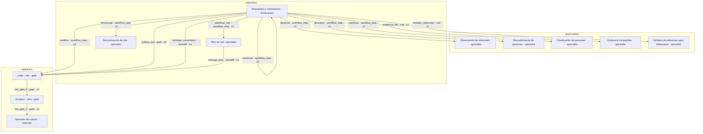

Bucle `comentario_actual` (active, máximo 2 rondas): Un borrador y una reescritura de reglas; no especialistas entre sí.

Gate `comentario` (INT-03): lider_jev → gustavo → operador_cuenta.
- comment_text_issues y content_issues; el verificador editorial no revisa comentarios.
- Jev condicionado por LEAD_ENABLED/capabilities; aprobación manual mantiene permisos.
- Veto y pausa de Gustavo; checks del operador antes de escribir.

Gate `red_social` (RED-01, RED-02, RED-04, INT-02): lider_jev → gustavo → operador_cuenta.
- network_issues y BAR-15 para RED; INT-02 se crea manualmente.
- Jev solo si lider.applies (INT-02 fuera por defecto).
- Ruta manual/autónoma, veto y controles de escritura actuales.

## Inbox

Estado: `active`. Orquestador: `workflow_inbox`.

- `read_inbox`: INBOX_EVERY_MINUTES=60, si INBOX_ENABLED.

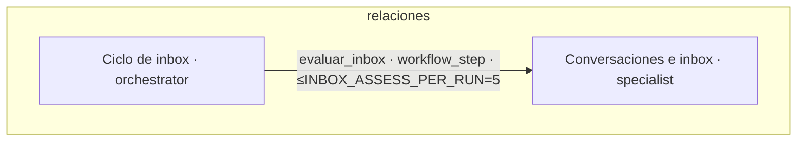

## Métricas

Estado: `active`. Orquestador: `metricas`.

- `collect_metrics`: METRICS_EVERY_MINUTES=180 si hay cortes pendientes; audiencia diaria.

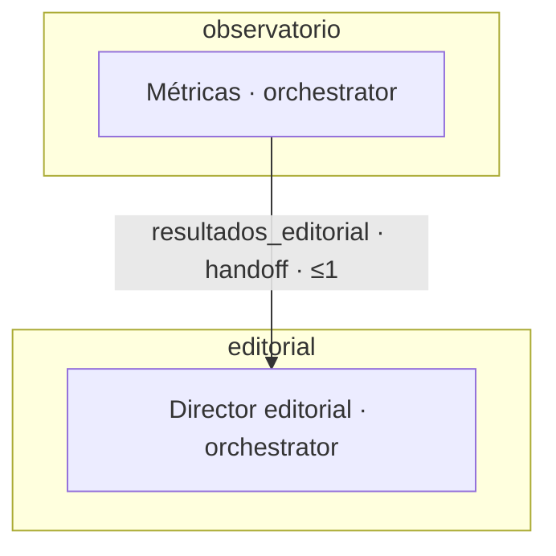

## Resumen semanal

Estado: `active`. Orquestador: `analista_barrio_resultados`.

- `weekly_summary`: Lunes tras WEEKLY_SUMMARY_TIME o solicitud manual; una semana local.

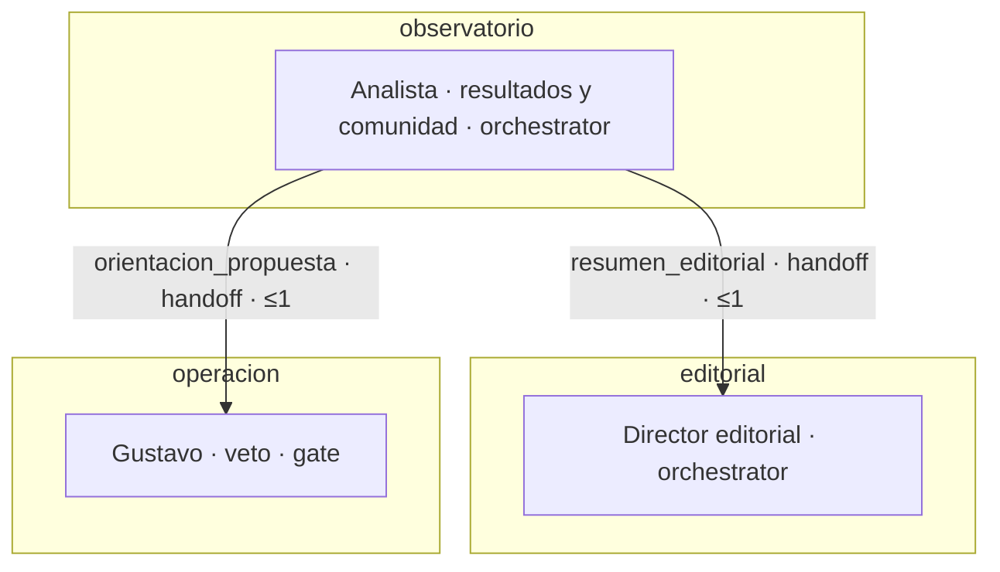

## Capturas

Estado: `active`. Orquestador: `capturas`.

- `process_capture`: Al recibir captura; sin cadencia del autopiloto.

```mermaid
flowchart TD
  classDef planned stroke-dasharray: 5 5,fill:#f5f5f5,color:#555;
  subgraph grupo_editorial["editorial"]
    director_editorial["Director editorial · orchestrator"]
  end
  subgraph grupo_relaciones["relaciones"]
    relaciones_comunidad["Relaciones y comentarios · orchestrator"]
  end
  subgraph grupo_operacion["operacion"]
    capturas["Procesamiento de capturas · orchestrator"]
    ruteador_capturas["Destino de capturas · specialist"]
    intencion_captura["Intención de captura · Jev · specialist"]
    transcripcion["Transcripción de audio · specialist"]
  end
  subgraph grupo_observatorio["observatorio"]
    investigacion_web["Investigación web · specialist"]
  end
  subgraph grupo_estrategia["estrategia"]
    posicionamiento["Posicionamiento · orchestrator"]
    perfil["Perfil · orchestrator"]
  end
  capturas -->|"rutear · workflow_step · ≤1"| ruteador_capturas
  capturas -->|"entender · workflow_step · ≤1"| intencion_captura
  capturas -->|"transcribir · workflow_step · ≤1"| transcripcion
  capturas -->|"investigar_captura · workflow_step · ≤1"| investigacion_web
  capturas -->|"captura_editorial · handoff · ≤1"| director_editorial
  capturas -->|"captura_persona · handoff · ≤1"| relaciones_comunidad
  capturas -->|"captura_memoria · handoff · ≤1"| posicionamiento
  capturas -->|"captura_perfil · handoff · ≤1"| perfil
```

## Consulta manual · posicionamiento

Estado: `active`. Orquestador: `posicionamiento`.

- `agent_run`: Manual, agent=posicionamiento

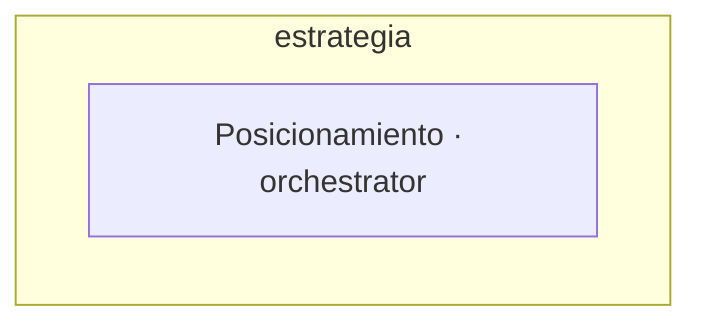

## Consulta manual · perfil

Estado: `active`. Orquestador: `perfil`.

- `agent_run`: Manual, agent=perfil

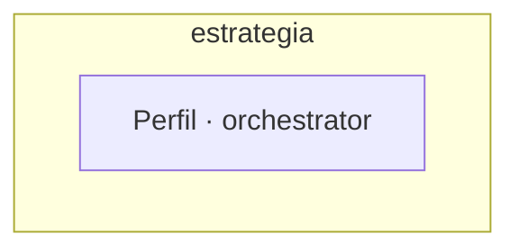

## Referentes mensuales

Estado: `active`. Orquestador: `investigador_lider`.

- `review_referents`: Prepara el último día del mes, publica día 1; recordatorios 1/4 a las 09:00 y cierre día 6 00:00 America/Bogota.

```mermaid
flowchart TD
  classDef planned stroke-dasharray: 5 5,fill:#f5f5f5,color:#555;
  subgraph grupo_relaciones["relaciones"]
    relaciones_comunidad["Relaciones y comentarios · orchestrator"]
  end
  subgraph grupo_operacion["operacion"]
    gustavo["Gustavo · veto · gate"]
  end
  subgraph grupo_observatorio["observatorio"]
    investigador_lider["Referentes mensuales · orchestrator"]
    evidencia_compartida["Evidencia compartida · specialist"]
    investigador_producto["Investigación · producto y startups · specialist"]
    investigador_ia["Investigación · IA aplicada · specialist"]
    investigador_audiencia["Investigación · audiencias del nicho · specialist"]
    seleccion_referentes["Selección mensual de referentes · specialist"]
  end
  investigador_lider -->|"evidencia_referentes · call · ≤1"| evidencia_compartida
  investigador_lider -->|"referentes_producto · call · ≤1"| investigador_producto
  investigador_lider -->|"referentes_ia · call · ≤1"| investigador_ia
  investigador_lider -->|"referentes_audiencia · call · ≤1"| investigador_audiencia
  investigador_lider -->|"seleccionar_referentes · call · ≤1"| seleccion_referentes
  investigador_lider -->|"decidir_referentes · handoff · ≤1"| gustavo
  investigador_lider -->|"foco_aprobado · handoff · ≤1"| relaciones_comunidad
```

Bucle `fan_out` (active, máximo 1 rondas): Tres ramas paralelas con contextvars/ledger común y gather de todas antes de liberar lease. Una llamada por rama; no delegan.

## Estrategia y perfil

Estado: `active`. Orquestador: `perfil`.

- `prepare_profile`: Primera activación y cada seis meses calendario desde ancla; mensual destacados/artículos/actividad; captura explícita bajo demanda.

```mermaid
flowchart TD
  classDef planned stroke-dasharray: 5 5,fill:#f5f5f5,color:#555;
  subgraph grupo_editorial["editorial"]
    director_editorial["Director editorial · orchestrator"]
    revision_visual["Revisión de imagen · gate"]
    editor_visual["Editor visual · specialist"]
  end
  subgraph grupo_observatorio["observatorio"]
    investigacion_web["Investigación web · specialist"]
  end
  subgraph grupo_estrategia["estrategia"]
    posicionamiento["Posicionamiento · orchestrator"]
    perfil["Perfil · orchestrator"]
    ciclo_perfil["Perfil · preparación de copy · specialist"]
    biblioteca_perfil["Biblioteca de Perfil · specialist"]
    lectura_perfil["Lectura del perfil propio · specialist"]
    revision_perfil["Revisión de fundamentos del perfil · specialist"]
  end
  perfil -->|"perfil_biblioteca · call · ≤2"| biblioteca_perfil
  perfil -->|"perfil_lectura · call · ≤8"| lectura_perfil
  perfil -->|"perfil_posicionamiento · call · ≤2"| posicionamiento
  perfil -->|"perfil_copy · call · ≤2"| ciclo_perfil
  perfil -->|"perfil_revision_copy · call · ≤2"| revision_perfil
  perfil -->|"perfil_web · call · ≤1"| investigacion_web
  perfil -->|"perfil_editar_persona · call · ≤6"| editor_visual
  perfil -->|"perfil_render · call · ≤2"| editor_visual
  perfil -->|"perfil_revision_visual · call · ≤6"| revision_visual
  perfil -->|"perfil_orientacion_editorial · handoff · ≤2"| director_editorial
```

Bucle `perfil_ajuste` (active, máximo 2 rondas): Primera propuesta y un ajuste explícito o por hecho respondido, mismo ledger de 10 USD. No se repiten transportes inciertos.

## Estudio mensual de comunidad

Estado: `active`. Orquestador: `director_editorial`.

- `community_study`: Mensual tras el corte anterior; 90 días, hasta 50 personas; una revisión adicional como máximo.

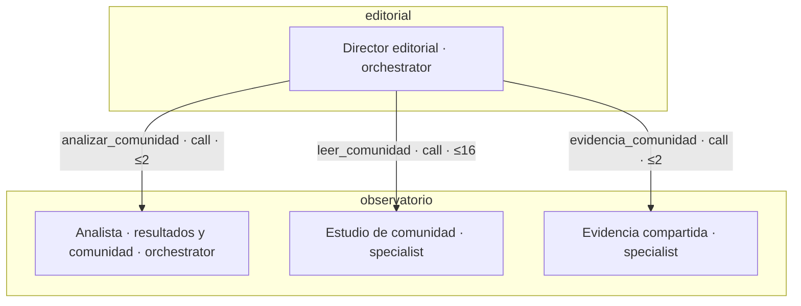

Bucle `revision_comunidad` (active, máximo 2 rondas): Primera versión y una revisión trazable por refresco o solicitud; conserva fuentes exitosas, presupuesto y contadores. Sin fan-out ni delegación.

## Consulta de evidencia compartida

Estado: `active`. Orquestador: `analista_barrio_resultados`.

- `weekly_summary`: Al preparar el resumen semanal; herramienta local disponible para consultas de los orquestadores.

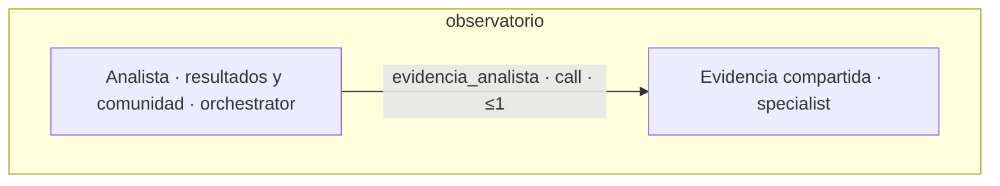

## Experimentos de referentes

Estado: `active`. Orquestador: `investigador_lider`.

- `advance_experiments`: Tick horario con planes aprobados; cortes semanales y cierre tras 14/28/7 días.

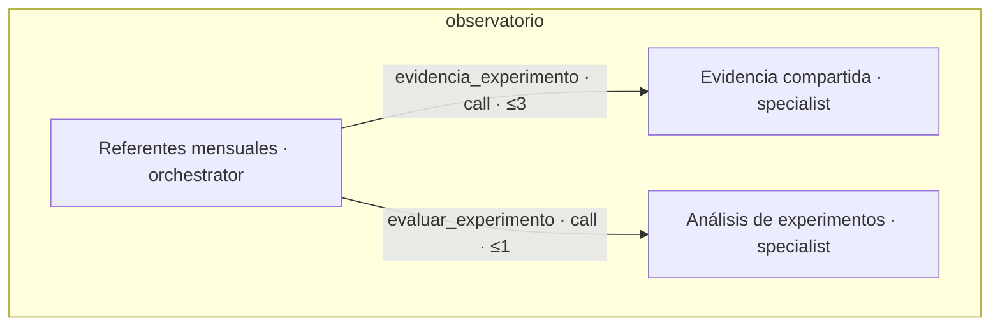

## Contratos referenciados

Los nombres siguientes enlazan las definiciones existentes. Las aristas con runtime validan JSON Schema, modelos, dataclasses o bytes según el contrato. Los demás contratos conservan su naturaleza descriptiva hasta que se migre su ciclo.

| Nombre | Tipo | Código |
| --- | --- | --- |
| `brief` | `json_schema` | [team_backend.editorial.BRIEF_SCHEMA](../../agentes-linkedin/infra/src/team_backend/editorial.py) |
| `variants` | `json_schema` | [team_backend.editorial.WRITER_SCHEMA](../../agentes-linkedin/infra/src/team_backend/editorial.py) |
| `panel` | `json_schema` | [team_backend.editorial.PANEL_SCHEMA](../../agentes-linkedin/infra/src/team_backend/editorial.py) |
| `selection` | `json_schema` | [team_backend.editorial.SELECTION_SCHEMA](../../agentes-linkedin/infra/src/team_backend/editorial.py) |
| `verification` | `json_schema` | [team_backend.editorial.VERIFIER_SCHEMA](../../agentes-linkedin/infra/src/team_backend/editorial.py) |
| `repair` | `json_schema` | [team_backend.editorial.REPAIR_SCHEMA](../../agentes-linkedin/infra/src/team_backend/editorial.py) |
| `comment` | `json_schema` | [team_backend.operador.COMMENT_SCHEMA](../../agentes-linkedin/infra/src/team_backend/operador.py) |
| `classification` | `json_schema` | [team_backend.red.CLASSIFY_SCHEMA](../../agentes-linkedin/infra/src/team_backend/red.py) |
| `weekly` | `json_schema` | [team_backend.resumen_semanal.SCHEMA](../../agentes-linkedin/infra/src/team_backend/resumen_semanal.py) |
| `image_choice` | `json_schema` | [team_backend.infografias.CHOICE_SCHEMA](../../agentes-linkedin/infra/src/team_backend/infografias.py) |
| `image_design` | `json_schema` | [team_backend.infografias.DESIGN_SCHEMA](../../agentes-linkedin/infra/src/team_backend/infografias.py) |
| `image_check` | `json_schema` | [team_backend.connectors_images.CHECK_SCHEMA](../../agentes-linkedin/infra/src/team_backend/connectors_images.py) |
| `research_request` | `dataclass` | [team_backend.research.ResearchRequest](../../agentes-linkedin/infra/src/team_backend/research.py) |
| `research_result` | `dataclass` | [team_backend.research.ResearchResult](../../agentes-linkedin/infra/src/team_backend/research.py) |
| `piece` | `model` | [team_backend.models.EditorialPiece](../../agentes-linkedin/infra/src/team_backend/models.py) |
| `proposal` | `model` | [team_backend.models.ActionProposal](../../agentes-linkedin/infra/src/team_backend/models.py) |
| `execution` | `model` | [team_backend.models.ActionExecution](../../agentes-linkedin/infra/src/team_backend/models.py) |
| `capture` | `model` | [team_backend.models.Capture](../../agentes-linkedin/infra/src/team_backend/models.py) |
| `conversation` | `model` | [team_backend.models.Conversation](../../agentes-linkedin/infra/src/team_backend/models.py) |
| `contact` | `model` | [team_backend.models.Contact](../../agentes-linkedin/infra/src/team_backend/models.py) |
| `post` | `model` | [team_backend.models.ObservedPost](../../agentes-linkedin/infra/src/team_backend/models.py) |
| `job` | `model` | [team_backend.models.Job](../../agentes-linkedin/infra/src/team_backend/models.py) |
| `metric` | `model` | [team_backend.models.PostMetric](../../agentes-linkedin/infra/src/team_backend/models.py) |
| `photo` | `model` | [team_backend.models.GalleryPhoto](../../agentes-linkedin/infra/src/team_backend/models.py) |
| `piece_image` | `model` | [team_backend.models.PieceImage](../../agentes-linkedin/infra/src/team_backend/models.py) |
| `editorial_input` | `python_payload` | [team_backend.editorial._run](../../agentes-linkedin/infra/src/team_backend/editorial.py) |
| `route` | `local_schema` | [team_backend.capturas.classify](../../agentes-linkedin/infra/src/team_backend/capturas.py) |
| `intent` | `typed_questions` | [team_backend.capture_intent.jev](../../agentes-linkedin/infra/src/team_backend/capture_intent.py) |
| `lead` | `typed_questions` | [team_backend.lider.review](../../agentes-linkedin/infra/src/team_backend/lider.py) |
| `prefilter` | `typed_questions` | [team_backend.lider.comment_worthy](../../agentes-linkedin/infra/src/team_backend/lider.py) |
| `inbox_assessment` | `typed_questions` | [team_backend.conversaciones.assess](../../agentes-linkedin/infra/src/team_backend/conversaciones.py) |
| `metrics_result` | `python_payload` | [team_backend.metricas.collect](../../agentes-linkedin/infra/src/team_backend/metricas.py) |
| `network_plan` | `python_payload` | [team_backend.red.plan](../../agentes-linkedin/infra/src/team_backend/red.py) |
| `read_result` | `json_schema` | [team_backend.orquestacion_schemas.READ_RESULT](../../agentes-linkedin/infra/src/team_backend/orquestacion_schemas.py) |
| `transcript` | `python_payload` | [knowledge.providers.assemblyai_transcribe](../../agentes-linkedin/infra/src/knowledge/providers.py) |
| `manual_request` | `serializer` | [team_backend.serializers.RunInput](../../agentes-linkedin/infra/src/team_backend/serializers.py) |
| `manual_result` | `python_payload` | [knowledge.agents.run](../../agentes-linkedin/infra/src/knowledge/agents.py) |
| `image_bytes` | `bytes` | [team_backend.connectors_images.ImageConnector.edit](../../agentes-linkedin/infra/src/team_backend/connectors_images.py) |
| `veto` | `python_payload` | [team_backend.operador.reject](../../agentes-linkedin/infra/src/team_backend/operador.py) |
| `orientation_decision` | `python_payload` | [team_backend.resumen_semanal.apply](../../agentes-linkedin/infra/src/team_backend/resumen_semanal.py) |
| `brief_input` | `json_schema` | [team_backend.orquestacion_schemas.BRIEF_INPUT](../../agentes-linkedin/infra/src/team_backend/orquestacion_schemas.py) |
| `writer_input` | `json_schema` | [team_backend.orquestacion_schemas.WRITER_INPUT](../../agentes-linkedin/infra/src/team_backend/orquestacion_schemas.py) |
| `panel_input` | `json_schema` | [team_backend.orquestacion_schemas.PANEL_INPUT](../../agentes-linkedin/infra/src/team_backend/orquestacion_schemas.py) |
| `selection_input` | `json_schema` | [team_backend.orquestacion_schemas.SELECTION_INPUT](../../agentes-linkedin/infra/src/team_backend/orquestacion_schemas.py) |
| `verifier_input` | `json_schema` | [team_backend.orquestacion_schemas.VERIFIER_INPUT](../../agentes-linkedin/infra/src/team_backend/orquestacion_schemas.py) |
| `repair_input` | `json_schema` | [team_backend.orquestacion_schemas.REPAIR_INPUT](../../agentes-linkedin/infra/src/team_backend/orquestacion_schemas.py) |
| `network_input` | `json_schema` | [team_backend.orquestacion_schemas.NETWORK_INPUT](../../agentes-linkedin/infra/src/team_backend/orquestacion_schemas.py) |
| `image_input` | `json_schema` | [team_backend.orquestacion_schemas.IMAGE_INPUT](../../agentes-linkedin/infra/src/team_backend/orquestacion_schemas.py) |
| `edit_input` | `json_schema` | [team_backend.orquestacion_schemas.EDIT_INPUT](../../agentes-linkedin/infra/src/team_backend/orquestacion_schemas.py) |
| `check_input` | `json_schema` | [team_backend.orquestacion_schemas.CHECK_INPUT](../../agentes-linkedin/infra/src/team_backend/orquestacion_schemas.py) |
| `check_result` | `json_schema` | [team_backend.orquestacion_schemas.CHECK_RESULT](../../agentes-linkedin/infra/src/team_backend/orquestacion_schemas.py) |
| `lead_result` | `json_schema` | [team_backend.orquestacion_schemas.LEAD_RESULT](../../agentes-linkedin/infra/src/team_backend/orquestacion_schemas.py) |
| `observe_result` | `json_schema` | [team_backend.orquestacion_schemas.OBSERVE_RESULT](../../agentes-linkedin/infra/src/team_backend/orquestacion_schemas.py) |
| `discover_result` | `json_schema` | [team_backend.orquestacion_schemas.DISCOVER_RESULT](../../agentes-linkedin/infra/src/team_backend/orquestacion_schemas.py) |
| `classify_result` | `json_schema` | [team_backend.orquestacion_schemas.CLASSIFY_RESULT](../../agentes-linkedin/infra/src/team_backend/orquestacion_schemas.py) |
| `plan_result` | `json_schema` | [team_backend.orquestacion_schemas.PLAN_RESULT](../../agentes-linkedin/infra/src/team_backend/orquestacion_schemas.py) |
| `sync_result` | `json_schema` | [team_backend.orquestacion_schemas.SYNC_RESULT](../../agentes-linkedin/infra/src/team_backend/orquestacion_schemas.py) |
| `visual_request` | `json_schema` | [team_backend.editor_visual.REQUEST_SCHEMA](../../agentes-linkedin/infra/src/team_backend/editor_visual.py) |
| `visual_proposal` | `json_schema` | [team_backend.editor_visual.PROPOSAL_SCHEMA](../../agentes-linkedin/infra/src/team_backend/editor_visual.py) |
| `visual_package` | `json_schema` | [team_backend.editor_visual.PACKAGE_SCHEMA](../../agentes-linkedin/infra/src/team_backend/editor_visual.py) |
| `profile_request` | `json_schema` | [team_backend.perfil_contenido.REQUEST_SCHEMA](../../agentes-linkedin/infra/src/team_backend/perfil_contenido.py) |
| `profile_proposal` | `model` | [team_backend.models.ProfileProposal](../../agentes-linkedin/infra/src/team_backend/models.py) |
| `profile_library` | `json_schema` | [team_backend.perfil_contenido.LIBRARY_SCHEMA](../../agentes-linkedin/infra/src/team_backend/perfil_contenido.py) |
| `profile_positioning` | `json_schema` | [team_backend.perfil_contenido.POSITION_SCHEMA](../../agentes-linkedin/infra/src/team_backend/perfil_contenido.py) |
| `profile_draft` | `json_schema` | [team_backend.perfil_contenido.DRAFT_SCHEMA](../../agentes-linkedin/infra/src/team_backend/perfil_contenido.py) |
| `profile_review` | `json_schema` | [team_backend.perfil_contenido.REVIEW_SCHEMA](../../agentes-linkedin/infra/src/team_backend/perfil_contenido.py) |
| `profile_read` | `json_schema` | [team_backend.perfil.READ_SCHEMA](../../agentes-linkedin/infra/src/team_backend/perfil.py) |
| `profile_edit` | `json_schema` | [team_backend.perfil_visual.EDIT_REQUEST](../../agentes-linkedin/infra/src/team_backend/perfil_visual.py) |
| `profile_render` | `json_schema` | [team_backend.perfil_visual.RENDER_RESULT](../../agentes-linkedin/infra/src/team_backend/perfil_visual.py) |
| `profile_vision` | `json_schema` | [team_backend.perfil_visual.CHECK_RESULT](../../agentes-linkedin/infra/src/team_backend/perfil_visual.py) |
| `evidence_request` | `dataclass` | [team_backend.evidencia.EvidenceRequest](../../agentes-linkedin/infra/src/team_backend/evidencia.py) |
| `evidence_result` | `dataclass` | [team_backend.evidencia.EvidenceResult](../../agentes-linkedin/infra/src/team_backend/evidencia.py) |
| `referents_request` | `json_schema` | [team_backend.referentes_research.REQUEST_SCHEMA](../../agentes-linkedin/infra/src/team_backend/referentes_research.py) |
| `referents_dossier` | `json_schema` | [team_backend.referentes_research.DOSSIER_SCHEMA](../../agentes-linkedin/infra/src/team_backend/referentes_research.py) |
| `referents_review` | `model` | [team_backend.models.ReferentReview](../../agentes-linkedin/infra/src/team_backend/models.py) |
| `referents_change` | `model` | [team_backend.models.ReferentChange](../../agentes-linkedin/infra/src/team_backend/models.py) |
| `referents_experiment` | `model` | [team_backend.models.ReferentExperiment](../../agentes-linkedin/infra/src/team_backend/models.py) |
| `referents_signals_request` | `json_schema` | [team_backend.experimentos.SIGNAL_REQUEST](../../agentes-linkedin/infra/src/team_backend/experimentos.py) |
| `referents_signals` | `json_schema` | [team_backend.experimentos.RESULT_SCHEMA](../../agentes-linkedin/infra/src/team_backend/experimentos.py) |
| `experiment_request` | `json_schema` | [team_backend.experimentos.EVALUATION_REQUEST](../../agentes-linkedin/infra/src/team_backend/experimentos.py) |
| `community_study` | `model` | [team_backend.models.CommunityStudy](../../agentes-linkedin/infra/src/team_backend/models.py) |
| `community_read` | `dataclass` | [team_backend.comunidad.PublicRead](../../agentes-linkedin/infra/src/team_backend/comunidad.py) |
| `community_read_result` | `dataclass` | [team_backend.comunidad.ReadResult](../../agentes-linkedin/infra/src/team_backend/comunidad.py) |
| `community_analysis` | `json_schema` | [team_backend.comunidad.ANALYSIS_SCHEMA](../../agentes-linkedin/infra/src/team_backend/comunidad.py) |

## Aristas y contratos

| Arista | Solicitud | Respuesta |
| --- | --- | --- |
| `brief` | `brief_input` | `brief` |
| `redactar_a` | `writer_input` | `variants` |
| `redactar_b` | `writer_input` | `variants` |
| `seleccionar` | `selection_input` | `selection` |
| `reparar` | `repair_input` | `repair` |
| `verificar` | `verifier_input` | `verification` |
| `investigar_pieza` | `research_request` | `research_result` |
| `disenar` | `image_input` | `image_design` |
| `editar_foto` | `edit_input` | `image_bytes` |
| `revisar_imagen` | `check_input` | `check_result` |
| `leer_lector_comprador` | `panel_input` | `panel` |
| `leer_lector_recomendador` | `panel_input` | `panel` |
| `leer_lector_divulgador` | `panel_input` | `panel` |
| `leer_lector_lider` | `panel_input` | `panel` |
| `leer_lector_par` | `panel_input` | `panel` |
| `proponer_visual` | `visual_request` | `visual_proposal` |
| `observar` | `network_input` | `observe_result` |
| `descubrir` | `network_input` | `discover_result` |
| `clasificar` | `network_input` | `classify_result` |
| `comentar` | `network_input` | `proposal` |
| `planificar_red` | `network_input` | `plan_result` |
| `sincronizar` | `network_input` | `sync_result` |
| `prefiltro` | `post` | `prefilter` |
| `evaluar_inbox` | `conversation` | `inbox_assessment` |
| `orientacion_propuesta` | `weekly` | `orientation_decision` |
| `rutear` | `capture` | `route` |
| `entender` | `capture` | `intent` |
| `transcribir` | `capture` | `transcript` |
| `investigar_captura` | `research_request` | `research_result` |
| `pieza_diaria_gate_0` | `proposal` | `lead_result` |
| `pieza_diaria_gate_1` | `proposal` | `veto` |
| `pieza_diaria_gate_2` | `proposal` | `execution` |
| `politica_red` | `proposal` | `lead_result` |
| `red_gate_0` | `proposal` | `veto` |
| `red_gate_1` | `proposal` | `execution` |
| `entregar_comentario` | `proposal` | `lead` |
| `entregar_plan` | `proposal` | `lead` |
| `captura_editorial` | `capture` | `capture` |
| `captura_persona` | `contact` | `contact` |
| `captura_memoria` | `capture` | `capture` |
| `resultados_editorial` | `metrics_result` | `metrics_result` |
| `resumen_editorial` | `weekly` | `weekly` |
| `entregar_visual` | `image_input` | `visual_package` |
| `perfil_biblioteca` | `profile_request` | `profile_library` |
| `perfil_lectura` | `profile_request` | `profile_read` |
| `perfil_posicionamiento` | `profile_request` | `profile_positioning` |
| `perfil_copy` | `profile_request` | `profile_draft` |
| `perfil_revision_copy` | `profile_request` | `profile_review` |
| `perfil_web` | `research_request` | `research_result` |
| `perfil_editar_persona` | `profile_edit` | `image_bytes` |
| `perfil_render` | `profile_request` | `profile_render` |
| `perfil_revision_visual` | `profile_request` | `profile_vision` |
| `captura_perfil` | `capture` | `profile_proposal` |
| `perfil_orientacion_editorial` | `profile_proposal` | `profile_proposal` |
| `evidencia_red` | `evidence_request` | `evidence_result` |
| `evidencia_analista` | `evidence_request` | `evidence_result` |
| `evidencia_referentes` | `evidence_request` | `evidence_result` |
| `referentes_producto` | `research_request` | `research_result` |
| `referentes_ia` | `research_request` | `research_result` |
| `referentes_audiencia` | `research_request` | `research_result` |
| `seleccionar_referentes` | `referents_request` | `referents_dossier` |
| `decidir_referentes` | `referents_review` | `referents_change` |
| `foco_aprobado` | `referents_experiment` | `referents_signals` |
| `senales_referentes` | `referents_signals_request` | `referents_signals` |
| `evidencia_experimento` | `evidence_request` | `evidence_result` |
| `evaluar_experimento` | `experiment_request` | `referents_signals` |
| `evidencia_comunidad` | `community_study` | `community_study` |
| `leer_comunidad` | `community_read` | `community_read_result` |
| `analizar_comunidad` | `community_study` | `community_study` |
