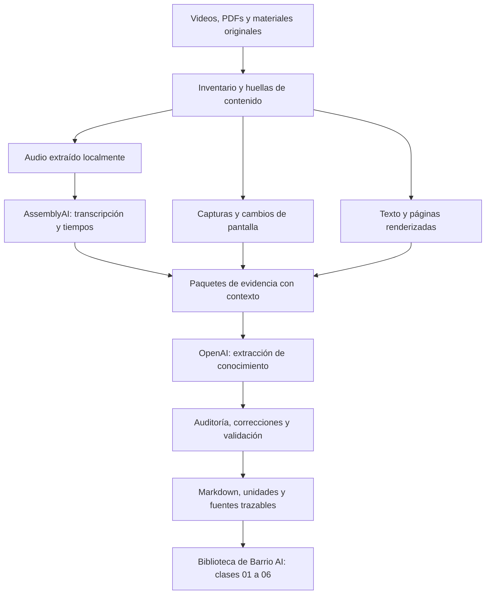
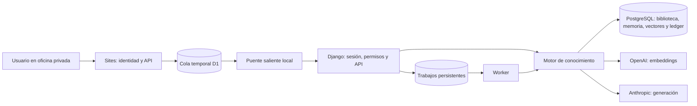
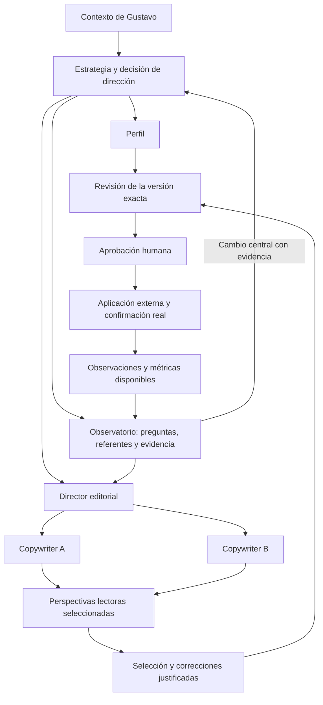

# Barrio AI: de las clases grabadas a un equipo de agentes

Documento de recorrido, arquitectura y estado del proyecto. Actualizado el **6 de noviembre de 2026** a partir del código, los entregables locales, los informes de revisión y una consulta de solo lectura al backend. Las cifras operativas son una fotografía de esa fecha.

Barrio AI nació de una pregunta: **¿cómo convertir todo lo que enseñan unas clases de LinkedIn en conocimiento que un equipo de agentes pueda aplicar a una persona real?** Primero construimos la herramienta para procesar las grabaciones y sus materiales. Después organizamos el conocimiento, añadimos búsqueda y memoria, construimos un backend y una oficina visual, y diseñamos cómo colaborarían los agentes.

Hoy tenemos esas bases y el diseño completo de sus circuitos. La coordinación autónoma de los trece agentes todavía está pendiente de implementación. Este documento distingue esos estados para que podamos continuar sin perder el rumbo.

## Contenido

1. [Propósito y alcance](#1-propósito-y-alcance)
2. [Cómo evolucionó el proyecto](#2-cómo-evolucionó-el-proyecto)
3. [Cómo procesamos los videos y materiales](#3-cómo-procesamos-los-videos-y-materiales)
4. [Qué extrajimos y cómo lo revisamos](#4-qué-extrajimos-y-cómo-lo-revisamos)
5. [La biblioteca compartida](#5-la-biblioteca-compartida)
6. [Embeddings, búsqueda y contexto](#6-embeddings-búsqueda-y-contexto)
7. [Memoria y personalización](#7-memoria-y-personalización)
8. [Backend, proveedores y ejecución](#8-backend-proveedores-y-ejecución)
9. [La oficina visual](#9-la-oficina-visual)
10. [Los cinco equipos y sus trece agentes](#10-los-cinco-equipos-y-sus-trece-agentes)
11. [Cómo se conectarán los ciclos](#11-cómo-se-conectarán-los-ciclos)
12. [Datos externos y aprendizaje](#12-datos-externos-y-aprendizaje)
13. [Pruebas, controles y límites](#13-pruebas-controles-y-límites)
14. [Qué está listo y qué sigue](#14-qué-está-listo-y-qué-sigue)
15. [Dónde está cada cosa](#15-dónde-está-cada-cosa)

## 1. Propósito y alcance

Queremos que el equipo ayude a Gustavo a posicionarse en LinkedIn como alguien que comprende el negocio, construye productos de software e incorpora IA cuando aporta valor. Las prioridades expresadas son **60% oportunidades personales en startups y 40% contratos para ProjectApp**. Es una orientación de prioridades; no una cuota de publicaciones ni una distribución de ingresos garantizada.

El mercado inicial es Estados Unidos, con afinidad por founders hispanohablantes o latinoamericanos y contenido público en inglés. Hay apertura a otras oportunidades pertinentes. En contratos personales Gustavo ejecuta directamente; en contratos de ProjectApp la entrega corresponde al equipo bajo su liderazgo. Esas modalidades deben permanecer claras en perfil, contenido y evaluación de oportunidades.

Autoridad y comunidad ayudan a alcanzar esos objetivos. La idea de **barrio**, tomada del curso, incluye compradores, pares, recomendadores, líderes y divulgadores. Por eso el sistema no evalúa cada pieza únicamente por su capacidad de vender de inmediato.

El alcance operativo actual son las **clases 01–06**. La clase 07 también se procesó, pero quedó fuera de la biblioteca activa porque abre la parte de outbound. Calentamiento, campañas y contacto de leads se incorporarán cuando completemos y revisemos esa mitad del curso.

## 2. Cómo evolucionó el proyecto

| Etapa | Trabajo realizado | Resultado |
| --- | --- | --- |
| Recuperación del material | Reunimos grabaciones, PDFs, la entrega de clase 01 y el piloto previo | Originales y resultados separados, con procedencia local |
| Piloto de clase 01 | Preparamos audio, páginas y capturas; transcribimos, extrajimos y auditamos | Una entrega navegable con 139 unidades de conocimiento |
| Campaña de clases 02–07 | Extendimos el procesamiento con caché, reanudación y presupuesto global | 226 tareas de extracción, seguidas por auditoría y correcciones |
| Revisión para uso por agentes | Contrastamos hallazgos contra fuentes y retiramos obligaciones meramente administrativas | Exportación revisada con límites explícitos y cambios registrados |
| Biblioteca común | Importamos las clases 01–06 sin reemplazar sus unidades por resúmenes nuevos | 1.035 unidades consultables y evidencia asociada |
| Infraestructura de IA | Añadimos embeddings, recuperación híbrida, memoria, proveedores y contabilidad | Un motor reutilizable para agentes especializados |
| Backend Django | Incorporamos usuarios, permisos, API, administración y trabajos persistentes | Base operativa con pruebas de integración |
| Oficina visual | Diseñamos un apartamento startup con pixel art e integramos la interfaz con Django | Un espacio visual para consultar fuentes y ejecutar los dos roles disponibles |
| Diseño del equipo completo | Definimos cinco grupos, trece contratos, datos y conexiones entre ciclos | Diseño recorrido y revisado por dos QA Astra en high |
| GitHub | Creamos el repositorio privado Barrio AI | Copia inicial del backend, oficina y diseños, con documentación |

Estas etapas no implican que todo el sistema ya opere de forma autónoma. La infraestructura existente permite ejecutar encargos acotados; los ciclos colectivos amplían ese comportamiento y aún deben implementarse.

## 3. Cómo procesamos los videos y materiales

La herramienta de procesamiento se llama `course_notes`. Vive en la entrega local de la primera clase y está separada de la aplicación Barrio AI. No enviamos una carpeta de videos a un modelo para obtener un único resumen: construimos varias capas de evidencia y registramos qué aporta cada una.



### Inventario y preservación

El inventario identifica sesiones, grabaciones y adjuntos. Usa huellas de contenido para reconocer las mismas entradas y conservar el estado de cada etapa. `inventory.json`, `catalog.sqlite`, manifiestos y archivos de estado permiten saber qué se procesó y con qué configuración.

Los originales se conservan. Los resultados se escriben aparte. Un archivo de enlace entregado con el curso se mantiene como evidencia de que ese enlace existe; su presencia no significa que hayamos consultado o validado el sitio de destino.

### Audio y transcripción

Extraemos el audio localmente con FFmpeg. AssemblyAI convierte ese audio en texto en español, con marcas de tiempo y diferenciación de hablantes. La configuración registrada para la campaña usa Universal-3.5 Pro y contexto del curso.

Conservamos el identificador del trabajo remoto y su respuesta. Si la transcripción sigue procesándose, la herramienta puede volver a consultar ese trabajo. Una interrupción no debe convertirse automáticamente en un nuevo envío del mismo audio.

La transcripción permite localizar una explicación dentro del video. No elimina la posibilidad de errores en nombres, negaciones, cifras o frases cortadas. Esas dudas se conservan para contrastarlas con audio e imágenes.

### Pantallas y materiales

Los PDFs se procesan de dos maneras complementarias: texto extraíble y páginas renderizadas como imágenes. Esto conserva tanto las palabras como elementos visuales, tablas, diagramas y capturas. Las herramientas locales incluyen PyPDF, PDFium, Pillow y OpenCV; durante la revisión también se utilizó OCR sobre evidencia seleccionada.

El piloto inicial exploró fotogramas clave y asociaciones entre pantallas y diapositivas. Después se añadió un recorrido visual denso, con muestreo cada **dos segundos**, detección de cambios y capturas representativas. La campaña de clases 02–07 conserva la pantalla completa.

Ese intervalo de muestreo tiene límites: no demuestra que observamos cada fotograma ni que detectamos cualquier elemento fugaz. Una coincidencia automática entre captura y página es una propuesta, no una correspondencia confirmada.

### Paquetes con continuidad

La extracción completa divide la explicación oral en bloques de hasta **cinco minutos** y los materiales en grupos de hasta **siete páginas**, según la planificación del procesador. Cada tarea identifica las fuentes que debe cubrir y las imágenes pertinentes.

El contexto incluye evidencia de la sesión para interpretar referencias a ideas anteriores. El diseño evita depender únicamente de una cadena de resúmenes, donde un error temprano podría propagarse. La serialización compacta elimina duplicaciones de transporte sin pretender sustituir el contenido por una paráfrasis.

Si una revisión visual excede la capacidad de una solicitud, se divide antes de enviarla y se comprueba que sus partes no pierdan ni dupliquen imágenes.

### Extracción, auditoría y revisión

OpenAI recibe transcripción, materiales y capturas y produce unidades estructuradas. La campaña documenta Sol como modelo de nuevas solicitudes. Hubo una ruta Batch histórica; por instrucción de Gustavo se continuó con **solicitudes directas a Responses**, reutilizando resultados completos y conservando el historial anterior.

La extracción no era el proceso completo. Después se auditó cobertura, fidelidad, referencias y omisiones; se aplicaron correcciones y se verificó la entrega. Finalmente hicimos una revisión local de hallazgos pendientes orientada al uso por agentes.

Las respuestas, estados y presupuestos quedan persistidos. Consultar los resultados terminados no requiere volver a transcribir ni volver a extraer las clases.

## 4. Qué extrajimos y cómo lo revisamos

Una unidad de conocimiento conserva explicación, aplicación, decisiones, contexto, entradas y salidas, ejemplos, contraejemplos, límites, recursos y relaciones, cuando existen en la fuente. Incluye un ID estable y referencias que permiten volver a la evidencia.

Por ejemplo, `LI-03-M005-K05` recoge los cinco papeles del barrio. Esa unidad puede servir al Observatorio, a Estrategia y a los Lectores. El identificador permite citar el mismo conocimiento sin crear tres versiones incompatibles de la enseñanza.

### Entregas y cantidades

| Clase | Unidades en la entrega usada como referencia | Dentro de la biblioteca activa |
| --- | ---: | --- |
| 01 | 139 | Sí |
| 02 | 192 | Sí |
| 03 | 150 | Sí |
| 04 | 212 | Sí |
| 05 | 127 | Sí |
| 06 | 215 | Sí |
| 07 | 136 | No; reservada para la fase outbound |
| **Total 01–06** | **1.035** | **Alcance actual de Barrio AI** |

La campaña de clases 02–07 abarcó aproximadamente **14 horas y 34 minutos**, **321 páginas PDF** y **226 tareas de extracción**. Su exportación revisada contiene 1.032 unidades. Ese número corresponde a clases 02–07; las 1.035 unidades del backend corresponden a clases 01–06. Son conjuntos diferentes.

### Correcciones con propósito

La revisión independiente de clases 02–07 registró **101 hallazgos con resolución explícita**, **59 cambios** y **11 detalles secundarios excluidos por alcance**. Se conservaron las incertidumbres reales, como cifras contradictorias o texto que no pudo recuperarse de forma fiable.

Una decisión importante fue separar el conocimiento útil de la logística del aula. Los agentes necesitan aprender cómo elaborar títulos, elegir pilares y revisar una pieza. No necesitan obedecer una fecha de entrega de los alumnos ni acceder a una plataforma del curso porque así lo pedía una consigna.

Las versiones revisadas se guardaron aparte con registro de antes/después. Los informes históricos y los registros de consumo no se borraron. Desde la incorporación de esas versiones a la biblioteca, sus originales se preservan y los metadatos derivados viven por separado.

### Qué significa «revisado»

Distinguimos tres alcances:

- **Validación técnica:** IDs, referencias, hashes, integridad, campos y enlaces.
- **Revisión de contenido por IA contra fuentes:** contraste de hallazgos o muestras concretas y delimitación de incertidumbres.
- **Aceptación humana:** lectura, escucha o decisión de una persona, que no se atribuye automáticamente por haber pasado los controles anteriores.

La clase 01 tuvo una revisión dirigida de 22 preguntas y 15 comprobaciones de integridad. Para clases 02–07 se cerraron los hallazgos pendientes para uso por agentes. Ninguna de esas afirmaciones equivale a una nueva revisión humana integral de cada frase o a verificar externamente todas las afirmaciones comerciales del curso.

### Presupuesto histórico de esa campaña

El cierre registrado de clases 02–07, del 5 de noviembre de 2026, conserva:

| Concepto | USD |
| --- | ---: |
| Límite autorizado | 80,00 |
| Consumo liquidado estimado | 74,82 |
| Consumo más reservas | 77,07 |
| Margen no comprometido | 2,93 |

Son estimaciones del registro local, no una factura del proveedor. La revisión independiente final no añadió llamadas API. Resolver un hallazgo de contenido no libera una reserva de facturación incierta. El piloto de clase 01 y los límites posteriores del backend tienen registros separados.

Durante la campaña se configuraron reportes cada diez minutos para seguir clases, etapas y presupuesto. El archivo actual del programador conserva `enabled=false` y el motivo `all_six_reports_complete`: ese seguimiento terminó. No se trata de un programador activo de contenido para LinkedIn.

## 5. La biblioteca compartida

La idea es que los agentes consulten una biblioteca común y reciban el conocimiento pertinente para su función. Asignar afinidad a un rol no le da propiedad exclusiva de una unidad ni impide que otro la encuentre.

La importación conserva el JSON original, su hash, ruta de origen y posición dentro del archivo. Las referencias a evidencia incorporan la clase, porque identificadores de transcripción o captura pueden repetirse entre sesiones.

El modelo de datos separa estas piezas:

| Pieza | Función |
| --- | --- |
| `units` y revisiones | Conocimiento original, identidad, procedencia e historial |
| `evidence` y vínculos | Transcripción, páginas y evidencia visual que respaldan unidades |
| `chunks` | Fragmentos literales preparados para búsqueda |
| `embedding_cache` | Vectores reutilizables por contenido, modelo y dimensiones |
| `edges` | Relaciones explícitas entre unidades |
| `memory` | Contexto del usuario y memoria de trabajo versionados |
| `runs` y trabajos Django | Encargos, contexto usado, resultados y estados |
| `usage_ledger` | Consumo, reservas y estados inciertos por proveedor |

La consulta de solo lectura del **6 de noviembre de 2026, 16:18 UTC**, encontró 1.035 unidades, 5.006 evidencias, 11.522 fragmentos, 11.555 entradas de caché de embeddings y 62 relaciones explícitas. La caché puede incluir consultas y contenido conservado; su tamaño no equivale al número de unidades ni debe interpretarse como una unidad por vector.

Los temas iniciales se derivan mediante palabras clave y las afinidades añaden una preferencia pequeña a la recuperación. Son metadatos técnicos iniciales. El grafo semántico enriquecido, las relaciones inferidas y una clasificación exhaustiva validada siguen pendientes.

## 6. Embeddings, búsqueda y contexto

Un embedding representa un texto mediante una lista de números que permite comparar similitud semántica. Usamos un proveedor existente para generar esos vectores: **OpenAI, con `text-embedding-3-small` y 1.536 dimensiones en la configuración observada**. PostgreSQL con pgvector los almacena y compara.

No hemos entrenado un modelo propio ni hecho fine-tuning con el curso. La arquitectura usa recuperación de conocimiento: busca evidencia relevante y la incorpora al contexto del modelo que responde. Eso es lo que aquí llamamos **RAG**.

### Del original a la búsqueda

1. Se divide cada sección de una unidad en fragmentos literales, conservando vínculo con la unidad y su campo de origen.
2. Se calcula un hash del contenido. La caché distingue además modelo y dimensiones para evitar reutilizar un vector incompatible.
3. Se generan únicamente los embeddings faltantes cuando la ejecución está habilitada.
4. Una consulta puede buscar palabras o combinar palabras con similitud semántica.
5. Los resultados seleccionados sirven para recuperar **unidades completas**, incluyendo sus excepciones y límites, dentro del presupuesto de contexto.

La fragmentación actual apunta a tramos de hasta 2.400 caracteres y controla que cada fragmento no supere 1.800 tokens según el tokenizador usado por el sistema. No crea un resumen nuevo para sustituir el texto original.

### Recuperación híbrida

La búsqueda textual utiliza PostgreSQL y procesamiento en español. Considera coincidencias, frecuencia de términos y el título. La búsqueda semántica compara el vector de la consulta con los fragmentos indexados.

Ambas listas se combinan mediante **Reciprocal Rank Fusion ponderado**: en la configuración actual, `k=20`, peso textual 1 y semántico 2. Son parámetros de esta implementación, no una regla universal. La afinidad de un rol ajusta ligeramente la puntuación; no filtra el resto de la biblioteca.

Si no hay índice semántico, el sistema puede devolver búsqueda textual y lo indica. Si el contexto no alcanza para todas las unidades, registra las omitidas. No afirma que el agente recibió todo el curso.

La calibración documentada pasó de recuperar la referencia esperada en 24 de 32 consultas a 26 de 32 dentro de los primeros diez resultados. Se usó el mismo conjunto para calibrar, y otra medida de ordenamiento no mejoró; por eso sigue pendiente un conjunto de evaluación ciego antes de declarar superioridad general.

### Ejemplo de uso

Ante «¿cómo ajustar mi titular para founders?», el agente de Perfil puede recuperar unidades sobre titular, lenguaje del comprador y propuesta de valor. Añade el contexto personal confirmado disponible, prepara una propuesta y cita sus unidades. Otro agente puede recuperar esas mismas fuentes para evaluar si el mensaje de un post es coherente.

El conocimiento se comparte por pertinencia, con procedencia visible. Una coincidencia semántica ayuda a encontrar material; no prueba por sí sola que una afirmación sea verdadera.

## 7. Memoria y personalización

Diseñamos cuatro capas que deben permanecer distinguibles:

| Capa | Contenido | Estado |
| --- | --- | --- |
| Curso | Métodos, ejemplos, condiciones y fuentes | Importado y consultable |
| Usuario | Objetivos, ofertas, experiencia, preferencias y hechos confirmados | Servicio implementado; contexto de Gustavo documentado, aún sin cargar en la memoria persistente |
| Trabajo del equipo | Briefs, borradores, objeciones, decisiones y versiones | Existen ejecuciones y memoria de trabajo; el modelo completo de artefactos de ciclo está diseñado |
| Observaciones | Publicaciones reales, métricas, conversaciones y oportunidades | Catálogo y contratos diseñados; captura integral pendiente |

Un agente puede proponer memoria. La confirmación de un hecho del usuario pasa por una operación humana autenticada. Se conserva historial y se comprueba la versión esperada para evitar que dos escrituras se pisen silenciosamente.

Una propuesta nueva no sustituye automáticamente al último hecho confirmado. Tampoco un lector simulado puede convertir su opinión en evidencia sobre clientes reales.

**Dato actual importante:** la tabla `memory` tenía cero registros en la consulta de esta documentación. La conversación y el brief sí contienen información de Gustavo, pero eso no significa que cada ejecución del backend ya la reciba. Incorporar esa información mediante el flujo previsto es un paso concreto pendiente.

## 8. Backend, proveedores y ejecución

La base elegida es **Django + Django REST Framework + PostgreSQL/pgvector**, con servicios Docker para base de datos, API, trabajador y puente de la oficina. Se incorporaron presets del repositorio `ai_skills_project`, con su revisión de origen documentada.



### Responsabilidad de cada proveedor

| Componente | Uso dentro de este proyecto |
| --- | --- |
| AssemblyAI | Transcripción de las grabaciones durante el procesamiento del curso |
| OpenAI Responses | Extracción y auditoría del conocimiento del curso |
| OpenAI Embeddings | Representación semántica de fragmentos y consultas |
| Anthropic / Claude | Generación de propuestas de los agentes disponibles en el backend |
| Codex y subagentes de diseño/QA | Construcción, revisión y documentación del proyecto; no equivalen a procesos permanentes del producto |

El adaptador de generación tiene configurado `claude-sonnet-4-6`. El soporte de varios proveedores permite asignar funciones diferentes; no significa que todos deban intervenir en cada tarea. Las tarifas y modelos configurados requieren mantenimiento, y este documento no presenta sus valores históricos como precios actuales.

### Qué aporta Django

Django añade autenticación, permisos, credenciales de servicio, validación de entradas, administración, auditoría y cola persistente. La API canónica vive bajo `/api/v1`.

Los trabajos largos se encolan y el trabajador los reclama de forma transaccional. Usan IDs estables para que reenviar la misma solicitud no cree otro encargo. Los latidos permiten detectar interrupciones. No se mantiene un bloqueo de base de datos durante toda una llamada al modelo.

Un trabajo puede finalizar técnicamente y aun así producir una respuesta que necesita revisión. El sistema comprueba que las citas existan en el contexto recibido; ese control no demuestra por sí mismo que cada frase esté respaldada por la cita.

La migración a Django preservó las tablas históricas y sus datos. Se ensayó con una copia de la base y comparación de huellas de las once tablas originales, incluidas memoria, vectores y contabilidad.

### Qué agentes se ejecutan hoy

El motor actual reconoce **Posicionamiento y Perfil**, mediante encargos acotados. Puede preparar una vista previa del contexto y, cuando se habilita la generación con los permisos y límites correspondientes, solicitar una respuesta a Claude.

Las vistas previas textuales no requieren generación pagada. Una búsqueda híbrida nueva puede necesitar un embedding de consulta. El motor actual tampoco realiza por sí solo una ronda autónoma adicional de investigación si el contexto resulta insuficiente.

Los once roles adicionales y la coordinación colectiva están especificados en documentos y contratos. Guardar esos JSON no los activa en el backend.

## 9. La oficina visual

Elegimos representar al equipo como un **apartamento grande de startup**, con zonas próximas para trabajar por grupos. El arte utiliza recursos de **LimeZu — Modern Interiors**, conservando sus créditos y sin distribuir la biblioteca original del pack.

Se diseñaron puestos, monitores y sillas con orientaciones coherentes, se ajustaron las pantallas y se añadieron recorridos periódicos hacia otras zonas, como la cocina. Esas animaciones hacen comprensible y agradable el espacio; caminar o conversar visualmente no demuestra que se esté ejecutando una llamada a IA.

La interfaz combina la aplicación React/Next del entorno Sites/Vinext con la escena de oficina en HTML, CSS y JavaScript. Su código y sus pruebas están en `apartamento-agentes/`.

La oficina tiene una conexión real con el backend. Sites mantiene acceso privado y una cola temporal D1. Un servicio local establece un **enlace saliente**, recibe comandos permitidos y devuelve respuestas. Django y PostgreSQL no necesitan abrir sus puertos a internet para ese flujo.

La interfaz permite consultar conocimiento, leer fuentes, preparar encargos y revisar memoria y resultados. Las claves de los proveedores permanecen en el entorno local. La computadora debe estar encendida para que el backend responda; el estado de conexión depende del latido del puente.

La integración registra reclamo, expiración y entrega. Si falla devolver una respuesta ya obtenida, puede reintentarse esa entrega sin volver a ejecutar el encargo.

**Límite de la prueba real:** durante la prueba final de integración, una llamada a Claude terminó en `ReadTimeout` y se conservó una reserva incierta de USD 0,085902. No se repitió automáticamente. La vista previa y la conexión sí se comprobaron; ese intento no acredita generación exitosa desde la oficina. El diagnóstico queda en el informe de integración.

## 10. Los cinco equipos y sus trece agentes

| Equipo | Agentes | Responsabilidad |
| --- | --- | --- |
| Estrategia y Perfil | Posicionamiento; Perfil | Definir dirección, audiencias, ofertas y expresión del perfil |
| Observatorio | Investigador de referentes; Analista de barrio y resultados | Investigar referentes y conversación; interpretar audiencia, comentarios y resultados reales |
| Editorial | Director editorial; Copywriter A; Copywriter B | Elegir oportunidades y briefs; desarrollar y seleccionar alternativas |
| Lectores | Par; Recomendador; Líder; Comprador; Divulgador | Simular perspectivas distintas para detectar problemas de comprensión, relevancia y credibilidad |
| Revisión | Editor/verificador | Contrastar afirmaciones, fuentes, voz, permisos y coherencia de la pieza |

La orquestación coordina dependencias, prioridad, contexto y límites. No es un especialista adicional que deba improvisar todos los juicios de los demás.

Cada contrato describe propósito, conocimiento de referencia, entradas, disparadores, decisiones, herramientas, autoridad, entregables, memoria, coordinación, evaluación y condiciones de parada. Las unidades pueden aparecer en varios contratos; su asignación no es exclusiva.

El investigador de referentes estudia quién reúne conversaciones pertinentes y qué problemas aparecen allí. No se limita a cuentas enormes o a la insignia Top Voice. El analista distingue esa investigación de los resultados propios posteriores a publicar.

Los dos copywriters reciben el mismo brief y evidencia y producen alternativas independientes. Los lectores también comienzan con juicios independientes antes del contraste. El Director elige, combina, pide correcciones o descarta con razones; no se decide únicamente por votos.

Las cinco perspectivas lectoras están disponibles, pero el brief fija cuáles necesita cada pieza y por qué. La simulación genera objeciones hipotéticas: no predice con fiabilidad el alcance ni reemplaza a una muestra de audiencia real.

## 11. Cómo se conectarán los ciclos

Este circuito es **diseño revisado por QA documental, pendiente de implementación y aceptación humana**:



Hay cuatro recorridos principales: arranque sin métricas propias, producción de contenido, aprendizaje con datos reales y actualización ante cambios de contexto o evidencia.

El primer contenido no necesita esperar estadísticas que todavía no existen. Puede partir de experiencia demostrable, contexto y preguntas investigadas. Más adelante, resultados reales alimentan decisiones locales de contenido o una propuesta de revisión estratégica.

Las entregas incluyen versiones, fuentes, motivo, destinatario y faltantes. Una recepción correcta —ACK— no equivale a aprobar el contenido. La aprobación se asocia a una versión exacta; modificar texto o assets obliga a revisar los controles afectados.

Se propuso un máximo de **dos rondas correctivas globales por pieza**, compartidas entre grupos. Tras la última revisión fallida se espera evidencia o se descarta; cambiar de agente o de ID no habilita un bucle nuevo.

El Observatorio también puede proponer un comentario orgánico. El borrador y el contexto del hilo pasan al verificador y después a Gustavo. Esa ruta no ejecuta comentarios ni autoriza campañas outbound.

## 12. Datos externos y aprendizaje

**Aclaración posterior de Gustavo:** el objetivo es que el equipo observe de forma continua su cuenta: perfil, publicaciones, métricas, interacciones, inbox y contenido de referentes. Los datos manuales son una alternativa de arranque, no el funcionamiento objetivo. El [diseño de observación integral](../agentes-linkedin/infra/docs/observacion-integral-linkedin.md) concreta qué consulta cada grupo y distingue necesidad de acceso y disponibilidad real de APIs.

El curso enseña métodos, pero no contiene los datos de nuestra cuenta ni la realidad actual del mercado. Definimos un catálogo de doce categorías:

| ID | Datos | Uso principal |
| --- | --- | --- |
| D01 | Objetivos, ofertas, restricciones y preferencias | Dirección y contexto compartido |
| D02 | Perfil actual y fecha de captura | Diagnóstico y propuestas de Perfil |
| D03 | Casos, contribución, resultados, pruebas y permisos | Sustentar afirmaciones |
| D04 | Referentes, especialidad y evidencia de audiencia pertinente | Investigación del barrio |
| D05 | Publicaciones ajenas y contexto | Temas, enfoques y conversación |
| D06 | Comentarios, respuestas y contexto de hilos | Preguntas, lenguaje y objeciones |
| D07 | Publicaciones propias realmente aplicadas | Vincular resultado con texto y versión |
| D08 | Métricas disponibles con periodo y definición | Exposición, interacción y composición |
| D09 | Muestras de voz, experiencias y recursos autorizados | Autenticidad y producción editorial |
| D10 | Conversaciones y oportunidades por modalidad | Evaluar contribución al negocio |
| D11 | Aprobaciones y confirmaciones de aplicación | Distinguir propuesto, aprobado y publicado |
| D12 | Fuentes actuales, tendencias y contradicciones | Contrastar hechos externos |

No todos los agentes necesitan acceso directo a todos los datos. Editorial recibe hallazgos y extractos pertinentes; los Lectores no necesitan cuentas propias ni conversaciones privadas completas. La captura puede comenzar con material aportado e importaciones. El catálogo no certifica acceso a ninguna API de LinkedIn.

El aprendizaje necesita fecha, fuente, ventana, definición y cobertura. Dato ausente significa desconocido, no cero. Impresiones no son personas únicas; un like no es una venta; una entrevista posterior a un post no demuestra causalidad.

La publicación diaria es una aspiración del usuario. La cadencia operativa, la capacidad personal y las ventanas de medición siguen por concretar. No hay una programación autónoma diaria activada por este diseño.

## 13. Pruebas, controles y límites

### QA de ingeniería

Los registros históricos muestran 79 pruebas del software en la revisión de clase 01 y 92 en el incremento de campaña. Son resultados de sus respectivas revisiones, no ejecuciones nuevas realizadas al redactar este documento.

Para Django se asignaron dos QA independientes: API/permisos y trabajador/memoria/proveedores. Encontraron y ayudaron a corregir acceso administrativo demasiado amplio, una omisión de permisos de auditoría, errores por Unicode inválido y aceptación de conteos de tokens negativos.

La revisión integrada documentó 90 pruebas Django y 24 del núcleo. La integración posterior de la oficina elevó la suite Django registrada a 97 y añadió 10 pruebas del relay, además de comprobaciones de navegador. Se verificaron regresiones, concurrencia y estados inciertos con proveedores simulados; eso no certifica la calidad semántica de cada respuesta real.

### QA del diseño colectivo

Dos subagentes **Astra en high** revisaron coordinación y fidelidad del conocimiento/datos. Se corrigieron seis hallazgos de diseño: selección de lectores, límite común de rondas, recepción frente a aprobación, deduplicación, entrada de propuestas de comentario y representación de aplicación desconocida.

Se comprobaron 104 referencias de los contratos correspondientes a 57 unidades distintas. No quedaron P1/P2 abiertos identificados en el alcance revisado. La revisión del diseño fue documental; no se ejecutaron esos trece agentes como equipo.

La comparación local de integridad comprobó las 1.035 unidades contra sus archivos y hashes. Esa comparación automática no equivale a haber leído semánticamente todo el corpus. La lectura para fundamentar los contratos sigue siendo selectiva.

### Preservación del trabajo y del gasto

Hay caché y registros en capas distintas: procesamiento de medios, trabajos de transcripción y extracción, embeddings, ejecuciones y contabilidad. No son una única caché universal de todas las respuestas.

Antes de una solicitud pagada se reserva presupuesto. Si una respuesta es incierta, la reserva sigue contando y no se repite automáticamente la llamada. Una autorización posterior de reintento no borra la posible obligación anterior. El consumo se conserva al reiniciar servicios.

Los permisos y la identidad delimitan quién puede consultar trabajos, gastar o confirmar memoria. La biblioteca actual es compartida dentro de un único espacio de trabajo; no se ha implementado aislamiento completo entre empresas. Las fuentes externas se tratan como datos y no pueden ampliar las instrucciones o permisos del agente.

## 14. Qué está listo y qué sigue

| Área | Estado que podemos sostener |
| --- | --- |
| Extracción de clases disponibles 01–07 | Terminada, con entregas y límites registrados |
| Revisión de hallazgos para uso por agentes | Cerrada en su alcance; aceptación humana integral no realizada |
| Biblioteca activa 01–06 | Importada, indexada y con integridad comprobada |
| Búsqueda textual e híbrida | Implementadas; evaluación ciega ampliada pendiente |
| Backend Django y controles monetarios | Implementados y probados en los alcances documentados |
| Oficina y puente | Integrados; el backend necesita el equipo local encendido |
| Posicionamiento y Perfil | Disponibles como encargos acotados; no equivalen a ciclos autónomos completos |
| Contexto de Gustavo | Documentado; incorporación a memoria persistente pendiente |
| Cinco equipos y trece contratos | Diseñados y revisados documentalmente |
| Investigación continua, analítica y coordinación autónoma | Pendientes de implementación y pruebas |
| Publicación y contacto automático en LinkedIn | No activados |
| Outbound de clases 07 y posteriores | Fuera del alcance operativo actual |

El plan F0–F7 organiza la continuación:

1. **F0 — Contrato colectivo:** diseño integral disponible; aceptación humana pendiente.
2. **F1 — Fundamentación:** ampliar la lectura de unidades y conexiones. No declarar lectura integral por haber importado el corpus.
3. **F2 — Contexto y evaluación:** incorporar contexto confirmado, pruebas, voz y línea base; contrastar hipótesis de audiencia.
4. **F3 — Coordinación persistente:** implementar ciclos, dependencias, artefactos, eventos y aprobaciones sobre Django.
5. **F4 — Recorrido mínimo:** verificar primero Estrategia/Perfil y después una pieza editorial, antes de activar toda la colaboración.
6. **F5 — Ampliación evaluada:** añadir Observatorio, escritores y lectores y medir qué aporta cada participación.
7. **F6 — Resultados reales:** conectar observaciones, medir y habilitar autonomía gradual dentro de límites.
8. **F7 — Operación visual:** reflejar estados reales, bloqueos y decisiones de los ciclos en la oficina.

La infraestructura base ya existe. Lo siguiente consiste en conectar esos componentes con el contrato colectivo y comprobar su comportamiento, sin confundir nuevas fichas o animaciones con autonomía operativa.

## 15. Dónde está cada cosa

Repositorio privado: [gustavop-dev/barrio-ai](https://github.com/gustavop-dev/barrio-ai).

```text
barrio-ai/
├── README.md
├── docs/
│   ├── como-construimos-barrio-ai.md
│   └── importacion-inicial.json
├── apartamento-agentes/          # Oficina y puente del lado de Sites
└── agentes-linkedin/
    ├── arquitectura/            # Plantilla, mapa e índice de agentes
    ├── equipos/                 # Contratos y asignaciones
    └── infra/                   # Django, motor de conocimiento y operación
        ├── src/knowledge/
        ├── src/team_backend/
        ├── docs/
        └── tests/
```

La copia local de GitHub está en `/home/cerrotico/personal/barrio-ai`. El entorno operativo y los materiales originales siguen en `/home/cerrotico/personal/linkedin`. Son ubicaciones separadas: editar una no sincroniza automáticamente la otra.

El repositorio reúne una copia inicial del código y los diseños; los historiales Git originales se conservaron en sus proyectos. No contiene las claves, la base operativa, sus backups ni las carpetas originales del curso. Algunos archivos de conocimiento seleccionados sí acompañan a los contratos; no sustituyen todo el corpus necesario para ejecutar importaciones y verificaciones.

La herramienta completa `course_notes`, las grabaciones, las páginas renderizadas y los resultados históricos del procesamiento siguen en el workspace local. No se incluyeron en la importación inicial de este repositorio.

### Documentación del repositorio

- [Catálogo de 72 acciones sobre LinkedIn](../agentes-linkedin/infra/docs/catalogo-acciones-linkedin.md): ampliación posterior para descubrir referentes, conectar, interactuar, conversar y administrar la presencia profesional; reparto y herramientas pendientes.
- [Plan maestro F0–F7](../agentes-linkedin/infra/docs/plan-equipo-autonomo.md).
- [Ciclos conectados de los equipos](../agentes-linkedin/infra/docs/circuitos-equipo.md).
- [Catálogo detallado de datos externos](../agentes-linkedin/infra/docs/datos-externos-por-equipo.md).
- [Índice de los trece contratos](../agentes-linkedin/arquitectura/indice-agentes-v1.json).
- [Brief de Gustavo y contraste inicial de casos](../agentes-linkedin/infra/docs/brief-gustavo-posicionamiento.md).
- [Arquitectura del backend](../agentes-linkedin/infra/docs/methodology/architecture.md).
- [Migración a Django y preservación de datos](../agentes-linkedin/infra/docs/django-migration.md).
- [Integración de la oficina y límites de la prueba real](../agentes-linkedin/infra/docs/office-integration.md).
- [QA del backend](../agentes-linkedin/infra/docs/qa-backend.md).
- [QA de coordinación](../agentes-linkedin/infra/docs/qa-circuitos-coordinacion.md) y [QA de conocimiento/datos](../agentes-linkedin/infra/docs/qa-circuitos-conocimiento-datos.md).
- [Registro de validación documental](../agentes-linkedin/arquitectura/validacion-diseno-equipo-v1.json).
- [Operación local](../agentes-linkedin/infra/LEEME.txt) y [oficina](../apartamento-agentes/README.md).
- Código de [importación](../agentes-linkedin/infra/src/knowledge/ingest.py), [recuperación](../agentes-linkedin/infra/src/knowledge/retrieval.py), [agentes](../agentes-linkedin/infra/src/knowledge/agents.py), [memoria](../agentes-linkedin/infra/src/knowledge/memory.py) y [proveedores](../agentes-linkedin/infra/src/knowledge/providers.py).

Algunos informes describen una etapa anterior —por ejemplo, antes de conectar la oficina o crear GitHub—. Conservamos esos documentos como evidencia histórica. Para el estado transversal, este recorrido y el plan actualizado distinguen lo anterior de lo vigente.

### Evidencia local del procesamiento del curso

Estas rutas son relativas a `/home/cerrotico/personal/linkedin` y requieren acceso al workspace privado:

- `LinkedIn Sales - Entrega clase 01/REVISION_FINAL.md`: revisión del piloto, alcance y dudas conservadas.
- `LinkedIn Sales - Entrega clase 01/02 - Software/src/course_notes/`: procesador de medios, transcripción, extracción, auditoría, presupuesto y recuperación.
- `LinkedIn Sales - Procesamiento completo/OPERACION.md` y `status.json`: campaña, cambio a ejecución directa y presupuesto registrado.
- `LinkedIn Sales - Procesamiento completo/session-XX/quality/tasks.json`: planificación de las 226 tareas de extracción de clases 02–07.
- `LinkedIn Sales - Procesamiento completo/revision-independiente/INFORME-FINAL.txt` y `validacion-entrega.json`: resolución de hallazgos y controles finales.
- `LinkedIn Sales - Procesamiento completo/conocimiento-para-agentes/politica-de-uso.json`: separación entre método del curso, incertidumbres y logística del aula.

Para redactar este documento se consultaron esos registros y el código existente. No se reprocesaron videos, no se cambiaron presupuestos y no se hicieron solicitudes pagadas a proveedores.
